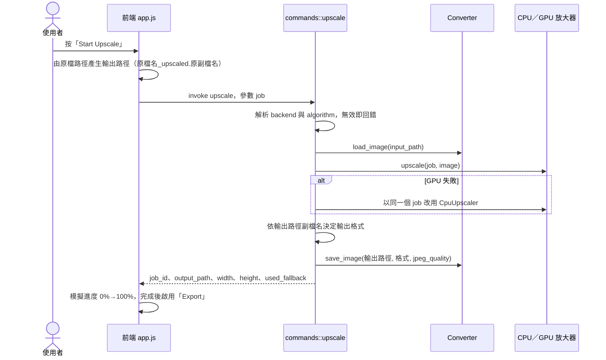

# 業務邏輯

| 文件資訊 | 內容 |
| --- | --- |
| 版本／建立／更新 | v1.5／2026-11-27／2026-11-27 |
| 變更摘要 | v1.4 依 opencode-gpu-port.md 移植 GPU 上的 FSR 1.0（EASU＋RCAS 兩 pass，上游 ffx_fsr1.h/ffx_a.h commit a21ffb8）、NIS（上傳 NIS_Config.h coef_scale／coef_usm 64×8 係數並由 NVScaler WGSL 索引，上游 NIS_Scaler.h/NIS_Config.h commit 35e13ba）、Anime4K CNN x2 M（9 個 //!HOOK 各一個 compute pass，權重機械複製自上游 GLSL，commit 7684e95），並放回畫面 GPU 選單（FSR 1.0／Anime4K／NIS，保留 Bilinear）。`error_flag` 與 `on_uncaptured_error` 為同一 Arc；GPU 失敗（含 pipeline panic）回傳 `Err`，由 `commands.rs` 改跑 CPU Lanczos3 並設 `used_fallback: true`；不再交付 3×3 鄰域銳化偽裝成官方演算法。中繼材質 rgba16float；FSR alpha 以原圖雙線性，RCAS alpha 穿透；Anime4K 殘差不加進 alpha，alpha 另以原圖雙線性。來源路徑與 commit 已註於各 wgsl 檔頭。測試 1–3（FSR 12-tap、NIS 64×8 並被索引、Anime4K 9 pass ＋ 0.16265294 權重）已通過。2026-11-27 這台 DX12 上 `gpu_dispatch_writes_target_size_png` 通過：Bilinear／FSR／NIS／Anime4K 皆寫出 128×96 PNG，且不是單色。NIS WGSL 以 row-major `array<f32, 512>` 索引（`phase * 8 + tap`），因為 DX12 不能動態索引 `array<array<f32, 8>, 64>`；Rust 表仍是 64×8。這不證明像素等同上游。Anime4K depth-to-space 仍只取 R。GUI 未實機驗證。 |
| 權威來源 | `src-tauri/src/main.rs:23-37`、`src-tauri/build.rs:3-14`、`src-tauri/capabilities/default.json`、`src-tauri/permissions/autogenerated/`、`src-tauri/src/commands.rs:366-393`、`src-tauri/src/commands.rs:807-817`、`src-tauri/src/gpu.rs`、`src-tauri/shaders/fsr_easu.wgsl`、`src-tauri/shaders/fsr_rcas.wgsl`、`src-tauri/shaders/bilinear.wgsl`、`src-tauri/shaders/nis_scaler.wgsl`、`src-tauri/shaders/anime4k_cnn_passes/*.wgsl`、`scripts/glsl_to_wgsl_anime4k.py`、`src/app.js:52-58`、`src-tauri/tests/integration_test.rs` |

## 放大流程

- 放大結果寫在原圖同一資料夾（`<原檔名>_upscaled.<原副檔名>`，`app.js:509-514`）或使用者選擇的輸出資料夾下。後端在 `check_write` 之前，對輸入路徑已 `allow_read` 的情況，把具體輸出檔路徑 `allow_write`（`src-tauri/src/commands.rs:807-817`）；只接受與輸入同資料夾或使用者已選輸出資料夾下的路徑，拒絕 `..` 與裝置名，不接受任意絕對路徑。同名檔案直接覆寫，不詢問。
- 輸出格式由輸出路徑的副檔名決定（`commands.rs:270`），即與原圖副檔名相同；副檔名無法對應到支援的輸出格式時（例如 `.hdr`），放大完成後才在存檔階段失敗。
- 前端不讀取 `used_fallback`，畫面不會提示已改用 CPU。

## 演算法與執行端

| 執行端 | 畫面選項（送出值） | 後端列舉 | 實作 |
| --- | --- | --- | --- |
| CPU | Nearest、Bilinear、CatmullRom、Lanczos3 | `Nearest`、`Bilinear`、`CatmullRom`、`Lanczos3` | `fast_image_resize` 對應 `ResizeAlg`（`cpu.rs:45`） |
| GPU | Bilinear、FSR 1.0、Anime4K、NIS | `Bilinear`、`Fsr1_0`、`Anime4k`、`Nis` | `gpu.rs`：Bilinear 為明確命名的雙線性取樣；FSR 1.0 為 EASU（12-tap，`textureLoad`＋邊界夾取，中繼 rgba16float，alpha 原圖雙線性）→ RCAS（sharpness＝exp2(-stops)，預設 stops＝`RCAS_DEFAULT_STOPS`，非上游指定預設，alpha 穿透）；NIS 為 NVScaler（64×8 係數上傳並索引，單軸 1×–2×，>2x 先 CPU Lanczos3 到一半再 NIS 2x，sharpness＝0.5 中點）；Anime4K 為 9-pass CNN x2 M（兩軸 >1.2 才跑，否則 bilinear，不設 used_fallback），單次 2x 並串接，最後 CPU Lanczos3 收到精確尺寸 |

- 後端解析大小寫不敏感，另接受別名：`catmull-rom`、`lanczos-3`、`fsr1_0`／`fsr-1-0`／`fsr1`、`anime-4k`（`commands.rs:81`）。
- CPU 放大器收到 GPU 演算法、GPU 放大器收到 CPU 演算法，都回傳「unsupported algorithm」。
- 畫面切換執行端時，演算法清單隨之替換（`populateAlgorithms`，`app.js:52-58`）。

## GPU→CPU 備援

- **設計意圖：** 選 GPU 時先嘗試 GPU；建立裝置或執行失敗就改用 CPU，並回傳 `used_fallback: true`（`commands.rs:824-844`）。
- **實際行為：** GPU 支援 Bilinear、FSR 1.0、NIS、Anime4K。真正的 GPU 失敗由 `commands.rs` 以 CPU Lanczos3 備援並回傳 `used_fallback: true`；使用者取消不觸發備援。FSR 按已完成的 EASU／RCAS 工作量回報，取消可阻止下一個未提交的 pass；對外進度在存檔成功前不顯示 100%。4096×2049 因 FSR 浮點中繼超過 64 MiB 而備援的 PNG 已另做讀回驗證。
- `create_shader_module_safe` / `create_compute_pipeline_safe` 以 `catch_unwind` 將 wgpu 驗證 panic 轉成 `Err`，不會讓 `spawn_blocking` 崩潰，備援分支能正常走到（`gpu.rs`）。
- 整合測試 `gpu_fallback_to_cpu_when_gpu_unavailable` 在備援時自行改用 Lanczos3（`aligned_allocator_tests.rs:131-194`），與正式程式行為一致。

## 目標解析度

- 畫面提供四個固定尺寸：3840×2160（預設）、1920×1080、2560×1440、7680×4320（`index.html:49`）。
- 放大器直接輸出指定寬高，**不保持原圖長寬比**；原圖大於目標時實際上是縮小。
- 勾選「保持長寬比」時，由**前端以短邊為準**預計算縮放後寬高（短邊 = 目標尺寸短邊；長邊 = 原圖比例 × 短邊，取整數），再呼叫 `upscale`；後端僅以 `keep_aspect_ratio` 欄位作標記，不自行重算。計算後長邊不得超過 4096（`validate_dimensions` 上限），超出則拒絕。
- 寬或高為 0 時回傳「target dimensions must be non-zero」。

## 格式與品質

| 項目 | 規則 | 位置 |
| --- | --- | --- |
| 讀取 | 依檔案內容判斷格式，支援 `image` 啟用的 png、jpeg、gif、webp、pnm、tiff、bmp、ico、hdr；開檔對話框篩選器不含 hdr | `converter.rs:94`、`commands.rs:205` |
| 輸出格式 | PNG、JPEG、WebP、GIF、TIFF、BMP、ICO、PNM 共 8 種；副檔名 `jpg`、`tif`、`pbm`／`pgm`／`ppm`／`pam` 為別名 | `commands.rs:96` |
| JPEG 品質 | 允許 50～100，未提供時預設 85，超出範圍回傳「invalid quality」；畫面滑桿範圍同為 50～100 | `converter.rs:178` |
| 非 JPEG 品質 | 忽略品質參數，不檢查範圍 | `converter.rs:188` |
| WebP | `image` 0.24 編碼器只輸出無損 WebP，品質參數無效 | `converter.rs:136` |
| ICO | 超過 256×256 時以 Lanczos3 等比縮到 256 以內 | `converter.rs:160` |
| PNM | 一律輸出二進位 PPM（RGB8），透明度被捨棄 | `converter.rs:141`、`converter.rs:167` |
| AVIF | 不支援；`converter.rs` 模組說明提到 AVIF，但列舉與編碼都沒有 | `converter.rs:1` |
| 輸出資料夾 | `settings.output_folder` 為 `null` 時放大結果寫入原圖同資料夾（現行行為）；非 null 時寫入該資料夾。必須透過原生資料夾選取器取得，並經後端 `check_write` 允許清單檢查；不得以自由文字輸入任意路徑 | `src-tauri/src/settings.rs`、`src/app.js` |
| 檔名樣板 | `settings.filename_template`，變數 `{name}`（原檔名不含副檔名）、`{scale}`（目標短邊，保持長寬比時為短邊；否則為目標寬度）、`{ext}`（副檔名）。後端 sanitize 禁止 `/ \ : * ? " < > |` 與 `..`，限制為單一檔名元素 | `src/app.js` `resolveOutputPath()`，後端 `settings.rs` |

## 預覽、匯出與轉換

- **預覽：** 載入時把圖片縮到長邊 800px 以內（Triangle 濾波），編成 PNG data URL 回傳（`commands.rs:175`）。預覽只顯示原圖，放大後不更新。
- **匯出：** 需先完成放大。讀回自動輸出的放大檔，再依使用者在存檔對話框選的副檔名重新編碼到指定路徑；品質取放大區的 `#quality` 滑桿（`app.js:286`）。來源為 JPEG 時會再次有損壓縮。
- **格式轉換：** 對**原圖**（非放大結果）重新編碼；預設檔名為原檔名加 `#convertFormat` 選的副檔名，實際格式以對話框選定路徑的副檔名為準，沒有副檔名才用下拉選單的值（`app.js:322`）。品質取 `#convertQuality`。
- **存檔對話框：** Windows 上 rfd 以第一組篩選器為預設存檔類型，前端會把對應目前副檔名的篩選器排到第一組（`saveFiltersFor`，`app.js:165`），避免存成 `x.webp.png`。

## 工作與錯誤處理

- 工作代號為程式內遞增的 `job-<n>`（`commands.rs:64`），重啟後從 `job-1` 開始。`JobStatus`、`UpscaleResult`、`Upscaler::supports_backend`／`fallback_available` 已定義，但正式流程未使用。
- 每個指令的錯誤以字串回傳，前端顯示「Load failed: …」「Upscale failed: …」「Export failed: …」「Convert failed: …」在狀態列；放大前未選圖、匯出前未放大則以 `alert` 提示。
- 取消、進度、FSR 1.0 選項等介面層落差見[服務架構](service-architecture.md)的「已知落差」。
