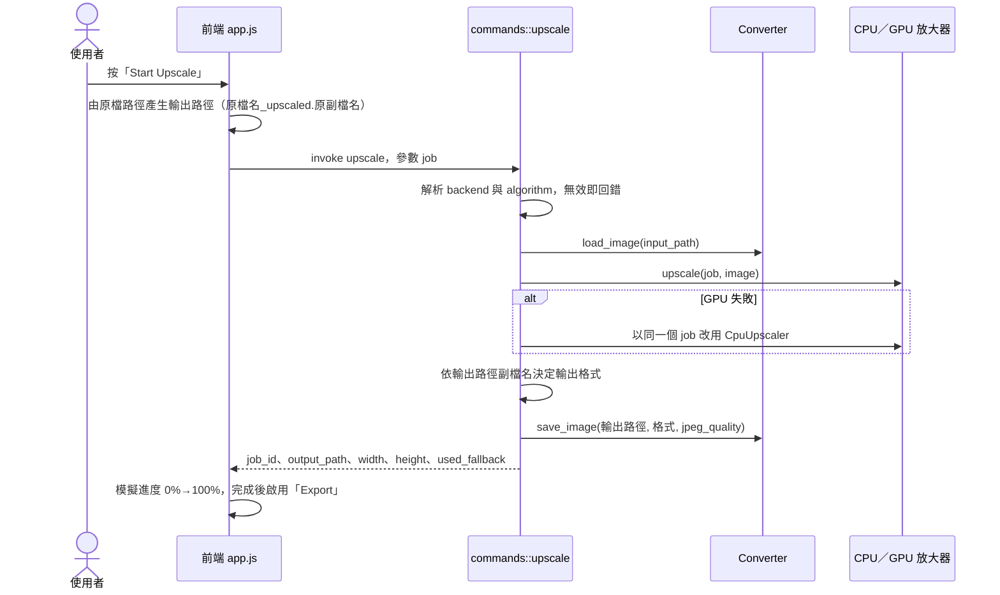

# 業務邏輯

| 文件資訊 | 內容 |
| --- | --- |
| 版本／建立／更新 | v1.1／2026-11-22／2026-11-22 |
| 變更摘要 | v1.0 依 `main`（`cb55693`，v0.1.0 初版）建立：放大流程、演算法對應、GPU→CPU 備援、目標解析度、格式與品質規則、預覽、匯出與轉換、錯誤處理、已知落差。v1.1 GPU→CPU 備援補本機實測：著色器 panic 使備援分支走不到 |
| 權威來源 | `src-tauri/src/commands.rs`、`src-tauri/src/converter.rs`、`src-tauri/src/cpu.rs`、`src-tauri/src/gpu.rs`、`src-tauri/src/upscaler.rs`、`src/app.js` |

## 放大流程

- 放大結果**自動寫在原圖同一資料夾**，檔名為 `<原檔名>_upscaled.<原副檔名>`（`app.js:136`），同名檔案直接覆寫，不詢問。
- 輸出格式由輸出路徑的副檔名決定（`commands.rs:270`），即與原圖副檔名相同；副檔名無法對應到支援的輸出格式時（例如 `.hdr`），放大完成後才在存檔階段失敗。
- 前端不讀取 `used_fallback`，畫面不會提示已改用 CPU。

## 演算法與執行端

| 執行端 | 畫面選項（送出值） | 後端列舉 | 實作 |
| --- | --- | --- | --- |
| CPU | Nearest、Bilinear、CatmullRom、Lanczos3 | `Nearest`、`Bilinear`、`CatmullRom`、`Lanczos3` | `fast_image_resize` 對應 `ResizeAlg`（`cpu.rs:45`） |
| GPU | FSR 1.0、Anime4K、NIS | `Fsr1_0`、`Anime4k`、`Nis` | `gpu.rs` 內嵌 WGSL，皆為雙線性取樣加簡化銳化，非 AMD／NVIDIA 官方演算法 |

- 後端解析大小寫不敏感，另接受別名：`catmull-rom`、`lanczos-3`、`fsr1_0`／`fsr-1-0`／`fsr1`、`anime-4k`（`commands.rs:81`）。
- CPU 放大器收到 GPU 演算法、GPU 放大器收到 CPU 演算法，都回傳「unsupported algorithm」。
- 畫面切換執行端時，演算法清單隨之替換（`populateAlgorithms`，`app.js:71`）。

## GPU→CPU 備援

- **設計意圖：** 選 GPU 時先嘗試 GPU；建立裝置或執行失敗就改用 CPU，並回傳 `used_fallback: true`（`commands.rs:251`）。
- **實際行為：** 備援沿用原本的 `job`，演算法仍是 `Fsr1_0`／`Anime4k`／`Nis`，CPU 放大器一律拒絕（`cpu.rs:50`），因此錯誤訊息為「GPU upscaler failed: …; CPU fallback also failed: unsupported algorithm …」。GPU 失敗時備援不會成功。
- 整合測試 `gpu_fallback_to_cpu_when_gpu_unavailable` 在備援時自行改用 Lanczos3（`integration_test.rs:164`），與正式程式行為不同，不能據此判定備援可用。
- GPU 著色器驗證錯誤會造成 panic，`commands.rs` 沒有攔截 panic，不會進入備援分支（2026-11-22 本機實測 Anime4K、NIS 皆如此，見[系統架構](system-architecture.md)的「放大子系統」）。因此在有 DX12 介面卡的機器上，備援分支目前走不到；只有建立 GPU 裝置失敗時才會進入並因演算法不符而失敗。

## 目標解析度

- 畫面提供四個固定尺寸：3840×2160（預設）、1920×1080、2560×1440、7680×4320（`index.html:49`）。
- 放大器直接輸出指定寬高，**不保持原圖長寬比**；原圖大於目標時實際上是縮小。
- 寬或高為 0 時回傳「target dimensions must be non-zero」。

## 格式與品質

| 項目 | 規則 | 位置 |
| --- | --- | --- |
| 讀取 | 依檔案內容判斷格式，支援 `image` 啟用的 png、jpeg、gif、webp、pnm、tiff、bmp、ico、hdr；開檔對話框篩選器不含 hdr | `converter.rs:94`、`commands.rs:205` |
| 輸出格式 | PNG、JPEG、WebP、GIF、TIFF、BMP、ICO、PNM 共 8 種；副檔名 `jpg`、`tif`、`pbm`／`pgm`／`ppm`／`pam` 為別名 | `commands.rs:96` |
| JPEG 品質 | 允許 50～100，未提供時預設 85，超出範圍回傳「invalid quality」；畫面滑桿範圍同為 50～100 | `converter.rs:178` |
| 非 JPEG 品質 | 忽略品質參數，不檢查範圍 | `converter.rs:188` |
| WebP | `image` 0.24 編碼器只輸出無損 WebP，品質參數無效 | `converter.rs:136` |
| ICO | 超過 256×256 時以 Lanczos3 等比縮到 256 以內 | `converter.rs:160` |
| PNM | 一律輸出二進位 PPM（RGB8），透明度被捨棄 | `converter.rs:141`、`converter.rs:167` |
| AVIF | 不支援；`converter.rs` 模組說明提到 AVIF，但列舉與編碼都沒有 | `converter.rs:1` |

## 預覽、匯出與轉換

- **預覽：** 載入時把圖片縮到長邊 800px 以內（Triangle 濾波），編成 PNG data URL 回傳（`commands.rs:175`）。預覽只顯示原圖，放大後不更新。
- **匯出：** 需先完成放大。讀回自動輸出的放大檔，再依使用者在存檔對話框選的副檔名重新編碼到指定路徑；品質取放大區的 `#quality` 滑桿（`app.js:286`）。來源為 JPEG 時會再次有損壓縮。
- **格式轉換：** 對**原圖**（非放大結果）重新編碼；預設檔名為原檔名加 `#convertFormat` 選的副檔名，實際格式以對話框選定路徑的副檔名為準，沒有副檔名才用下拉選單的值（`app.js:322`）。品質取 `#convertQuality`。
- **存檔對話框：** Windows 上 rfd 以第一組篩選器為預設存檔類型，前端會把對應目前副檔名的篩選器排到第一組（`saveFiltersFor`，`app.js:165`），避免存成 `x.webp.png`。

## 工作與錯誤處理

- 工作代號為程式內遞增的 `job-<n>`（`commands.rs:64`），重啟後從 `job-1` 開始。`JobStatus`、`UpscaleResult`、`Upscaler::supports_backend`／`fallback_available` 已定義，但正式流程未使用。
- 每個指令的錯誤以字串回傳，前端顯示「Load failed: …」「Upscale failed: …」「Export failed: …」「Convert failed: …」在狀態列；放大前未選圖、匯出前未放大則以 `alert` 提示。
- 取消、進度、FSR 1.0 選項等介面層落差見[服務架構](service-architecture.md)的「已知落差」。
