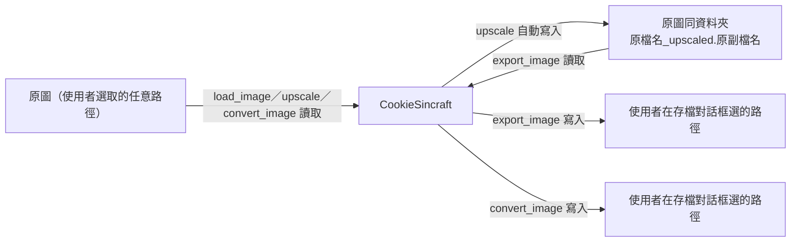

# 資料庫結構

| 文件資訊 | 內容 |
| --- | --- |
| 版本／建立／更新 | v1.0／2026-11-22／2026-11-22 |
| 變更摘要 | v1.0 依 `main`（`cb55693`，v0.1.0 初版）建立：確認沒有資料庫，記錄實際的持久化資料（圖檔讀寫）與記憶體狀態 |
| 權威來源 | `src-tauri/Cargo.toml`（無資料庫相依）、`src-tauri/src/commands.rs`、`src-tauri/src/converter.rs`、`src/app.js` |

## 現況：沒有資料庫

v0.1.0 沒有資料庫、設定檔、歷史紀錄或快取。相依套件中沒有 SQLite 或其他儲存引擎，程式也不寫入 Tauri 的應用程式資料目錄。關閉程式後，除了使用者產出的圖檔，不留下任何狀態。

## 持久化資料：本機圖檔

| 檔案 | 產生者 | 位置與命名 | 覆寫行為 |
| --- | --- | --- | --- |
| 原圖 | 使用者 | 開檔對話框選取的任意路徑 | 程式只讀取 |
| 放大結果 | `upscale` | 原圖同資料夾，`<原檔名>_upscaled.<原副檔名>` | 同名直接覆寫，不詢問 |
| 匯出檔 | `export_image` | 存檔對話框選定路徑 | 由 Windows 存檔對話框詢問是否取代 |
| 轉換檔 | `convert_image` | 存檔對話框選定路徑 | 同上 |

- 寫檔使用 `File::create` 直接寫入目標路徑，沒有先寫暫存檔再更名；編碼中途失敗會留下不完整的檔案。
- 放大結果在匯出後不會被刪除。

## 記憶體狀態

| 狀態 | 位置 | 意義 |
| --- | --- | --- |
| `currentFile` | `app.js:42` | 目前載入的原圖 `{ path, name }` |
| `currentJobId` | `app.js:43` | 最近一次放大的工作代號，只用於 `cancel_job` |
| `outputPath` | `app.js:44` | 最近一次放大結果的路徑，匯出時讀取 |
| `NEXT_JOB_ID` | `commands.rs:64` | 後端工作代號計數器，重啟歸零 |

## 測試產生的檔案

- 整合測試寫入 `src-tauri/tests/*.png|jpg|webp`（已列入 `.gitignore`）。
- 單元測試寫入系統暫存目錄下的 `cookiesincraft_*` 資料夾，測試結束不清除。

## 日後加入儲存時

加入設定檔、處理歷史或資料庫時，在本文件記錄儲存位置、資料表或檔案結構、欄位中文意義、遷移方式與保留策略，並同步更新[系統架構](system-architecture.md)與[使用者權限](user-permissions.md)。
