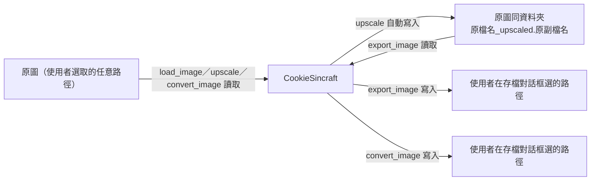
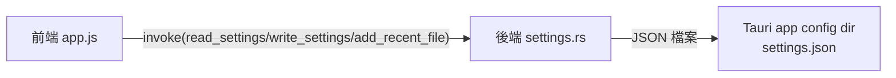

# 資料庫結構

| 文件資訊 | 內容 |
| --- | --- |
| 版本／建立／更新 | v1.4／2026-11-23／2026-11-27 |
| 變更摘要 | v1.4 記錄取消與原子發布的先後及暫存清理。v1.3 記錄批次序號保留；v1.2 記錄同資料夾暫存、不覆寫發布與可信最近檔；v1.1 新增設定持久化。 |
| 權威來源 | `src-tauri/Cargo.toml`（無資料庫相依）、`src-tauri/src/commands.rs`、`src-tauri/src/converter.rs`、`src-tauri/src/settings.rs`、`src/app.js` |

## 現況：沒有資料庫

v0.1.0 沒有資料庫、設定檔、歷史紀錄或快取。相依套件中沒有 SQLite 或其他儲存引擎，程式也不寫入 Tauri 的應用程式資料目錄。關閉程式後，除了使用者產出的圖檔，不留下任何狀態。

## 持久化資料：本機圖檔

| 檔案 | 產生者 | 位置與命名 | 覆寫行為 |
| --- | --- | --- | --- |
| 原圖 | 使用者 | 開檔對話框選取的任意路徑 | 程式只讀取 |
| 放大結果 | `upscale`／`batch_upscale` | 原圖同資料夾或核准的輸出資料夾，套用輸出檔名設定 | 單張須明確確認才可取代；批次不覆寫 |
| 匯出檔 | `export_image` | 存檔對話框選定路徑 | 由 Windows 存檔對話框詢問是否取代 |
| 轉換檔 | `convert_image` | 存檔對話框選定路徑 | 同上 |

- `converter.rs` 在目的資料夾獨佔建立暫存檔，完成編碼後才發布；未核准覆寫時用原子 no-replace，已核准才替換。放大／批次的取消和發布共用同一閘門：取消先到不改舊檔並清理暫存；發布先到則保留已完成檔。已用隔離 Windows 探針控制先後順序，不外推到目錄替換或原生 release GUI。
- `src/app.js` 的 `resolveOutputPath` 保留批次項目的零起算序號：有 `{name}` 時沿用原有原檔名加序號；沒有 `{name}` 時在副檔名前加序號；若清理規則使用備用檔名，則為 `output_<序號>.<ext>`。單張不加序號。此規則不為磁碟上既有檔案自動改名，批次仍不得覆寫。
- 放大結果在匯出後不會被刪除。

## 記憶體狀態

| 狀態 | 位置 | 意義 |
| --- | --- | --- |
| `currentFile` | `app.js:42` | 目前載入的原圖 `{ path, name }` |
| `currentJobId` | `app.js:43` | 最近一次放大的工作代號，只用於 `cancel_job` |
| `outputPath` | `app.js:44` | 最近一次放大結果的路徑，匯出時讀取 |
| `NEXT_JOB_ID` | `commands.rs:64` | 後端工作代號計數器，重啟歸零 |

## 測試產生的檔案

- 整合測試寫入 `src-tauri/tests/*.png|jpg|webp`（已列入 `.gitignore`）。
- 單元測試寫入系統暫存目錄下的 `cookiesincraft_*` 資料夾，測試結束不清除。

## 持久化資料：設定檔（settings.json）

v0.2.0 新增設定檔持久化，關閉程式後重開仍保留使用者選項。儲存於 Tauri 應用程式資料目錄下的 `settings.json`，由後端 `settings.rs` 讀寫，前端僅透過 `read_settings`/`write_settings`/`add_recent_file` IPC 指令交握，不直接讀寫本機檔案。

| 欄位 | 中文意義 | 允許值／預設 |
| --- | --- | --- | --- |
| `backend` | 放大執行端 | `cpu`／`gpu`，預設 `cpu` |
| `algorithm` | 放大演算法 | `Nearest`/`Bilinear`/`CatmullRom`/`Lanczos3`（CPU）或 `Fsr1_0`/`Anime4k`/`Nis`（GPU），預設 `Lanczos3` |
| `quality` | JPEG 品質 | 50～100，預設 85 |
| `output_folder` | 自訂輸出資料夾 | 絕對路徑字串，或 `null`（寫入原圖同資料夾，現行行為） |
| `keep_aspect_ratio` | 保持長寬比 | `true`/`false`，預設 `false` |
| `filename_template` | 輸出檔名樣板 | 字串，預設 `{name}_upscaled_{scale}x.{ext}`；變數 `{name}`、`{scale}`、`{ext}` |
| `recent_files` | 最近開啟檔案 | `settings.json` 的舊值只供顯示。後端在 `recent.json` 維護最多 5 筆已授權路徑、最新優先、去重；拖放暫存不持久化 |

- 寫入方式：先寫暫存檔（`settings.json.tmp`）再 `rename` 至 `settings.json`（atomic replace），避免寫至一半的損壞檔。
- 路徑由後端自行構建（Tauri app config dir），前端不得傳入路徑；不進入 `AppState.check_write` 允許清單，為後端內部例外，已文件化。
- 損壞檔：`read_settings` 忽略損壞檔，回傳預設值，於狀態列提示；不自動覆寫損壞檔。

## 日後加入儲存時

加入設定檔、處理歷史或資料庫時，在本文件記錄儲存位置、資料表或檔案結構、欄位中文意義、遷移方式與保留策略，並同步更新[系統架構](system-architecture.md)與[使用者權限](user-permissions.md)。
