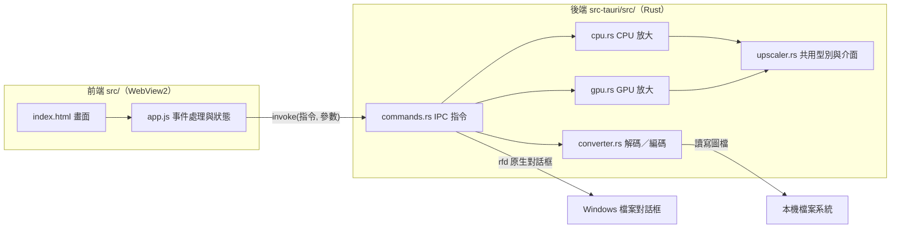

# 服務架構與前後端歸屬

| 文件資訊 | 內容 |
| --- | --- |
| 版本／建立／更新 | v1.1／2026-11-22／2026-11-22 |
| 變更摘要 | v1.0 依 `main`（`cb55693`，v0.1.0 初版）程式碼建立：前後端組成、歸屬原則、功能對照、IPC 指令契約、已知落差。v1.1 「FSR 1.0」落差補本機實測錯誤訊息；註明 Anime4K、NIS 執行時 panic |
| 權威來源 | 前端 `src/index.html`、`src/app.js`；後端 `src-tauri/src/main.rs`（指令註冊）、`src-tauri/src/commands.rs`（指令實作） |

## 組成

CookieSincraft 是單機桌面程式，沒有伺服器。「前端」指 Tauri 視窗內的網頁介面（WebView2），「後端」指同一個執行檔內的 Rust 程式，兩者透過 Tauri 行程間通訊（Inter-Process Communication，IPC）的 `invoke` 呼叫溝通。

## 歸屬原則

- **影像處理、檔案讀寫、格式判斷與檔案對話框一律在後端。** Tauri 2 的 `<input type="file">` 與拖放檔案不提供實體路徑，所以前端只能透過 `select_image`／`select_save_path` 取得路徑。
- **前端只負責畫面狀態、選項、組參數與顯示結果。** 前端狀態只有記憶體中的 `currentFile`、`currentJobId`、`outputPath`，關閉程式即消失。
- **演算法、輸出格式清單兩邊各有一份。** 前端 `ALGORITHMS`（`app.js:36`）、`SAVE_FILTERS`（`app.js:153`）與畫面選項（`index.html`）；後端 `parse_algorithm`（`commands.rs:81`）、`parse_image_format`（`commands.rs:96`）、`select_image` 篩選器（`commands.rs:205`）。新增或改名時前後端同時改，且前端送出的值必須能被後端解析。
- **錯誤以字串回傳。** 所有指令回傳 `Result<T, String>`；失敗時前端的 `invoke` Promise 以該字串拒絕，前端顯示在狀態列（`#statusText`）。

## 功能對照

| 功能 | 前端元素與處理函式 | IPC 指令 | 後端位置 |
| --- | --- | --- | --- |
| 選擇圖片 | `#dropZone` 點擊或放下 → `selectImage`（`app.js:96`） | `select_image` | `commands.rs:200`，rfd 開檔對話框 |
| 載入與預覽 | `loadImagePath`（`app.js:108`）→ `#previewImg` | `load_image` | `commands.rs:158`；`Converter::load_image`、預覽縮圖 `commands.rs:175` |
| 放大 | `#btnStart`（`app.js:199`），參數來自 `#backend`、`#algorithm`、`#resolution`、`#quality` | `upscale` | `commands.rs:232`；`CpuUpscaler`／`GpuUpscaler`、`Converter::save_image` |
| 取消 | `#btnCancel`（`app.js:255`） | `cancel_job` | `commands.rs:291`，空實作 |
| 匯出（另存放大結果） | `#btnExport`（`app.js:266`） | `select_save_path` → `export_image` | `commands.rs:213`、`commands.rs:298` |
| 格式轉換（另存原圖） | `#btnConvert`（`app.js:301`），參數來自 `#convertFormat`、`#convertQuality` | `select_save_path` → `convert_image` | `commands.rs:213`、`commands.rs:314` |
| 範本殘留 | 無 | `greet` | `main.rs:14`，前端未呼叫 |

## IPC 指令契約

Tauri 會把頂層參數的 Rust 蛇形命名（snake_case）對應成前端的駝峰命名（camelCase），例如 `output_path` 在前端寫 `outputPath`。`upscale` 的參數是一個 `job` 物件，物件內欄位由 serde 反序列化，維持 snake_case。

| 指令 | 前端參數 | 成功回傳 | 失敗 |
| --- | --- | --- | --- |
| `select_image` | 無 | 選取的絕對路徑字串；取消時 `null` | 不會失敗 |
| `select_save_path` | `defaultName`：預設檔名；`filters`：`[[名稱, 副檔名…], …]`，第一組為預設存檔類型 | 選取的絕對路徑；取消時 `null` | 不會失敗 |
| `load_image` | `path`：圖檔絕對路徑 | `{ width, height, format, preview }`：寬、高、依副檔名判斷的格式代號、800px 以內的 PNG data URL | 開檔或解碼失敗訊息 |
| `upscale` | `job`：`{ input_path, output_path, backend, algorithm, target_width, target_height, jpeg_quality }` | `{ job_id, output_path, width, height, used_fallback }`：工作代號、輸出路徑、輸出寬高、是否改用 CPU | 後端或演算法名稱無效、解碼、放大、編碼或寫檔失敗訊息 |
| `cancel_job` | `id`：工作代號 | 無 | 不會失敗（未實作） |
| `export_image` | `path`：放大結果路徑；`outputPath`；`format`；`quality` | 無 | 格式無效、品質超出範圍、讀寫失敗訊息 |
| `convert_image` | `inputPath`：原圖路徑；`outputPath`；`format`；`quality` | 無 | 同 `export_image` |

各欄位的業務規則（允許值、品質範圍、輸出格式判斷）見[業務邏輯](business-logic.md)。

## 已知落差（截至 v0.1.0）

以下依程式碼判讀，記錄現況，修正需經使用者排入任務。

- **GPU 的「FSR 1.0」無法從畫面使用。** 前端送出選項值 `FSR 1.0`（`app.js:38`、`app.js:77`），後端轉小寫為 `fsr 1.0`，不在 `parse_algorithm` 接受的 `fsr1_0`／`fsr-1-0`／`fsr1` 內（`commands.rs:87`），回傳「invalid algorithm 'fsr 1.0': …」（2026-11-22 本機實測）。`Anime4K`、`NIS` 可通過解析，但執行時因著色器錯誤 panic（見[系統架構](system-architecture.md)）。
- **進度條是前端模擬。** `upscale` 是同步指令，回傳時放大已完成；前端之後才以計時器把進度從 0% 跑到 100%（`app.js:232`）。
- **取消沒有作用。** `cancel_job` 為空實作（`commands.rs:292`），前端只重設畫面。
- **拖放不讀取拖入的檔案。** 放下時改為開啟檔案對話框（`app.js:192`）；`index.html` 的 `#fileInput` 未被使用。
- **未使用的外掛。** `tauri-plugin-dialog` 有初始化（`main.rs:21`）且列在 `package.json`，但前端未呼叫，對話框改用 rfd；`tauri-plugin-shell` 列在 `Cargo.toml` 但未初始化。
- **除錯輸出殘留。** `select_save_path` 以 `eprintln!` 印出參數（`commands.rs:214`、`commands.rs:224`），前端匯出／轉換流程有 `console.log`。
