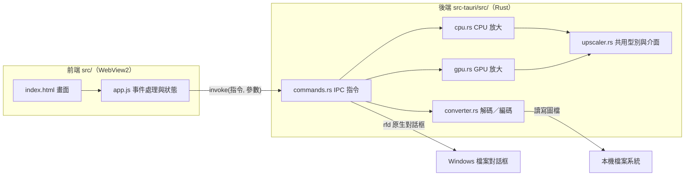

# 服務架構與前後端歸屬

| 文件資訊 | 內容 |
| --- | --- |
| 版本／建立／更新 | v1.8／2026-11-27／2026-11-27 |
| 變更摘要 | v1.8 記錄取消與發布排序及型別化錯誤，不以 Windows Wry 指令測試取代 GUI 驗收。v1.7 更新拖放、預覽與設定。v1.6 記錄獨立批次取消入口、父工作 ID 和終態。v1.5 批次在解碼後按各來源比例計算目標尺寸。 |
| 權威來源 | 前端 `src/app.js`；後端 `src-tauri/src/main.rs:23-37`（指令註冊）、`src-tauri/src/commands.rs`（指令實作）、`src-tauri/src/settings.rs`（設定檔）、`src-tauri/build.rs:3-14`（app manifest）、`src-tauri/capabilities/default.json`（capability 權限）、`src-tauri/permissions/autogenerated/`（命令級 ACL） |

## 組成

CookieSincraft 是單機桌面程式，沒有伺服器。「前端」指 Tauri 視窗內的網頁介面（WebView2），「後端」指同一個執行檔內的 Rust 程式，兩者透過 Tauri 行程間通訊（Inter-Process Communication，IPC）的 `invoke` 呼叫溝通。

## 歸屬原則

- **影像處理、實體路徑存取、格式判斷與原生對話框在後端。** DOM 拖放不信任實體路徑，前端讀使用者交給 WebView 的 `File`，以 Base64 交給後端建立程式管理的暫存。
- **前端只負責畫面狀態、選項、組參數與顯示結果。** 前端狀態只有記憶體中的 `currentFile`、`currentJobId`、`outputPath`，關閉程式即消失。
- **演算法、輸出格式清單兩邊各有一份。** 前端 `ALGORITHMS`（`app.js:36`）、`SAVE_FILTERS`（`app.js:153`）與畫面選項（`index.html`）；後端 `parse_algorithm`（`commands.rs:81`）、`parse_image_format`（`commands.rs:96`）、`select_image` 篩選器（`commands.rs:205`）。新增或改名時前後端同時改，且前端送出的值必須能被後端解析。
- **錯誤以字串回傳。** 所有指令回傳 `Result<T, String>`；失敗時前端的 `invoke` Promise 以該字串拒絕，前端顯示在狀態列（`#statusText`）。

## 功能對照

| 功能 | 前端元素與處理函式 | IPC 指令 | 後端位置 |
| --- | --- | --- | --- |
| 選擇圖片 | `#dropZone` 點擊 | `select_image` | `commands.rs`，rfd 開檔對話框 |
| 拖放圖片 | `#dropZone` 的 `drop` 讀第一個符合圖像檢查的 DOM File，經 `loadImageFromBase64` | `load_image_from_base64` | `commands.rs`，輸入檢查後建立工作階段暫存 |
| 載入與預覽 | `loadImagePath` → Blob URL → `#previewImg` | `load_image` | `commands.rs`；`Converter::load_image`、後端 PNG 預覽 |
| 放大 | `#btnStart`（`app.js:199`），參數來自 `#backend`、`#algorithm`、`#resolution`、`#quality` | `upscale` | `commands.rs:232`；`CpuUpscaler`／`GpuUpscaler`、`Converter::save_image` |
| 取消 | 單張 `#btnCancel`；批次 `#btnCancelBatch` 由 `Started.data.batch_id` 啟用 | `cancel_job({ id })` | `commands.rs` 在 blocking 工作等待發布閘門，再設定共享取消旗標；批次終態後前端停用按鈕 |
| 匯出（另存放大結果） | `#btnExport`（`app.js:266`） | `select_save_path` → `export_image` | `commands.rs:213`、`commands.rs:298` |
| 格式轉換（另存原圖） | `#btnConvert`（`app.js:301`），參數來自 `#convertFormat`、`#convertQuality` | `select_save_path` → `convert_image` | `commands.rs:213`、`commands.rs:314` |

## IPC 指令契約

Tauri 會把頂層參數的 Rust 蛇形命名（snake_case）對應成前端的駝峰命名（camelCase），例如 `output_path` 在前端寫 `outputPath`。`upscale` 的參數是一個 `job` 物件，物件內欄位由 serde 反序列化，維持 snake_case。

| 指令 | 前端參數 | 成功回傳 | 失敗 |
| --- | --- | --- | --- |
| `select_image` | 無 | 選取的絕對路徑字串；取消時 `null` | 不會失敗 |
| `select_save_path` | `defaultName`：預設檔名；`filters`：`[[名稱, 副檔名…], …]`，第一組為預設存檔類型 | 選取的絕對路徑；取消時 `null` | 不會失敗 |
| `load_image` | `path`：圖檔絕對路徑 | `{ width, height, format, preview }`：寬、高、依副檔名判斷的格式代號、800px 以內的 PNG data URL | 開檔或解碼失敗訊息 |
| `load_image_from_base64` | `base64`：Base64 圖片資料；`suggestedName`：建議檔名 | `{ temp_path, image_meta: { width, height, format, preview } }`：暫存檔路徑與圖片中繼資料 | Base64 解碼失敗、檔案過大、檔名不合法 |
| `check_path_exists` | `path`：檔案路徑 | `boolean`：檔案是否存在 | 路徑檢查失敗（受率限制） |
| `upscale` | `job`：`{ input_path, output_path, backend, algorithm, target_width, target_height, jpeg_quality }` | `{ job_id, output_path, width, height, used_fallback }`：工作代號、輸出路徑、輸出寬高、是否改用 CPU | 後端或演算法名稱無效、解碼、放大、編碼或寫檔失敗訊息 |
| `cancel_job` | `id`：單張工作或批次父工作代號 | 接受取消要求；不等於已取消終態 | 已離開登記或未知工作回 `job not found` |
| `export_image` | `path`：放大結果路徑；`outputPath`；`format`；`quality` | 無 | 格式無效、品質超出範圍、讀寫失敗訊息 |
| `convert_image` | `inputPath`：原圖路徑；`outputPath`；`format`；`quality` | 無 | 同 `export_image` |
| `read_settings` | 無 | 設定物件 `{ backend, algorithm, quality, output_folder, keep_aspect_ratio, filename_template, recent_files: string[] }` | 讀檔失敗訊息；檔案不存在時回傳預設值 |
| `write_settings` | `{ settings }`；其中的 `recent_files` 不得改寫可信最近檔清單 | 無 | 寫檔失敗訊息 |
| `add_recent_file` | `path`：圖檔絕對路徑 | 更新後的設定物件（含 recent_files） | 讀寫失敗訊息 |
| `batch_upscale` | `{ dto: { items, backend, algorithm, keep_aspect_ratio, target_width, target_height, quality }, onEvent: Channel }` | `{ batch_id, total }`；`Progress.done` 是已處理的項目數；批次正常完成或取消僅回一種終態 | 佇列建立失敗訊息；單張失敗不中斷，記錄後繼續 |
| `select_output_folder` | 無 | 選取的資料夾絕對路徑；取消時 `null` | 不會失敗 |
| `select_multiple_images` | 無 | 選取的多個圖檔絕對路徑陣列；取消時空陣列 | 不會失敗 |

各欄位的業務規則（允許值、品質範圍、輸出格式判斷）見[業務邏輯](business-logic.md)。

Windows Wry 直接驗證批次指令：中間損毀仍處理下一張；收到第二項的進度通知時取消，保留第一張成品，不產出第二張，並清除工作登記。v1.5 修正批次忽略保持比例：每張圖解碼後按目標短邊算同一倍率，再以 4096 長邊限制整體倍率；原生 Wry 探測確認 2×5 → 8×20，其他來源及其硬連結位元組未變。這不是 WebView IPC、GUI 或 GPU 已提交工作取消的驗收。

## 已知落差（截至 v0.2.0）

以下依程式碼判讀，記錄現況，修正需經使用者排入任務。

- **GPU 演算法與驗證範圍。** frontend `ALGORITHMS.gpu` 與後端包含 Bilinear、FSR 1.0、NIS、Anime4K。真 DX12 dispatch 與有限像素測試已驗；不代表已全面通過新版 GUI、進度／取消或上游等效驗收。
- **進度條後端回報進度。** `upscale` 為非同步指令，透過 `Channel<UpscaleProgress>` 回報 Started／Progress／Completed／Failed／Cancelled；前端顯示實際進度（`src/app.js:683-753`）。
- **取消：** `commands.rs`／`converter.rs` 用工作共用的發布閘門排序。取消先取得鎖則不發布；若原子發布已成功，保留該項結果且不再發布後續項目。真正 I/O 失敗依型別回 `Failed`，不看訊息內容。這兩種排序及批次邊界在隔離 Windows Wry command 已測；取消要求本身不是終態，原生 release GUI 未驗。
- **原生 GUI 還未完整驗收。** 拖放及預覽流程已可由源碼確認，不能因此宣稱最新 Windows release 的原生拖放或可信最近檔跨重啟已通過。後端隔離行程測試僅覆蓋最近檔儲存及信任判斷。
