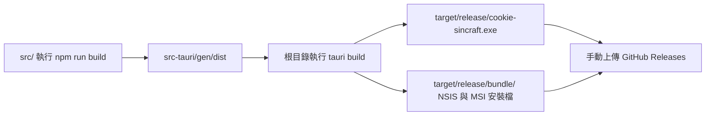
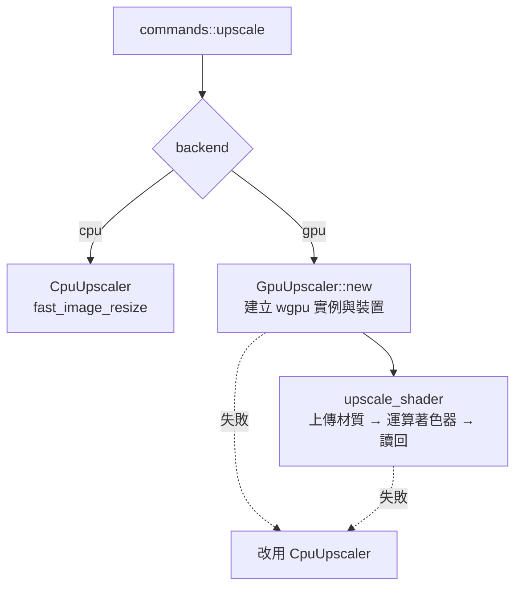

# 系統架構

| 文件資訊 | 內容 |
| --- | --- |
| 版本／建立／更新 | v1.3／2026-11-23／2026-11-23 |
| 變更摘要 | v1.0 依 `main`（`cb55693`，v0.1.0 初版）建立：技術堆疊、目錄結構、建置與發布流程、執行期設定、GPU／CPU 放大子系統、非功能性特性。v1.1 GPU 著色器現況改為本機實測結果（Anime4K、NIS 因著色器解析錯誤 panic）。v1.2 #[#3] 程式碼清理與 CI 建置：移除 `integration_test.rs` 全域配置器，新增 `aligned_allocator_tests.rs` 獨立測試二進制；新增 `.github/workflows/ci.yml` CI 工作流與 `scripts/sync-version.js` 版本同步腳本；移除 `gpu.rs`/`app.js` 除錯輸出；加入 `validate_dimensions` 4096×4096 尺寸上限。v1.3 #[#4] 功能增強-可選：新增 `settings.rs` 設定檔模組、`read_settings`/`write_settings`/`add_recent_file`/`batch_upscale`/`select_output_folder`/`select_multiple_images` 指令；`upscale` 已為非同步並透過 `Channel<UpscaleProgress>` 回報進度；批次處理採 `batch_progress` 事件式總進度 |
| 權威來源 | `Cargo.toml`、`src-tauri/Cargo.toml`、`Cargo.lock`、`src-tauri/tauri.conf.json`、`src/package.json`、`src/vite.config.js`、`src-tauri/src/main.rs`、`src-tauri/src/gpu.rs`、`src-tauri/src/cpu.rs` |

## 技術堆疊

| 層 | 技術（`Cargo.lock`／`node_modules` 實際版本） | 選用理由 |
| --- | --- | --- |
| 桌面框架 | Tauri 2（`tauri` 2.12.7，CLI 2.12.6） | 以 Rust 處理影像、系統 WebView 顯示介面，執行檔小 |
| 前端 | Vite 5.4.21、原生 JavaScript、`@tauri-apps/api` 2.12.5 | 介面只有單一頁面，不需框架 |
| 影像編解碼 | `image` 0.24.9（啟用 png、jpeg、gif、webp、pnm、tiff、bmp、ico、hdr） | 一個套件涵蓋所有支援格式 |
| CPU 放大 | `fast_image_resize` 0.7.0 | 提供 Nearest／Bilinear／Catmull-Rom／Lanczos3 |
| GPU 放大 | `wgpu` 0.19.4（啟用 dx12、vulkan-portability）＋ WGSL 運算著色器 | 不依賴特定廠商 SDK 即可在 GPU 執行 |
| 檔案對話框 | `rfd` 0.13.0 | 後端直接取得實體路徑 |
| 預覽傳輸 | `base64` 0.22 | 預覽以 data URL 傳給前端，免開檔案存取權限 |

`Cargo.toml` 中的 Tauri 相依宣告為 `2.0.0-beta`，實際解析版本以 `Cargo.lock` 為準。

## 目錄結構

| 路徑 | 內容 |
| --- | --- |
| `Cargo.toml` | Cargo 工作區，成員只有 `src-tauri` |
| `src/` | 前端原始碼與 npm 設定；`npm run build` 輸出到 `src-tauri/gen/dist` |
| `src-tauri/src/` | `main.rs`（啟動與指令註冊）、`commands.rs`、`converter.rs`、`cpu.rs`、`gpu.rs`、`upscaler.rs` |
| `src-tauri/shaders/` | 四個 `.wgsl` 檔；程式未引用，實際執行的著色器內嵌在 `gpu.rs` 的 `shaders` 模組 |
| `src-tauri/tests/integration_test.rs` | 整合測試，不再宣告全域配置器；對齊配置器測試移至 `aligned_allocator_tests.rs` |
| `src-tauri/tests/aligned_allocator_tests.rs` | 新增：獨立測試二進制檔，宣告 `#[global_allocator]` 僅作用於本二進制 |
| `src-tauri/icons/` | 應用程式與系統匣圖示 |
| `src-tauri/gen/` | 前端建置產物與 Tauri 產生的 schema，不進版控 |
| `target/` | Rust 建置產物與安裝檔，不進版控 |

## 建置與發布

- `tauri.conf.json` 只設定 `frontendDist: gen/dist`，沒有 `devUrl`、`beforeDevCommand`、`beforeBuildCommand`；打包前必須先手動建置前端，否則會包到舊的或不存在的前端。CI 工作流（`.github/workflows/ci.yml`）在打包前自動執行 `npm run build`。
- 發布物：NSIS 安裝檔、MSI 安裝檔、免安裝執行檔（需系統已有 WebView2），見 `README.md`。GitHub Actions CI 自動執行格式檢查、clippy、測試、前端與 Tauri 建置及版本一致性檢查；發布仍為手動上傳 GitHub Releases。
- 應用程式識別碼 `com.cookiesincraft.dev`；版本 0.2.0 同時寫在 `src-tauri/Cargo.toml`、`tauri.conf.json`、`src/package.json`。版本號同步腳本（`scripts/sync-version.js`）可在 CI 中以 `--check` 模式驗證三處一致性。

## 執行期設定

- 單一視窗，標題「CookieSincraft 曲奇芯刻」，1200×800，可調整大小；啟用系統匣圖示（`icons/icon.png`）。
- 發行版以 `windows_subsystem = "windows"` 隱藏主控台（`main.rs:1`）。除錯版啟動時自動開啟開發者工具（`main.rs:23`）。
- 安全相關設定（CSP、capability、開發者工具功能旗標）見[使用者權限](user-permissions.md)。

## 放大子系統

- **GPU：** 每次放大都重新建立 wgpu 實例、介面卡與裝置，不快取（`gpu.rs:215`）。只列舉 DX12 介面卡並取第一個（`gpu.rs:219`）；沒有 DX12 介面卡時回傳「backend unavailable」。來源列以 256 bytes 對齊上傳，16×16 工作群組運算後複製到暫存緩衝區讀回。三個演算法共用同一套繫結配置與參數緩衝區。
- **GPU 著色器現況：** 內嵌 WGSL 無法通過 wgpu 驗證，`create_shader_module` 直接 panic。2026-11-22 在本機（有 DX12 介面卡）以暫時測試呼叫 `upscale` 實測：Anime4K、NIS 皆 panic，訊息為「Shader 'gpu upscaler shader' parsing error: name `sampler` is a reserved keyword」；著色器另含 `let mut`、`fn fx2(vec2 v: vec2<f32>)` 等非 WGSL 語法（`gpu.rs:38`、`gpu.rs:65`）。對齊配置器測試以 `catch_unwind` 吞掉此 panic（`aligned_allocator_tests.rs`）。目前 GPU 路徑無法產出結果。
- **CPU：** 強制使用純量路徑 `CpuExtensions::None`（`cpu.rs:111`），避開 `fast_image_resize` 的 AVX2／SSE4 路徑在 Lanczos3 讀取未對齊係數時 panic；來源像素另複製到 16-byte 對齊緩衝區（`cpu.rs:71`）。
- **執行緒：** 大部分指令為同步函式（未標 `async`），依 Tauri 2 規則在主執行緒執行；`upscale` 已為非同步（`pub async fn`），透過 `tokio::task::spawn_blocking` 在背景執行放大，並以 `Channel<UpscaleProgress>` 回報進度，放大期間視窗可回應。`batch_upscale` 亦為非同步，透過 `batch_progress` 事件回報批次總進度。一次處理一個放大工作（`running_jobs` 互斥），期間無法發起新的單次 `upscale`。

## 非功能性特性

- **記憶體：** 整張圖解碼進記憶體並轉為 RGBA8，放大過程同時存在來源、對齊副本與輸出緩衝區。目標尺寸上限 4096×4096（對應約 64 MB RGBA8 緩衝區），超出尺寸會被 `validate_dimensions` 拒絕；8K 輸出（7680×4320）單一 RGBA8 緩衝區約 133 MB，目前仍會被尺寸上限阻擋。
- **效能：** CPU 放大使用純量路徑，沒有 SIMD 加速；GPU 每次重建裝置有固定啟動成本。沒有量測基準。
- **併發：** 沒有工作佇列；一次處理一個放大工作，期間主執行緒阻塞。
- **可用性：** 純本機運作，不需網路。GPU 不可用時的設計是改用 CPU，實際限制見[業務邏輯](business-logic.md)的「GPU→CPU 備援」。
