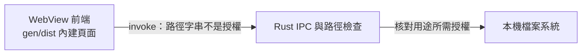

# 使用者權限

| 文件資訊 | 內容 |
| --- | --- |
| 版本／建立／更新 | v1.4／2026-11-27／2026-11-27 |
| 變更摘要 | v1.4 依現行程式修正 CSP、外掛及開發者工具記載。v1.3 補記 WebP 完整解碼前的尺寸與輸出緩衝預檢。v1.2 分離讀取、輸出資料夾及明確另存授權。 |
| 權威來源 | `src-tauri/tauri.conf.json`、`src-tauri/Cargo.toml`、`src-tauri/src/main.rs:23-37`、`src-tauri/src/commands.rs`、`src-tauri/build.rs:3-14`、`src-tauri/capabilities/default.json`、`src-tauri/permissions/autogenerated/` |

## 現況：沒有帳號與角色

- **身分驗證：** 不適用。單機程式，沒有登入、帳號或授權碼。
- **權限控管模型：** 不採用角色權限控管（RBAC）。程式以執行它的 Windows 使用者身分讀寫檔案，能存取的範圍等於該使用者的檔案系統權限。
- **傳輸加密：** 不適用。程式不連網；前後端之間只有同一行程內的 Tauri IPC。

## 信任邊界

- **授權按用途分離：** 讀取由選檔、程式管理的拖放暫存或可信最近紀錄授權。放大可在來源資料夾或另行選取的輸出資料夾下建立成品；不會因此授予可供轉檔／匯出重用的寫入權。`convert_image`／`export_image` 要求原生另存對話框授權的確切目的路徑；選過資料夾不足以核准覆寫檔案。路徑別名及 Windows 硬連結的同檔判定已測試；資料夾被替換的競爭及 junction 邊界尚未完整驗收（`src-tauri/src/commands.rs`）。
- **尺寸與輸出緩衝預檢：** 放大目標寬、高不超過 4096；解碼器依可取得的 metadata 預檢尺寸與輸出緩衝。WebP 使用 `image-webp` 先檢查寬、高與 64 MiB 輸出上限，再配置並解碼（`converter.rs`）；這不代表其內部工作記憶體或所有格式都已驗證有相同硬上限。
- **錯誤訊息含路徑：** 錯誤字串包含完整檔案路徑，只顯示在本機狀態列，不外傳。

## Tauri 安全設定現況

| 項目 | 現況 | 位置 |
| --- | --- | --- |
| 內容安全政策（Content Security Policy，CSP） | 啟用；`img-src 'self' blob:`，不允許 `data:` 圖片來源；圖像預覽在渲染前轉為 Blob URL。`connect-src` 限打包頁面來源及 Tauri IPC | `tauri.conf.json:20–22`、`src/app.js` |
| Capability 設定 | `src-tauri/capabilities/default.json` 設定最小權限，涵蓋全部 15 個自訂指令的 `allow-<command>`；命令級 ACL 在 `src-tauri/permissions/autogenerated/`（每個指令一個 `allow-<command>` / `deny-<command>` TOML） | `src-tauri/capabilities/default.json`、`src-tauri/permissions/autogenerated/` |
| 自訂指令 | 15 個指令註冊到主視窗：select_image、select_multiple_images、select_save_path、select_output_folder、load_image、load_image_from_base64、check_path_exists、upscale、cancel_job、export_image、convert_image、read_settings、write_settings、add_recent_file、batch_upscale | `src-tauri/src/main.rs:23-37` |
| 外掛 | 未宣告或註冊 `tauri-plugin-dialog`／`tauri-plugin-shell`；後端使用 `rfd` 顯示原生對話框 | `Cargo.toml`、`src-tauri/src/main.rs` |
| 開發者工具 | `tauri` 相依未啟用 `devtools` 功能旗標；程式只在 `debug_assertions` 編譯條件下呼叫 `open_devtools` | `Cargo.toml:14`、`src-tauri/src/main.rs:20–23` |
| 前端來源 | 只載入打包在執行檔內的 `gen/dist`，不載入遠端頁面 | `tauri.conf.json` |

## 變更規則

- 新增或修改 IPC 指令時，在本文件記錄路徑來源（對話框或前端字串）、讀寫範圍與副作用，並在任務 Design 的 Security 審查中檢查。
- 加入任何網路功能、遠端內容、外部連結開啟或 shell 執行之前，先設定 CSP 與 capability，限制可呼叫的指令與外掛權限，並更新本文件。
- 移除或啟用外掛、調整 `devtools` 旗標，視為權限變更，回寫本文件。
