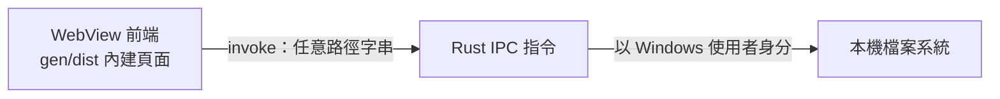

# 使用者權限

| 文件資訊 | 內容 |
| --- | --- |
| 版本／建立／更新 | v1.0／2026-11-22／2026-11-22 |
| 變更摘要 | v1.0 依 `main`（`cb55693`，v0.1.0 初版）建立：確認沒有帳號與角色，記錄實際的權限邊界（作業系統檔案權限、WebView↔Rust IPC）、Tauri 安全設定現況與變更規則 |
| 權威來源 | `src-tauri/tauri.conf.json`、`src-tauri/Cargo.toml`、`src-tauri/src/main.rs`、`src-tauri/src/commands.rs`、`src-tauri/gen/schemas/capabilities.json` |

## 現況：沒有帳號與角色

- **身分驗證：** 不適用。單機程式，沒有登入、帳號或授權碼。
- **權限控管模型：** 不採用角色權限控管（RBAC）。程式以執行它的 Windows 使用者身分讀寫檔案，能存取的範圍等於該使用者的檔案系統權限。
- **傳輸加密：** 不適用。程式不連網；前後端之間只有同一行程內的 Tauri IPC。

## 信任邊界

- **路徑不受限制：** `load_image`、`upscale`、`export_image`、`convert_image` 接受前端傳入的任意絕對路徑，後端不檢查目錄範圍、不限制副檔名以外的條件（`commands.rs:158`、`commands.rs:232`、`commands.rs:298`、`commands.rs:314`）。正常操作下路徑來自原生對話框，但任何能在 WebView 執行的腳本都可直接呼叫這些指令，讀取使用者可讀的圖檔，或在使用者可寫的位置建立、覆寫檔案。
- **輸入大小不受限制：** 解碼與目標尺寸沒有上限檢查，超大圖可能耗盡記憶體（見[系統架構](system-architecture.md)的「非功能性特性」）。
- **錯誤訊息含路徑：** 錯誤字串包含完整檔案路徑，只顯示在本機狀態列，不外傳。

## Tauri 安全設定現況

| 項目 | 現況 | 位置 |
| --- | --- | --- |
| 內容安全政策（Content Security Policy，CSP） | 停用（`"csp": null`） | `tauri.conf.json` |
| Capability 設定 | 沒有 `src-tauri/capabilities/` 目錄；產生的 `gen/schemas/capabilities.json` 為空物件 | `src-tauri/` |
| 自訂指令 | `greet`、`select_image`、`select_save_path`、`load_image`、`upscale`、`cancel_job`、`export_image`、`convert_image` 全部註冊到主視窗 | `main.rs:27` |
| 外掛 | `tauri-plugin-dialog` 已初始化但前端未使用；`tauri-plugin-shell` 只宣告相依、未初始化 | `main.rs:21`、`Cargo.toml` |
| 開發者工具 | `tauri` 啟用 `devtools` 功能旗標，發行版也可開啟開發者工具；只有除錯版會自動開啟 | `Cargo.toml`、`main.rs:23` |
| 前端來源 | 只載入打包在執行檔內的 `gen/dist`，不載入遠端頁面 | `tauri.conf.json` |

## 變更規則

- 新增或修改 IPC 指令時，在本文件記錄路徑來源（對話框或前端字串）、讀寫範圍與副作用，並在任務 Design 的 Security 審查中檢查。
- 加入任何網路功能、遠端內容、外部連結開啟或 shell 執行之前，先設定 CSP 與 capability，限制可呼叫的指令與外掛權限，並更新本文件。
- 移除或啟用外掛、調整 `devtools` 旗標，視為權限變更，回寫本文件。
