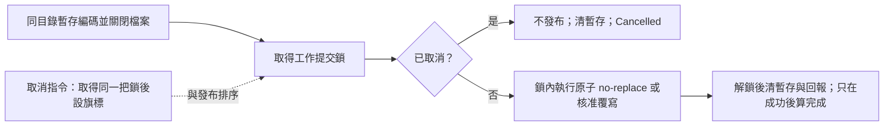
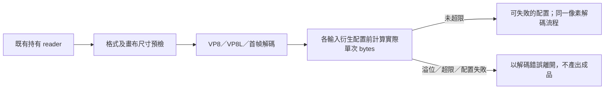

# CookieSincraft 缺失修復與 Windows 驗收

依據：[planning.md](planning.md)、[前次審查](Review.md)，以及使用者要求由 Reviewer 自己實機驗證既有功能。保留現行工作樹；不新增規劃中可選且尚未出貨的 HDR/WebP 有損功能，不更改 Planning。較大 GPU 倍率與像素品質不可由小圖 smoke 推論。

| 項目 | 修復契約與驗證 |
| --- | --- |
| R1 權限、設定、最近檔案 | `write_settings` 不得供前端寫入授權名單，`add_recent_file` 只接受本次已授權讀取的檔案。舊版歷史只是顯示用，重新選檔後可有可信的新紀錄；分開儲存可信紀錄且比對有效路徑，不信任 renderer 提供的授權。不得任意核准持久設定的資料夾；重開後未核准要提示重新選擇，不可暗中改到其他目錄。權限與尺寸測試須檢查拒絕分支。 |
| R2 真實工作流 | 原生開檔與存檔、拖放、單張、批次、預覽、覆寫／改名／取消、格式轉換、設定重啟；使用專用測試圖，驗證讀回尺寸、格式及狀態。保持比例須同倍縮放，不可各軸獨立截斷。覆寫僅在確認後；不允許工作覆蓋任何輸入（含同檔別名）。批次不得靜默覆蓋或一檔損毀拖垮整批。 |
| R3 進度與取消 | 單張與批次各持有一個 `Arc<AtomicBool>`，批次各項、GPU／CPU 處理及備援複用同一 token；不以取消刪除工作登記，待工作退出才釋放。工作單元與提交邊界見下節。 |
| R4 GPU | 保留 DX12 裝置初始化、實際 dispatch、儲存再讀回；小圖與實用倍率都測。有 adapter 時不得用 skip 或 CPU 最後出圖假裝 GPU 通過。依上游修正 Anime4K feature map 必須能存負值、4 個子像素通道、尺寸及 alpha；對照 FSR tap/方向與 NIS 已知簡化，沒有參考像素實驗不聲稱等價。以獨立回歸案例驗證 GPU 失敗的 CPU 備援與 UI 訊息。 |
| R5 打包與品質 | 前端建置後，執行測試、fmt、clippy、版本檢查、Windows 打包；不以發行檔能建置代替 GUI 或演算法驗證。以測試檔取代會吞 GPU 失敗的測試，避免配置布局不一致。CSP 預覽使用受控 PNG Blob，釋放物件 URL；Windows 若使用 HTML drop，停用 WebView2 原生攔截以讓 DOM 收到事件。 |

## 實作邊界（Codex 2026-11-27 阻塞複查）

- **B1 資源預算（Spec，Planning #13）**：維持 4096×4096 與每個應用程式影像緩衝／GPU 材質 **64 MiB**，不只計算最終 RGBA8。分配之前用 checked arithmetic 計實際像素格式、尺寸和每列 padding，涵蓋浮點材質、上傳、讀回和 CPU 中繼。4096×4096 RGBA8 可達 64 MiB；等尺寸 RGBA16Float 不可建立（128 MiB）。若僅 GPU 所需中繼超限，依既有 GPU 失敗契約改 CPU Lanczos3，明示原因；若來源、目標或備援本身超限，拒絕且不建立成品。測 64 MiB 界線和其上一個可表示的尺寸組合，驗證拒絕或有標記備援，不靠實際超額分配測試。
- **B2 進度與取消（Code，Planning #7–8）**：CPU 橫向按來源列帶處理完整寬度，再縱向按目的欄帶處理完整高度；每次只切與該次濾波垂直的軸，維持全圖取樣相位、輪廓與原先橫→縱順序。和原 Native 整圖結果用奇數寬高、四個濾波器及上下縮放對照。GPU 以已完成的運算 pass／拆分 dispatch 為工作單元，等待該單元完成再回報並在下一個單元前查 token；已送出的 GPU 工作不能強行中斷。CPU 以實際處理像素、GPU 以完成的工作群組數計進度，依 10% 級距、相隔至少 100ms 發送，中途可合併但不可倒退；100% 只在成品發布後送出。備援是同一工作，不能把 `Cancelled` 當 GPU 錯誤，且備援進度不得倒退。編解碼單次呼叫不可強制中止；可取消的作業以同目錄暫存編碼，發布前與取消共用提交判定，先收到取消不發布、保留舊檔；提交點之後回報已完成。批次只停止未提交的項目，不撤回已完成的項目。
- **B3 Anime4K 倍率（Code，Planning #2）**：卷積在目前輸入的完整解析度計算；depth-to-space 的兩軸尺寸必須嚴格等於來源 ×2，不能用最終尺寸代入。每輪以偶奇座標選 4 個殘差分量之一；RGB 使用按輸出像素中心雙線性取樣的完整來源加殘差，alpha 以原圖同座標雙線性取樣、不加殘差。任一軸倍率 ≤1.2 依上游條件走 GPU Bilinear，不宣稱跑了 CNN；兩軸都 >1.2 時先執行至少一個完整 ×2，再重複至兩軸達到目標所需尺寸；每輪必須先通過 B1 及裝置上限檢查。最後若尺寸不同，以完整中繼圖重取樣至目標，不裁切；純 GPU 與含 CPU 收尾需可區分，正常收尾不是「因 GPU 錯誤而備援」。以精確 ×2、1280×720 → 1920×1080 與非等軸倍率測右下邊界標記、alpha 和非單色，不能只測尺寸。
- **B4 解碼前限制（Security，Planning #13）**：原生開檔、拖放、放大／批次、匯出與轉檔共用 `Converter` 的受限解碼入口。猜格式後先讀標頭／解碼器 metadata，檢查尺寸及依解碼像素格式估算的配置，再讀完整像素；設定 codec 支援的嚴格尺寸與配置限制。不能預先取得可靠尺寸／限制的分支不得直接退回不受限的解碼。有效檔案格式不變；重驗解碼後尺寸並作為第二道防線。用可讀 metadata 但超限且不含完整像素資料的測試圖，確認錯在預檢而不是後段解碼。

## 審查及實作紀錄

| 時點 | Spec | Code | Security |
| --- | --- | --- | --- |
| 獨立設計審查（Codex `gpt-6.1-sol`，首輪） | 需修正：B1 64 MiB 必須含浮點中繼 | 需修正：B2 真實工作單元／共享取消；B3 非整數倍率不得裁切 | 需修正：B4 將尺寸限制前移至完整解碼前 |
| 上述四點的設計複查（Codex `gpt-6.1-sol`） | 通過：B1 | 通過：B2、B3 | 通過：B4 |
| 本輪實作 | 待驗證 | 待審查 | 待審查 |
| R1 路徑授權增量（OpenCode 實作／Codex 唯讀複查） | 通過：三種用途分離，僅限本次差異 | 通過：保留正常衍生輸出；整合後 Windows 18 項回歸通過 | 可增量合入；junction／目錄替換競爭及全批次輸入保護未關閉 |
| Anime4K B3 與相關 B1 差異（OpenCode 實作／Codex 唯讀複查） | 通過：完整 ×2 CNN 中繼後全圖 GPU 重取樣 | 通過：四分量殘差、像素中心插值、透明度與出圖斷言 | 通過：本次差異的 checked doubling、裝置尺寸、材質及讀回預算；不代表其他 GPU 路徑的資源驗收 |
| 批次 R2／R3 差異（OpenCode 實作／Codex 唯讀複查） | 正常→損毀→正常仍繼續；第二項開始前取消保留前一成品 | 真 Wry 指令與取消探測通過；完成數按已處理項目，取消只回一種終態、退出清除登記 | 測試排除共用日誌與暫存清理；不涵蓋 WebView、全批次來源與提交競爭 |
| WebP B4 增量（OpenCode 實作／Codex 唯讀複查） | 4097×1 metadata-only 在讀像素前拒絕 | 尺寸、輸出位元組預檢；RGBA 無損讀回逐 byte 相同 | 輸出緩衝上限與 `try_reserve_exact`；套件內部配置及動畫相容性不由本輪證實 |
| 批次保持比例（OpenCode 實作／Codex 唯讀複查） | 通過：每張依原圖比例、以目標短邊計算，再等比限制長邊 | 通過：Wry 2×5 → 8×20，原有批次錯誤後續處理仍通過 | 通過：另一張來源及真硬連結未受影響；不外推至目錄替換或完整競賽 |
| WebP VP8X 首幀背景（OpenCode 實作／Codex 唯讀複查） | 通過：無 alpha 動畫的不滿畫布首幀恢復舊背景色 | 通過：8×6 全畫布及偏移首幀兩案例，以舊解碼器完整 RGBA 對照；驗出並修正 BGRA 通道順序 | 通過本次差異，不改尺寸與分配預檢；內部工作記憶體仍只部分受控 |
| DX12 FSR 進度與備援（OpenCode 實作／Codex 唯讀複查） | 通過：EASU 實際完成才回報，取消不當成 CPU 備援；保留正常備援 | 通過：真 DX12 pass 邊界、成功讀回工作量、Wry 取消與 4096×2049 CPU 成品；前端 GUI 尚未驗收 | 通過本次差異；浮點中繼比較單材質 64 MiB 預算，非 GPU 總工作集；其他演算法及提交競賽不外推 |
| 批次取消前端入口（OpenCode 實作／Codex 唯讀複查） | 通過：Started 以批次 ID 啟用、結束或呼叫失敗後清除 | 通過：Node VM 實際前端片段驗證取消傳參、終態、重試及上一批延遲失敗；非原生 GUI | 通過：僅呼叫既有 `cancel_job`，不改權限與檔案操作；提交競爭另外驗證 |
| 批次檔名（OpenCode 實作／Codex 唯讀複查） | 通過：預設批次與單張命名不變，無 `{name}` 及備用檔名時保留批次序號 | 通過：實際 JavaScript 的四種命名情境；先清理再加序號，以保留原有備用檔名判定 | 通過：未新增路徑或 IPC 能力；磁碟已存在的檔案仍由後端 no-replace 保護 |
| B2 提交鎖設計複查（Codex 唯讀） | 通過：先取消不發布；先提交保留，批次停止後續項目 | 首輪阻塞：字串誤判終態；明訂工作內部型別化結果與 `spawn_blocking` 等鎖後通過 | 通過：維持既有授權、ACL、原子 no-replace 與核准覆寫 |
| Bilinear／NIS B2 差異（OpenCode 實作／Codex 唯讀複查） | 限定通過：以實際 GPU 提交完成作為工作單位 | 工作樹差異在隔離 Windows 真 DX12 測試輸出兩張 PNG、各回報 `(96,96)`，回呼取消有型別；工作樹鎖版回歸 145／0／1 | 限定通過：不改 shader、授權或路徑；不聲稱中止已送 GPU 工作或新版 release 已驗 |
| B2 提交鎖 converter 候選（OpenCode 實作／Codex 唯讀複查） | 單模組通過：兩種排序與兩種發布模式 | 隔離 Windows 控制排程、核對新舊檔和暫存清理；commands 尚未通過編譯，不能視為端到端通過 | 限定通過：鎖內沒有暫存清理，不改既有原子 no-replace 或核准覆寫；不外推到目錄替換 |
| B2 提交鎖及型別終態實作複查（Codex 唯讀） | 通過：`ConverterError::Cancelled` 和 `UpscaleError::Cancelled` 依 variant 分流，I/O 錯誤不會因檔名而誤判 | 通過：Windows 隔離入口 45／0／0；原樣整合工作樹重新跑 locked 回歸 145／0／1。臨界排程證據來自隔離測試，不是 GUI | 限定通過：此差異不動路徑、授權與 ACL；新版 GUI 與發行產物未驗 |
| B4 WebP 單次配置設計（Codex 唯讀，首輪） | 通過：維持 4096×4096、單一緩衝 64 MiB 與既有首幀行為；不是各行程總上限 | 需修正：尚缺逐配置點的 bytes 計算及容量與成長規則，預算須在解碼器建構前傳入 | 需修正：同一阻塞，暫不能確認所有工作配置均受限；確認現行失敗不走不受限的 fallback |
| B4 WebP 清冊複查（Codex 唯讀，第二輪） | 通過 | 建構前預算和共用成長規則已過；清冊須明定 VP8 分區儲存、完整 macroblock 容量與 VP8L code-length 型別 | 同一清冊阻塞；已按下表補正，尚未完成第三輪確認或 codec 實作 |
| B4 WebP 清冊複查（Codex 唯讀，第三輪） | 限定通過：原規格與首幀行為不變 | 設計通過：三個指定配置清冊阻塞已補正 | 設計通過：建構先拿預算、錯誤拒絕且無寬鬆備援；未驗產品實作 |
| B4 WebP 外層中繼實作複查（Codex 唯讀） | 限定通過：畫布、影格與 alpha 使用同一單次配置預算 | 限定通過：checked／fallible，畫布與兩種 alpha 的足額結果逐像素相同；隔離 Windows 5／0／0 | 限定通過：分型失敗、無寬鬆備援。VP8／VP8L 內部配置、RIFF 索引與產品尚未涵蓋 |

R2 批次以不覆寫的原子提交避免查詢後競爭；單張明確核准覆寫以暫存成品成功後再替換。先檢查存在與一般 `rename` 的組合不是 no-clobber；暫存檔以獨佔建立，目的地未核准覆寫時採真正的 no-replace 發布。

### B2 取消與成品發布的先後判定

隔離 Windows 探測確認：在最後一次旗標讀取後、實際發布前設定取消，普通輸出仍建立新檔，核准覆寫仍替換舊檔。將兩個動作併入**每個已登記工作自己的提交鎖**。仍用同一 `Arc<AtomicBool>` 讓 CPU／GPU 與備援讀取取消狀態，但正式取消命令只透過該工作控制物件寫入旗標。單張持有自己的控制物件；整批及其每個項目共用父工作物件，不以項目 ID 查另一把鎖。

- 登記表鎖只拿來複製工作控制物件、不在其內等提交鎖；編解碼、通知、預覽及暫存清理都在提交鎖外。Tauri `cancel_job` 保留 `Result<(), String>`、參數與 ACL，改非同步指令且在 `spawn_blocking` 內等待提交鎖，不在 UI 或非同步執行器上同步等待。非放大轉檔／匯出的普通存檔 API 和既有授權檢查維持不變；兩個以 `#[path]` 載入後端的整合 crate 仍須正常編譯與啟動。
- 取消先取得提交鎖且設旗標：不建立新檔或替換舊檔，回 `Cancelled`。提交先取得鎖且成功：該項維持 `Completed`，晚到取消不得撤回成品，但仍能阻止其後批次項目；鎖內發布失敗仍回原寫入錯誤。以實際寫入結果判斷完成，不在檔案發布後再分開更新一個完成旗標。這不是目錄替換／junction 防護，也不主張已提交 GPU 可強停。
- 內部工作結果保留可區分的取消與一般失敗型別：CPU／GPU 的 `UpscaleError::Cancelled`、提交的 `ConverterError::Cancelled` 與明確的 token 檢查才屬取消；解碼、驗證、寫入錯誤與 panic 不按字串或當下 token 猜測。單張及批次都是在決定終態後才轉成既有的 IPC 字串。寫入錯誤即使目的檔名含 `cancelled` 仍是失敗，並保留原錯誤；成功發布不因任何晚到旗標改判。
- 驗收兩種順序：在暫存關閉後、取鎖前先接受取消，分別驗證新檔不存在與舊檔 bytes 不變；控制排程讓發布先取鎖，驗證競爭的取消不能在該次發布前回應、成功成品可讀且批次不再發布下一項。保留不覆寫碰撞及暫存清理回歸。排程探針僅放隔離測試副本，不納入 release。

### B4 WebP：解碼器單次配置限制（設計複查通過，實作待驗）

Planning #13 約束的是**單一緩衝**，不是整個行程的尖峰。應用程式維持既有 4096×4096 與最終輸出預檢，並保留持有同一 reader、VP8X 首幀背景和支援格式。固定版本 `image-webp 0.2.4` 的 `set_memory_limit` 不足以控制圖像解碼用的工作緩衝（`decoder.rs:551–555, 644–654`；`vp8.rs:1047–1052`），不可把它列作完整限制證據。

- **建構前定案：** 保留授權與版本來源的窄版固定 codec 修補，解碼 API 接收不可變的 `max_allocation_bytes`，由應用程式在建立 `WebPDecoder` **之前**決定 64 MiB，於 `new`／`new_with_options` 讀取前傳入同一預算。既有 metadata API 限制另計，不充作工作緩衝限制。不要全域攔截配置器、用整個 RIFF 檔案大小替代每個請求大小，或在失敗後改走舊的無限制解碼器。不改 shader、WebP 編碼或其他格式。
- **共用規則：** 每個輸入衍生元素數以 `usize::try_from`、`checked_add`、`checked_mul` 及無溢位的整除向上取整計算；用 `count.checked_mul(size_of::<T>())` 比較 64 MiB。已知數量先 `try_reserve_exact` 再初始化／填入，不能用 `vec!`、`collect`、`into_boxed_slice` 等讓輸入衍生容量直接由不可失敗 API 成長。逐批成長先核對 `len + additional` 與請求的目標容量，再 `try_reserve_exact`；保留後操作不得在已核對容量之外觸發配置。不假設配置器實際佔用等於請求容量。固定微小常數配置與輸入衍生配置分開列；不得把所有緩衝加總當成此門檻。

| 固定版本配置點 | 請求型別與上限計算 | 失敗／成長處理 |
| --- | --- | --- |
| `decoder.rs:328–352,405–533` RIFF 範圍索引 | 鍵為封閉列舉 `WebPRiffChunk`，值為 `Range<u64>`；改固定有限的索引表，未知標籤不新增項目，保留已知標籤的首筆範圍行為 | 不讓檔案 chunk 數決定建構期容量；範圍加法 checked，保留既有格式錯誤 |
| `decoder.rs:622–645,687,809–870` metadata、影格及畫布 | `u8`：`range.end - range.start`、`width * height * {3,4}`；alpha decoder 同一預算 | 依精確元素數 fallible 分配；對已由 caller 提供的輸出只檢查大小、不得重複配置 |
| `extended.rs:305–315` alpha | `u8`：`width * height * 4`、`width * height`（壓縮解出的綠色平面、未壓縮 alpha） | 同一預算傳入 `LosslessDecoder`；先核算、再分配 |
| `vp8.rs:923,1031–1052,1219`、`vp8_arithmetic_decoder.rs:40,84–97` 壓縮分區 | `u8` 的 `3*n-3`、`[u8;4]` 的 `ceil(partition_bytes/4)*4`；末分區 `Vec<u8>` 與其字組副本分別核算；主分區 `b` 外是固定 `[ArithmeticDecoder;8]` | 取代 `read_to_end`：以固定大小堆疊緩衝循序讀取，在每次附加前檢查容量與 `try_reserve_exact`，已知長度時可直接讀入已檢查的字組 Vec。主分區及最多八個 token 分區的每次 `init` 都使用已查過容量的 `Vec<[u8;4]>` 作為 storage，保留 `pop` 後的長度語意但移除 `into_boxed_slice()`，避免額外容量收縮配置。padding 一併計入。 |
| `vp8.rs:1201–1215,1953–1989,2051–2061` 平面與 macroblock | 平面 `u8`：`(mbwidth*b)*(mbheight*b)`，`b=16` 或 `8`；邊框 `u8`：`width+20`、`8*mbwidth` 與固定鄰接像素；`Vec<MacroBlock>` 的全圖 `macroblocks` 為 `mbwidth.checked_mul(mbheight)` 項，`top` 則獨立為 `mbwidth` 項，各乘 `size_of::<MacroBlock>()` | 進雙層 decode 迴圈前分別檢查並預留全部 `macroblocks` 和 `top` 的容量，迴圈 push 不增長配置。固定大小 `COEFF_PROB_NODES`（`:990`）不受尺寸或輸入控制，核對常數大小。 |
| `lossless.rs:191–255,305–343,389–423` VP8L 工作區 | cache `[u8;4]` 的 `1<<bits`；轉換圖片、色表 `u8` 的 `block_x*block_y*4`、`color_table_size*4`；entropy plane 相同 RGBA 計算，索引 `u16` 的 `huffman_x*huffman_y`；組別數 `num_huff_groups*size_of::<HuffmanCodeGroup>()`，每組固定 `[HuffmanTree;5]`；code-length 的兩個 `Vec<u16>` 分別是 `19 * size_of::<u16>()` 和 `usize::from(num_symbols) * size_of::<u16>()`；alphabet `[280,256,256,256,40]`，cache 開啟時第一個加 `1<<bits` | 檢查移位／乘法及組數再逐組初始化；每個組內的 Huffman 配置獨立檢查，轉換順序只有固定種類可改用固定陣列，不隱含增長。 |
| `huffman.rs:75–163` Huffman table/tree | `u32` 的 `table_size`；`HuffmanTreeNode` 的 `2*tree_size` 與每次要新增的一或二個節點；單／雙節點捷徑為固定小結構 | 以實際元素大小及累計長度檢查，不能只查初始化容量而放任 `push` 增長，固定結構不得由輸入放大。 |
| `lossless_transform.rs:414–529` 色表和逐列解包 | `[u8;4]` 最多 256 項（含補零），另有固定 256 項 `[u8;EXP_ENTRY_SIZE]` 展開表；逐列 `u8` 依 `packed_image_width_in_blocks` | 色表固定陣列或一次受控容量；逐列配置失敗向上回傳。不能只檢查畫布寬高而略過特殊路徑。 |

溢位、超限或 `TryReserveError` 以明確 `DecodingError` 回到建構／解碼，再映射 `ConverterError::Decode`；錯誤含階段及可用的請求大小，不轉成取消或嘗試寬鬆備援。實作時用固定版原始碼核完所有呼叫者與靜態元素型別，並以剩餘配置／增長點清單為驗收輸入；上表是設計，不是已完成的覆蓋證明。
- 驗證使用正常 VP8、VP8L、VP8X/alpha 圖，對照此前解碼的完整像素。以測試版本的較小預算讓實際解碼進入拒絕路徑，確認錯在配置預檢、沒有成品，不靠刻意真的配置過量，也不將較小預算寫進產品。各行程的總記憶體仍可能超過單一緩衝預算，不做額外保證。

**既有文件校準（不改實作或契約）：** `Agents/user-permissions.md` 原誤記 CSP 停用與外掛啟用；以 `tauri.conf.json`、`Cargo.toml` 及 `main.rs` 為準修訂。`Agents/service-architecture.md` 原誤記拖放開啟對話框及 `write_settings` 回傳 `{ ok: true }`；以 `app.js` 與 `settings.rs` 為準修訂，並保留 GUI 驗收限制。

修復前基準：兩個整合測試 crate 已補 `settings` 模組。Reviewer 重跑 `cargo test -p cookie-sincraft` 仍退出 101：單元 23 通過、對齊案例 25 通過、整合 36 通過／2 失敗／1 忽略，失敗為 Anime4K alpha 與 DX12 最終出圖平坦。上一輪隔離 release GUI 的 1920×1080 PNG 已讀回；同一來源下 FSR alpha 64–65、Anime4K alpha 0–24，來源 alpha 64–255，不能以能出圖或無備援作為通過。
