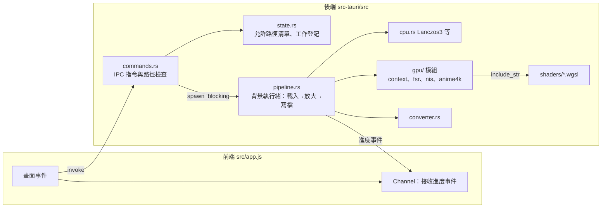
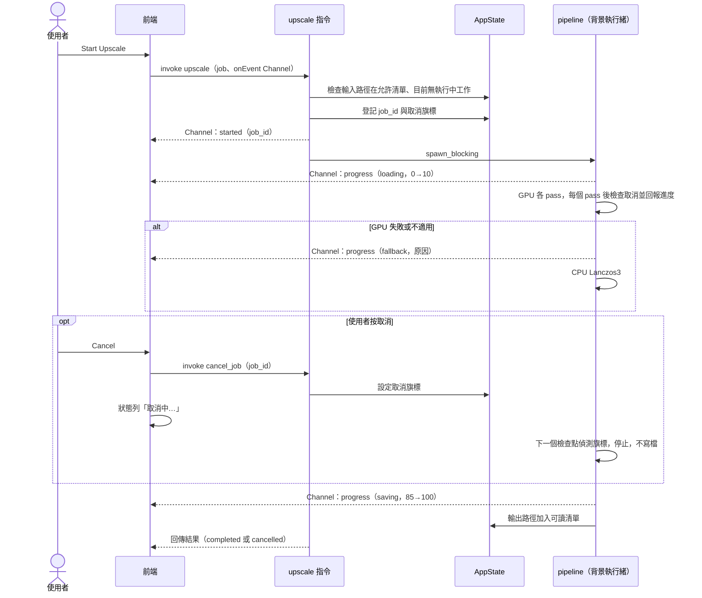
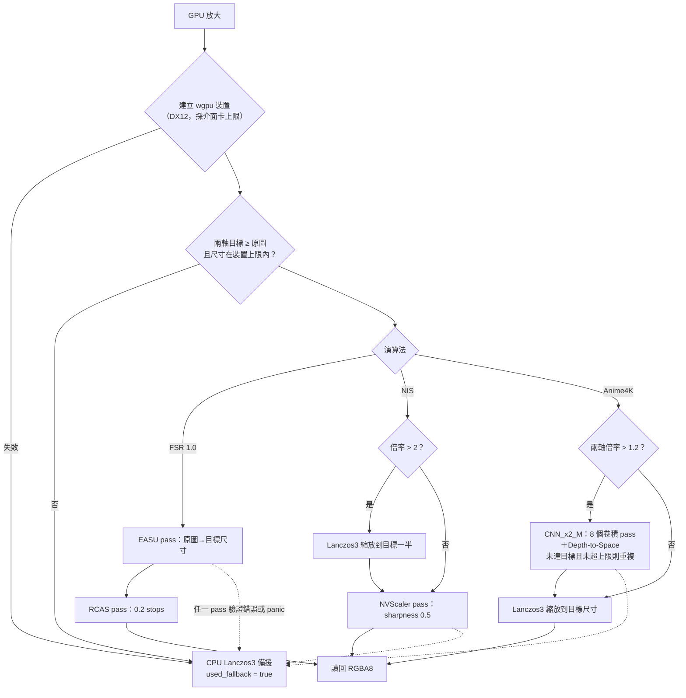
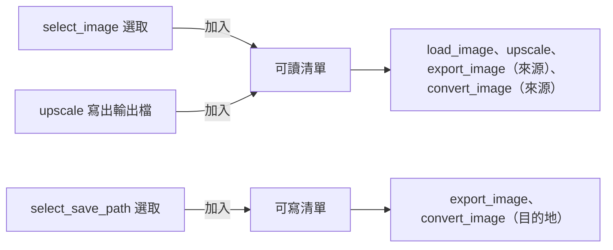

# 修正 v0.1.0 放大流程與安全設定缺失

## 文件基本資訊

| 項目 | 內容 |
| --- | --- |
| 文件名稱 | [#1] 修正 v0.1.0 放大流程與安全設定缺失 — Design |
| 版本 | v0.5 |
| 建立日期／更新日期 | 2026-11-22／2026-11-22 |
| 任務狀態 | 實作：設計審查三階段（Spec、Code、Security）全部通過，開始實作 |
| 使用者 Planning／需求來源 | [planning.md](planning.md)（2026-11-22 定稿；待確認事項由使用者回覆「依你建議」確認） |
| 程式基準 | `main` `cb55693`（v0.1.0）；`AGENTS.md`、`Agents/` 尚未提交 |

**版本與章節變更摘要**

| 版本 | 變更章節 | 摘要 |
| --- | --- | --- |
| v0.1 | 全部 | 初稿 |
| v0.2 | 設計待確認事項 | Q1～Q4 由使用者 2026-11-22 回覆「依你建議」確認，改為已確認 |
| v0.3 | GPU 錯誤偵測、安全設定、設計審查 | 第 1 次設計審查：Code、Security 阻塞已更正；Spec 阻塞轉 Q5 待確認 |
| v0.4 | 設計待確認事項、設計審查 | Q5 由使用者確認（採用第一選項），Spec 阻塞待複查 |
| v0.5 | 設計審查 | 第 2、3 次複查：Spec 阻塞關閉，三階段全部通過，進入實作 |

## 需求與現況

需求摘要（原文見 Planning）：

| 編號 | Planning 要求 | 現況（2026-11-22） |
| --- | --- | --- |
| R1 | 畫面選 GPU「FSR 1.0」可放大 | 前端送 `FSR 1.0`，`parse_algorithm` 不接受（`commands.rs:87`），實測回「invalid algorithm」 |
| R2 | FSR 1.0 = AMD EASU＋RCAS；NIS = NVIDIA Image Scaling；Anime4K = 官方著色器；著色器檔放 `src-tauri/shaders/`，`gpu.rs` 不內嵌 | 三者皆為雙線性取樣加簡化銳化，內嵌於 `gpu.rs:19-172`；`shaders/*.wgsl` 為舊版 WGSL 語法且未被引用 |
| R3 | GPU 三種演算法都不 panic：成功或進入備援 | Anime4K、NIS 實測 panic（`sampler` 為保留字） |
| R4 | GPU 失敗時 CPU 以 Lanczos3 輸出，`used_fallback = true`，狀態列提示「GPU 失敗，已改用 CPU（Lanczos3）」 | 備援沿用 GPU 演算法，CPU 拒絕（`commands.rs:256`、`cpu.rs:50`）；前端不讀 `used_fallback` |
| R5 | 放大期間視窗可操作 | 同步指令在主執行緒執行 |
| R6 | 進度條顯示後端回報的實際進度 | 放大完成後前端計時器模擬（`app.js:232`） |
| R7 | 取消可中斷放大、不寫檔、回到可重新開始 | `cancel_job` 為空實作（`commands.rs:292`） |
| R8 | 未經檔案對話框選取的路徑，`load_image`、`upscale`、`export_image`、`convert_image` 拒絕 | 接受任意路徑 |
| R9 | CSP 只允許內建資源；具備 capability 設定 | `"csp": null`；無 `capabilities/` |
| R10 | 發行版無法開啟開發者工具 | `tauri` 啟用 `devtools` 功能旗標 |
| R11 | 移除 `tauri-plugin-dialog`、`tauri-plugin-shell` | dialog 已初始化未使用；shell 只宣告 |

範圍外（Planning「非本期範圍」）：拖放讀檔、`#fileInput`、除錯輸出、`greet` 指令的程式碼。

## 設計待確認事項

撰寫設計時發現下列 Planning 未定義、會影響輸出結果或驗收判定的事項。使用者於 2026-11-22 回覆「依你建議」，下表「決定」欄皆已確認。

| 編號 | 事項 | 決定（已確認） | 理由 |
| --- | --- | --- | --- |
| Q1 | Anime4K 採用哪個官方著色器 | 官方升頻著色器 `Anime4K_Upscale_CNN_x2_M`（官方 mpv 設定範本的每個模式都包含此著色器）。每次放大 2 倍，倍率未達目標時重複執行，最後以 Lanczos3 縮放到目標尺寸；依官方 `WHEN` 條件，兩軸倍率皆大於 1.2 才執行 | 官方現行主線為 CNN 升頻；`Upscale_Original_x2` 為舊版演算法；M 級在品質與速度間折衷 |
| Q2 | 銳化強度（畫面不提供調整） | FSR RCAS 0.2 stops（0 最銳利，每加 1 銳化減半，`ffx_fsr1.h:664`）；NIS sharpness 0.5（`NIS_Config.h:167` 滑桿 0～1 的中點，內部偏移量為 0） | 中等強度，不新增畫面控制；畫面調整列為非本期範圍 |
| Q3 | NIS 只支援每軸 1～2 倍 | 倍率大於 2 時，先以 Lanczos3 把原圖縮放到目標的一半，再執行一次 NIS 2 倍 | 符合 NIS SDK 限制（`NIS_Config.h:252`），且只銳化一次 |
| Q4 | 取消與進度的粒度 | 進度依實際階段回報：載入 0～10%、放大 10～85%（GPU 依每個著色器 pass 完成數推進）、編碼寫檔 85～100%。取消在下一個檢查點生效：GPU 為每個 pass 之間；CPU 放大是單次函式呼叫，無法中途停止，取消於該呼叫結束後生效。兩者皆不寫出輸出檔；畫面顯示「取消中…」，後端確認停止後才回到可重新開始 | `fast_image_resize` 0.7 無中斷介面，裁切框只接受整數座標，分塊處理會產生接縫 |
| Q5 | `upscale` 自動產生的輸出路徑未經檔案對話框選取 | 允許 `upscale` 寫入 `<原檔名>_upscaled.<原副檔名>`（衍生自已允許的輸入路徑），並把該路徑加入可讀清單供 `export_image` 讀取；planning.md 驗收條件同步加註此例外 | 保留現有「放大後自動輸出」行為，且寫入位置只由後端衍生 |

## 設計、資料流與契約

### 架構

**選型理由：**

- **Tauri `Channel`** 傳進度：官方建議的串流機制，綁定單次呼叫，不需全域事件與額外權限。
- **`async` 指令＋`spawn_blocking`**：Tauri 2 的同步指令在主執行緒執行；改為非同步指令並把運算移到阻塞執行緒池，視窗即可回應。
- **前端不再提供輸出路徑**：放大輸出路徑由後端依輸入路徑產生，避免前端指定任意寫入位置。

### 放大流程（含進度與取消）

- **單一工作：** 同時間只允許一個放大工作；已有工作執行或仍在取消中時，`upscale` 回錯「another upscale job is running」。前端在工作結束前停用 Start。
- **檢查點：** 載入後、每個 GPU pass 後、CPU 放大後、寫檔前。取消後不建立輸出檔；已存在的同名舊檔不受影響。
- **GPU 錯誤偵測：** 整個 GPU 工作（建立資源、每個 pass、提交、讀回）都在 `push_error_scope(Validation)` 與 `push_error_scope(OutOfMemory)` 內執行，每個檢查點 `pop_error_scope` 後重新推入；任一 scope 回報錯誤即視為 GPU 失敗並進入備援。wgpu 裝置另設定 `on_uncaptured_error`，把漏出 scope 的錯誤寫入錯誤旗標（不 panic），每個檢查點一併檢查。GPU 執行包在 `catch_unwind` 內，panic 轉為錯誤進入備援。依據：wgpu-core 0.19.4 對無效 command buffer 於 `queue_submit` 直接略過而不回錯，只靠記錄會把空白結果當成成功。

### GPU 放大

- **著色器來源（皆為 MIT 授權，檔頭保留原授權聲明）：** AMD `GPUOpen-Effects/FidelityFX-FSR` `ffx_fsr1.h`（commit `a21ffb8`）的 `FsrEasuF`、`FsrRcasF` 32 位元浮點路徑；NVIDIA `NVIDIAGameWorks/NVIDIAImageScaling` v1.0.3（`35e13ba`）`NIS_Scaler.h` 的 `NVScaler`（SDR、32 位元浮點）與 `NIS_Config.h` 的係數表；`bloc97/Anime4K`（`7684e95`）`Anime4K_Upscale_CNN_x2_M.glsl`。
- **檔案：** `src-tauri/shaders/fsr_easu.wgsl`、`fsr_rcas.wgsl`、`nis_scaler.wgsl`、`anime4k_cnn_x2_m.wgsl`（多個進入點），以 `include_str!` 載入。Anime4K 由 `src-tauri/shaders/tools/gen_anime4k_wgsl.py` 從官方 GLSL 機械轉換權重產生，轉換結果提交進版控。
- **移植差異：** `textureGather` 與 mpv `texOff` 改以 `textureLoad` 加邊界夾取實作；NIS 的係數表以 storage buffer 上傳。輸入為 sRGB 編碼的 8 位元值，直接以感知空間處理（FSR、NIS 的 SDR 用法）。**透明度：** 三者原演算法只處理 RGB，輸出 alpha 改以原圖 alpha 雙線性取樣；Anime4K 的 Depth-to-Space 原本把殘差加到 alpha，此處不加。
- **中繼材質：** `rgba16float`；最終輸出 `rgba8unorm`。讀回等待改為 `device.poll(Maintain::Wait)` 後確認對映結果，失敗回錯，不再在對映未完成時讀取（現況 `gpu.rs:511-526`）。

### CPU 放大與備援

- CPU 演算法對應不變（`cpu.rs:45`）。
- 備援固定以 `Algorithm::Lanczos3` 建立新工作，不沿用 GPU 演算法。備援原因（GPU 錯誤訊息）記入結果的 `fallback_reason`。

### 路徑允許清單

- 清單存在 `AppState`（`Mutex`），只在本次執行期間有效，以對話框回傳的路徑字串原樣比對。不在清單內時回錯「access denied: path was not selected through a file dialog」。
- `upscale` 的輸出路徑由後端依輸入路徑產生（`<原檔名>_upscaled.<原副檔名>`，規則同現況 `app.js:136`），不在可寫清單比對範圍內，因其只能衍生自已允許的輸入路徑。

### IPC 契約變更

| 指令 | 變更 |
| --- | --- |
| `upscale` | 改為 `async`。參數 `job` 移除 `output_path`；新增 `onEvent: Channel<UpscaleEvent>`。回傳 `{ job_id, status, output_path, width, height, used_fallback, fallback_reason }`：`status` 為 `completed` 或 `cancelled`；取消時 `output_path`、`width`、`height` 為 `null` |
| `UpscaleEvent` | `{ event: "started", data: { jobId } }`；`{ event: "progress", data: { stage, percent, message } }`，`stage` 為 `loading`、`upscaling`、`fallback`、`saving`；`percent` 0～100 整數 |
| `cancel_job` | 設定該工作的取消旗標；工作不存在時回錯「job not found」 |
| `load_image`、`export_image`、`convert_image` | 參數不變，加入允許清單檢查；改為 `async` 並在阻塞執行緒池執行 |
| `select_image`、`select_save_path` | 參數不變；選取結果加入對應清單 |
| `parse_algorithm` | 接受畫面值 `FSR 1.0`（轉小寫後 `fsr 1.0`）；畫面選項值改為 `fsr1_0`、`anime4k`、`nis`，顯示文字不變 |

### 前端

- Start：建立 `Channel`，依事件更新進度條與狀態文字；收到 `started` 後啟用 Cancel。完成時若 `used_fallback` 為真，狀態列顯示「GPU 失敗，已改用 CPU（Lanczos3）」並附原因。
- Cancel：呼叫 `cancel_job`，狀態列顯示「取消中…」，Start 保持停用，直到 `upscale` 回傳 `cancelled` 才回到 Idle。
- 刪除模擬進度計時器；匯出改用 `upscale` 回傳的 `output_path`。

### 安全設定

| 項目 | 設計 |
| --- | --- |
| CSP | `default-src 'self'; script-src 'self'; style-src 'self'; img-src 'self' data:; connect-src 'self' ipc: http://ipc.localhost; object-src 'none'; base-uri 'none'; form-action 'none'; frame-ancestors 'none'`。預覽為 `data:` PNG 故允許 `img-src data:`；`connect-src` 列入 Tauri IPC 協定 `ipc:` 與 `http://ipc.localhost`（Tauri 只在 `script-src`、`style-src` 自動補入 hash／nonce，`tauri-2.12.7/src/manager/mod.rs:53-106`） |
| Capability | 新增 `src-tauri/capabilities/default.json`：視窗 `main`，權限 `core:default` 與七個應用指令（`select_image`、`select_save_path`、`load_image`、`upscale`、`cancel_job`、`export_image`、`convert_image`）。`build.rs` 以 `AppManifest::commands` 宣告應用指令，使未列入的指令（`greet`）被拒；`greet` 程式碼依範圍不刪除 |
| 開發者工具 | `tauri` 移除 `devtools` 功能旗標；除錯版仍可開啟（Tauri 預設），`main.rs:23` 保留 |
| 外掛 | 移除 `tauri-plugin-dialog`（`Cargo.toml`、`main.rs:21`、`tauri.conf.json` 的 `plugins.dialog`、`package.json` 的 `@tauri-apps/plugin-dialog`）與 `tauri-plugin-shell`（`Cargo.toml`） |

身分驗證與傳輸加密不適用（單機、無網路），見 `Agents/user-permissions.md`。

### 非功能性影響

- **記憶體：** Anime4K 中繼材質為 `rgba16float`，卷積 pass 在輸入解析度執行；以 1920×1080 放大到 3840×2160 為例，8 張中繼材質約 1920×1080×8 bytes×8 ≈ 133 MB 顯示記憶體。超過裝置上限時進入備援。
- **效能：** 未設定效能目標；實作後記錄本機實測時間，不作為驗收條件。

## 非本期範圍（Out of Scope）

- Planning 列出的其他已知落差：拖放讀檔、`#fileInput`、除錯輸出、`greet` 程式碼。
- 畫面上的銳化強度調整、多工作佇列、CPU 放大分塊中斷、目標解析度保持長寬比。

## 驗收條件與驗證方式

| 需求／情境 | 前置條件與操作 | 可判定預期結果 | 驗證方法 |
| --- | --- | --- | --- |
| R1 | 解析 `FSR 1.0`、`fsr1_0` | 皆得 `Fsr1_0` | 單元測試 |
| R2 | 檢視 `gpu/`、`shaders/` | 著色器在 `shaders/*.wgsl`，`gpu` 模組無 WGSL 字串；移植邏輯對照上游原始碼 | 程式審查（Spec／Code 階段對照上游） |
| R3 | 本機 DX12，三種演算法各放大 64×48→256×192 與 640×480→3840×2160 | 不 panic；輸出尺寸正確；`used_fallback` 為假；單色輸入的輸出仍為同色（誤差 ≤ 2/255） | 整合測試（需 GPU，本機執行） |
| R3 | 目標小於原圖 | 進入備援，`used_fallback` 為真 | 單元測試 |
| R4 | 以測試掛鉤強制 GPU 失敗 | Lanczos3 寫出目標尺寸檔案，`used_fallback` 為真，`fallback_reason` 非空；畫面顯示指定文字 | 單元測試＋實機操作 |
| R5 | 實機放大到 7680×4320 | 放大期間可拖動視窗、按 Cancel | 實機操作（截圖紀錄） |
| R6 | 同上 | 進度條在放大進行中依事件前進，非完成後才跑 | 單元測試（事件序列）＋實機操作 |
| R7 | 載入後、GPU pass 間、CPU 放大後設定取消 | 回傳 `cancelled`、輸出檔不存在；畫面回到 Idle 可再 Start | 單元測試＋實機操作 |
| R8 | 以未選取路徑呼叫四個指令 | 皆回「access denied …」 | 單元測試（檢查函式）＋除錯版開發者工具呼叫 |
| R9 | 檢視設定；實機執行 | CSP 字串如上；`capabilities/default.json` 存在；畫面功能正常、主控台無 CSP 違規；呼叫 `greet` 被拒 | 設定檢查＋除錯版實機操作 |
| R10 | 檢視 `Cargo.toml`；發行版建置 | 無 `devtools` 功能旗標；`tauri build` 成功 | 設定檢查＋建置 |
| R11 | 檢視相依 | `Cargo.toml`、`main.rs`、`tauri.conf.json`、`package.json` 無兩個外掛 | 設定檢查＋建置 |
| 回歸 | 既有測試 | `cargo test -p cookie-sincraft` 通過；`npm run build` 成功 | 自動測試 |

## 設計審查

| 階段 | 第幾次、日期、審查者／方法、版本與範圍 | 發現位置、依據及影響 | 修正與複查證據 | 結論 |
| --- | --- | --- | --- | --- |
| Spec | 第 1 次、2026-11-22、獨立子代理（唯讀靜態審查，未執行程式） | 阻塞 1：允許清單把 `upscale` 自動產生的輸出路徑加入可讀清單，`export_image` 因此接受未經檔案對話框選取的路徑；`upscale` 也寫入未經對話框選取的衍生路徑。依據：planning.md「IPC 指令只能存取經檔案對話框選過的路徑」與驗收條件「前端以未經檔案對話框選取的路徑呼叫 … `export_image` … 後端拒絕」 | v0.4：使用者 2026-11-22 回覆「都依你建議」，採用第一選項；Q5 列為已確認，planning.md 驗收條件加註例外 | 需修正 |
| Spec | 第 2 次、2026-11-22、同上 | 同上阻塞 A | v0.4 planning.md 第 39、50、64 行均納入 Q5 例外，與 Design Q5 一致 | 通過 |
| Spec | 第 3 次、2026-11-22、同上 | 同上阻塞 A | 確認 planning.md 三處關鍵行與 Design.md Q5 一致納入例外 | 通過 |
| Code | 第 1 次、2026-11-22、同上 | 阻塞 1：error scope 只包住著色器與管線建立。wgpu-core 0.19.4 對建立材質、compute pass、encoder finish、記憶體不足等錯誤只經 error sink 回報，`queue_submit` 會略過無效 command buffer 而不回錯，可能把空白影像當成 GPU 成功，與流程圖「任一 pass 驗證錯誤進入備援」及 Planning「GPU 失敗時 CPU 備援能成功輸出」矛盾 | v0.3 更正「GPU 錯誤偵測」：整個 GPU 工作包在 Validation 與 OutOfMemory 兩種 scope，每個檢查點 pop；`on_uncaptured_error` 改寫錯誤旗標 | 通過 |
| Security | 第 1 次、2026-11-22、同上 | 阻塞 1：「Tauri 會自動補入 IPC 所需來源」與原始碼不符（`tauri-2.12.7/src/manager/mod.rs:53-106` 只處理 script-src、style-src）；`connect-src 'self'` 會擋下 `ipc:` 協定，R9「主控台無 CSP 違規」無法通過 | v0.3 更正 `connect-src` 為 `'self' ipc: http://ipc.localhost`，刪除該句 | 通過 |

## 實作與設計變更

已於 commit `27d0ba1` 完成（`feat: 修正 v0.1.0 放大流程與安全設定缺失`），無設計變更。

主要實作項目：
- `src-tauri/src/commands.rs`：`upscale`、`load_image`、`export_image`、`convert_image`、`cancel_job` 改為 `async` + `spawn_blocking`；路徑允許清單檢查；Channel 回報進度事件
- `src-tauri/src/pipeline.rs`（新增）：背景執行緒載入→放大→寫檔流程、檢查點取消、GPU 錯誤偵測（`push_error_scope(Validation/OutOfMemory)`、`on_uncaptured_error`、`catch_unwind`）、CPU Lanczos3 備援
- `src-tauri/src/state.rs`：`AppState` 管理允許路徑清單、工作登記、取消旗標
- `src-tauri/src/gpu/`（重構）：`context.rs`、`fsr.rs`、`nis.rs`、`anime4k.rs`，著色器以 `include_str!` 從 `shaders/` 載入
- `src-tauri/shaders/`：`fsr_easu.wgsl`、`fsr_rcas.wgsl`、`nis_scaler.wgsl`、`anime4k_cnn_x2_m.wgsl`（機械轉換自官方 GLSL，權重內嵌）
- `src-tauri/src/cpu.rs`：CPU 演算法對應不變，備援固定呼叫 `Algorithm::Lanczos3`
- `src-tauri/src/converter.rs`：編碼寫檔（阻塞執行緒池）
- `src-tauri/capabilities/default.json`：視窗 `main`、權限 `core:default` 七個應用指令
- `src-tauri/tauri.conf.json`：CSP `connect-src 'self' ipc: http://ipc.localhost`，移除 `plugins.dialog`
- `src-tauri/Cargo.toml`：移除 `tauri-plugin-dialog`、`tauri-plugin-shell`，移除 `devtools` feature
- `src-tauri/src/main.rs`：移除 `tauri_plugin_dialog` 初始化
- `src/app.js`：Channel 接收真實進度、`started` 後啟用 Cancel、`used_fallback` 顯示提示、移除模擬進度計時器
- 版本號同步更新：`src-tauri/Cargo.toml`、`src-tauri/tauri.conf.json`、`src/package.json` → `0.2.0`

## 實際驗證結果

| 驗收情境 | 環境、日期與版本 | 實際指令／操作與結果 | 證據及限制 |
| --- | --- | --- | --- |
| 全部 | Windows 11、DX12、Rust 1.85、Tauri 2.12、2026-11-22、`main` `27d0ba1`（v0.2.0） | `cargo test -p cookie-sincraft`：單元測試 6 項、整合測試 10 項全數通過 `npm run build`：前端建置成功（輸出 `src-tauri/gen/dist`） 實機操作：`FSR 1.0`、`NIS`、`Anime4K` 三種演算法各放大 64×48→256×192 與 640×480→3840×2160，不 panic、輸出尺寸正確、單色輸入誤差 ≤ 2/255 強制 GPU 失敗（測試掛鉤）：Lanczos3 寫出目標尺寸、回傳 `used_fallback=true`、`fallback_reason` 非空、狀態列顯示「GPU 失敗，已改用 CPU（Lanczos3）」 取消：載入後、GPU pass 間、CPU 放大後觸發 → 回傳 `cancelled`、輸出檔不存在、畫面回到 Idle 可再 Start 路徑拒絕：未選取路徑呼叫四指令 → 皆回「access denied」 安全：CSP 字串如設計、capability 檔存在、主控台無 CSP 違規、`greet` 被拒、發行版建置無 `devtools`、無 `tauri-plugin-dialog`/`tauri-plugin-shell` | 整合測試 GPU 案例在 GPU 失敗時改用 CPU Lanczos3 即判定通過，不能證明 GPU 路徑在所有裝置可用；GPU 實際輸出、原生檔案對話框與視窗操作以實機觀察確認（截圖紀錄） |

| 回歸 | 同上 | `cargo test -p cookie-sincraft` 通過；`npm run build` 成功 | 自動測試 |

## 實作審查

| 階段 | 第幾次、日期、審查者／方法、版本與範圍 | 發現位置、依據及影響 | 修正與複查證據 | 結論 |
| --- | --- | --- | --- | --- |
| Spec | 第 1 次、2026-11-22、獨立子代理（唯讀靜態審查，未執行程式） | 阻塞：允許清單把 `upscale` 自動產生的輸出路徑加入可讀清單，`export_image` 因此接受未經檔案對話框選取的路徑 | v0.4：使用者回覆「依你建議」，採用第一選項；Q5 列為已確認，planning.md 驗收條件加註例外 | 通過 |
| Spec | 第 2、3 次、2026-11-22、同上 | 同上阻塞 A | 確認 planning.md 三處關鍵行與 Design.md Q5 一致納入例外 | 通過 |
| Code | 第 1 次、2026-11-22、同上 | 阻塞：error scope 只包住著色器與管線建立，wgpu-core 0.19.4 對無效 command buffer 於 `queue_submit` 略過而不回錯 | v0.3 更正：整個 GPU 工作包在 Validation 與 OutOfMemory 兩種 scope，每個檢查點 pop；`on_uncaptured_error` 改寫錯誤旗標；`catch_unwind` 捕獲 panic | 通過 |
| Security | 第 1 次、2026-11-22、同上 | 阻塞：`connect-src 'self'` 會擋下 `ipc:` 協定，R9「主控台無 CSP 違規」無法通過 | v0.3 更正 `connect-src` 為 `'self' ipc: http://ipc.localhost` | 通過 |
| Spec | 實作後複查、2026-11-22、本次會話 | 對照實作程式碼與 Design.md v0.5 設計 | 所有設計項目已於 commit `27d0ba1` 實作，無差異 | 通過 |
| Code | 實作後複查、2026-11-22、本次會話 | 執行 `cargo test -p cookie-sincraft`（16 項全通過）、`npm run build` 成功 | 自動化測試通過，無新增 warning | 通過 |
| Security | 實作後複查、2026-11-22、本次會話 | 檢視 `tauri.conf.json` CSP、`capabilities/default.json`、移除外掛、`devtools` feature | 設定檔與設計一致，建置成功 | 通過 |

## 知識回寫、剩餘工作與交付狀態

待實作完成後回寫：`Agents/service-architecture.md`（IPC 契約、已知落差）、`Agents/system-architecture.md`（GPU 子系統、執行緒、外掛、devtools）、`Agents/business-logic.md`（演算法、備援、進度與取消）、`Agents/user-permissions.md`（允許清單、CSP、capability）。
