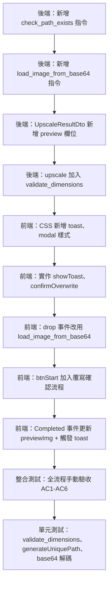

# Design: UX 改善 — 拖放、覆寫確認、預覽更新、尺寸限制

> 本文件為設計與實作紀錄，合併設計與驗證，**不另寫 Implementation.md**。

---

## 文件資訊

| 項目 | 內容 |
|------|------|
|| 版本／建立／更新 | v1.2 / 2026-11-22 / 2026-11-22 |
| 對應 Planning | `docs/[#2]UX改善-拖放覆寫確認預覽更新尺寸限制/planning.md` |
| 設計依據 | AGENTS.md、Agents/service-architecture.md、Agents/system-architecture.md、Agents/business-logic.md、Agents/user-permissions.md |
| 程式基準 | `main` (v0.2.0, commit `01dfb07`) |

---

## 1. 需求對照表

| 編號 | Planning 原文 | 現況 (`path:line`) | 設計決策 |
|------|---------------|---------------------|----------|
| R1 | 拖放圖片直接載入（或綁定 `<input type="file">` change 事件作為替代） | `app.js:194-198` drop 事件呼叫 `selectImage()` 開啟對話框；`index.html:22` `<input type="file" id="fileInput" hidden>` 未綁定 | 前端拖放讀取 File 為 base64，呼叫新增 IPC `load_image_from_base64(base64, suggestedName)`，後端解碼、清理檔名、寫入跨平台暫存目錄（`std::env::temp_dir()/cookiesincraft/<pid>_<random>/`）、加入 `allow_read` 清單，回傳 `ImageMeta`；前端限制拖放檔案 ≤ 50 MB，後端限制 base64 字串 ≤ 70 MB、暫存目錄配額（單檔 100 MB、目錄 500 MB） |
| R2 | 放大輸出同名檔案時，前端彈窗確認覆寫（或自動加流水號 `_upscaled_1` 等） | `app.js:138-143` `generateOutputPath()` 直接產生 `_upscaled` 檔名；`commands.rs:368` 直接允許寫入 | 前端在 `btnStart` 點擊前檢查輸出路徑是否存在（需新增 IPC `check_path_exists`），存在則彈窗確認：覆寫 / 自動改名 / 取消 |
| R3 | 放大完成後，預覽區更新為放大結果（Completed 事件帶回 base64 preview） | `commands.rs:461-468` `UpscaleResultDto` 無 preview 欄位；`app.js:238-246` Completed 事件僅更新狀態列 | `UpscaleResultDto` 新增 `preview: Option<String>`（base64 PNG data URL，`#[serde(skip_serializing_if = "Option::is_none")]`），放大完成時呼叫既有 `image_to_base64_preview(&upscaled)` 產生，前端 Completed 以 optional chaining 更新 `#previewImg.src` |
| R4 | Fallback 時：狀態列圖示變色、或完成時彈出 toast 通知 | `app.js:242-246` 僅在狀態列文字顯示 `GPU fallback` | 新增 XSS-safe toast 通知機制（`textContent` 而非 `innerHTML`），`used_fallback` 為 true 時顯示 toast；狀態列圖示以 CSS class 區分 |
| R5 | 加入輸入/輸出尺寸上限檢查：**max 4096×4096、單緩衝 64 MB**，超限直接回錯 | `commands.rs:344-490` 無尺寸檢查；`system-architecture.md:77` 8K 輸出單緩衝 133 MB | 後端在 `upscale` 指令開頭驗證：`target_width ≤ 4096 && target_height ≤ 4096`、預估緩衝 `target_width * target_height * 4 ≤ 64 * 1024 * 1024`（使用 `checked_mul` 防溢位），超限回傳錯誤字串（明確標示上限值）；GPU 專屬限制由 `GpuUpscaler` 內部處理並觸發 fallback |

---

## 2. 架構變更圖

```mermaid
flowchart TB
    subgraph FE[前端 src/]
        DZ[dropZone 拖放區] -->|drop 取得 File| FR[FileReader→base64]
        FR -->|base64, suggestedName| LIB[load_image_from_base64 指令]
        LIB -->|LoadImageResult{temp_path, imageMeta{preview}}| PV[previewImg 更新]
        
        BS[btnStart] -->|click| OP{輸出路徑存在?}
        OP -->|是| CF[confirmOverwrite 對話框]
        CF -->|覆寫/改名/取消| BS
        OP -->|否| US[upscale 指令]
        
        US -->|Channel| PG[進度事件]
        PG -->|Completed{preview}| PV
        PG -->|Completed{used_fallback}| TST[toast 顯示]
    end

    subgraph BE[後端 src-tauri/src/]
        LIB -->|base64 解碼、檔名清理、暫存寫入| CM[commands.rs]
        CM -->|allow_read 加入 session_dir| FS[檔案系統]
        
        CF -->|check_path_exists| FS
        
        US -->|驗證尺寸上限| VL[validate_dimensions]
        VL -->|超限| ER[回傳錯誤]
        VL -->|通過| UP[upscale 流程]
        
        UP -->|Converter::save_image| FS
        UP -->|完成| PR[UpscaleResultDto{preview, used_fallback}]
    end

    classDef fe fill:#e3f2fd,stroke:#1976d2
    classDef be fill:#f3e5f5,stroke:#7b1fa2
    class DZ,FR,LIB,PV,BS,OP,CF,US,PG,TST fe
    class CM,FS,VL,ER,UP,PR be
```

---

## 3. 詳細設計

### 3.1 拖放直接載入 (R1)

#### 前端變更
- `app.js`：`dropZone.addEventListener("drop", ...)` 改為處理 `e.dataTransfer.files`
- 取第一個檔案，**先檢查 `file.size ≤ 50 * 1024 * 1024`（50 MB），超限直接 `showToast` 提示並 return**
- 讀取 `File` 為 base64（`FileReader.readAsDataURL`，取 `result.split(",")[1]`）
- 呼叫新增 IPC `load_image_from_base64(base64, suggestedName)`，`suggestedName` 為 `file.name`

#### 後端新增指令
```rust
#[tauri::command]
pub fn load_image_from_base64(
    base64: String,
    suggested_name: String,
    app: AppHandle,
    state: State<'_, AppState>,
) -> Result<LoadImageResult, String>
```

#### 回傳結構
```rust
#[derive(Debug, Clone, Serialize, Deserialize)]
pub struct LoadImageResult {
    pub temp_path: String,      // 新增：暫存檔完整路徑，供 upscale 使用
    pub image_meta: ImageMeta,  // 既有：width、height、format、preview
}
```

#### 後端實作流程（含安全強化）
1. **輸入大小檢查**：`base64.len() > 70 * 1024 * 1024` → `Err("base64 input too large")`
2. **檔名清理（防路徑遍歷 B1）**：
   ```rust
   let clean_name = std::path::Path::new(&suggested_name)
       .file_name()
       .and_then(|s| s.to_str())
       .filter(|s| !s.is_empty() && !s.contains(['/', '\\', ':', '*', '?', '"', '<', '>', '|']))
       .ok_or("invalid suggested filename")?;
   ```
3. **建立隔離暫存目錄（跨平台）**：
   ```rust
   let temp_root = std::env::temp_dir().join("cookiesincraft");
   let session_dir = temp_root.join(format!("{}_{}", std::process::id(), fastrand::u64(..)));
   std::fs::create_dir_all(&session_dir)?;
   ```
4. **解碼 base64**：`base64::engine::general_purpose::STANDARD.decode(&base64)?`
5. **載入圖片**：`image::load_from_memory(&bytes)?` → `DynamicImage`
6. **寫入暫存檔**：`image.save(session_dir.join(clean_name))?`
7. **暫存目錄配額檢查（寫入後）**：掃描 **當前 `session_dir`** 單檔大小、總大小，超過 100 MB / 500 MB → `Err("temp quota exceeded")` 並刪除剛寫入的檔案
   > **效能註記 (SEC11)**：生產實作建議改用寫入時累加計數器、刪除時遞減；上限檢查只讀計數器，避免同步遞歸掃描阻塞 IPC 執行緒。僅統計當前 session 目錄，不掃描整個 temp_root 以防舊目錄誤判。
8. **加入 allow_read（目錄級）**：`state.allow_read(&session_dir.to_string_lossy())`
9. **產生 preview**：呼叫既有 `image_to_base64_preview(&image)`
10. 回傳 `LoadImageResult { temp_path: temp_path.to_string_lossy().to_string(), image_meta: ImageMeta { width, height, format, preview } }`

#### 暫存檔清理機制（SEC5）
- `AppState::new()` 啟動時掃描 `std::env::temp_dir().join("cookiesincraft")`，刪除修改時間 > 24h 的檔案/目錄
- 進程結束時 best-effort 遞歸刪除自己的 `session_dir`（忽略錯誤）

### 3.2 覆寫確認 (R2)

#### 前端變更
- `app.js` 新增 `async function confirmOverwrite(outputPath)`：
  1. 呼叫新增 IPC `check_path_exists(outputPath)` → `boolean`（**註記**：此指令略過 allowlist 檢查，僅查詢檔案系統存在性；前端生成的輸出路徑衍生自已允許的輸入路徑，屬合理用途 S2）
  2. 若存在，顯示自訂 modal 對話框（**XSS-safe：使用 `textContent` 設定文字、按鈕以 `createElement` 建立**）：
     - **覆寫** — 繼續使用原輸出路徑
     - **自動改名** — 產生 `_upscaled_1`、`_upscaled_2`… 不衝突的路徑（見下）
     - **取消** — 中止放大
  3. 回傳 `{ action: "overwrite" | "rename" | "cancel", finalPath?: string }`

#### 後端新增指令
```rust
#[tauri::command]
pub fn check_path_exists(
    path: String,
    state: State<'_, AppState>,
) -> Result<bool, String>
```
- **權限邏輯（S2, SEC3）**：略過 `state.check_read/write`，**僅檢查 `std::path::Path::new(&path).exists()`**；但加入**速率限制**（進程級 `Mutex<Instant>`，每分鐘 ≤ 20 次）與審計日誌
- **錯誤脫敏（SEC4）**：路徑錯誤僅回傳 `Err("path check failed")`，不洩露完整路徑

#### 自動改名邏輯（前端，C13）
```javascript
async function generateUniquePath(basePath) {
  const dot = basePath.lastIndexOf(".");
  const ext = dot === -1 ? "" : basePath.slice(dot);
  const base = dot === -1 ? basePath : basePath.slice(0, dot);
  for (let n = 1; n <= 100; n++) {
    const candidate = `${base}_upscaled_${n}${ext}`;
    const exists = await invoke("check_path_exists", { path: candidate });
    if (!exists) return candidate;
  }
  throw new Error("Unable to generate unique path after 100 attempts");
}
```
- **上限 100 次**，超過拋錯避免無限迴圈與大量 IPC 呼叫

#### 前端實作片段（C9）
```javascript
// showToast - XSS-safe
function showToast(message, kind = "info", duration = 4000) {
  const container = document.getElementById("toastContainer");
  const toast = document.createElement("div");
  toast.className = `toast toast-${kind}`;
  toast.textContent = message;  // textContent 而非 innerHTML
  container.appendChild(toast);
  setTimeout(() => toast.remove(), duration);
}

// confirmOverwrite - 使用 createElement + textContent（XSS-safe，SEC7）
async function confirmOverwrite(outputPath) {
  const exists = await invoke("check_path_exists", { path: outputPath });
  if (!exists) return { action: "overwrite", finalPath: outputPath };

  return new Promise((resolve) => {
    const overlay = document.createElement("div");
    overlay.className = "modal-overlay";
    const modal = document.createElement("div");
    modal.className = "modal";

    // 文字節點使用 textContent，避免 XSS
    const fileName = outputPath.split(/[/\\\\]/).pop();
    const p1 = document.createElement("p");
    p1.textContent = `檔案已存在：${fileName}`;
    const p2 = document.createElement("p");
    p2.textContent = "要如何處理？";
    modal.appendChild(p1);
    modal.appendChild(p2);

    // 按鈕使用 createElement + textContent
    const actions = document.createElement("div");
    actions.className = "modal-actions";

    const btnOverwrite = document.createElement("button");
    btnOverwrite.id = "ovrOverwrite";
    btnOverwrite.className = "btn btn-primary";
    btnOverwrite.textContent = "覆寫";
    btnOverwrite.onclick = () => { overlay.remove(); resolve({ action: "overwrite", finalPath: outputPath }); };

    const btnRename = document.createElement("button");
    btnRename.id = "ovrRename";
    btnRename.className = "btn btn-secondary";
    btnRename.textContent = "自動改名";
    btnRename.onclick = async () => {
      try {
        const newPath = await generateUniquePath(outputPath);
        overlay.remove();
        resolve({ action: "rename", finalPath: newPath });
      } catch (e) {
        showToast("無法產生新檔名", "err");
      }
    };

    const btnCancel = document.createElement("button");
    btnCancel.id = "ovrCancel";
    btnCancel.className = "btn btn-outline";
    btnCancel.textContent = "取消";
    btnCancel.onclick = () => { overlay.remove(); resolve({ action: "cancel" }); };

    actions.appendChild(btnOverwrite);
    actions.appendChild(btnRename);
    actions.appendChild(btnCancel);
    modal.appendChild(actions);

    overlay.appendChild(modal);
    document.body.appendChild(overlay);
  });
}
```

### 3.3 預覽更新放大結果 (R3)

#### 後端變更
- `commands.rs`：`UpscaleResultDto` 新增 `preview: Option<String>`
- 放大完成、存檔前，直接呼叫既有 `image_to_base64_preview(&upscaled)` 產生 preview（C12）
- `Completed` 事件攜帶 `preview`（可能為 `None`，若生成失敗）

```rust
#[derive(Debug, Clone, Serialize, Deserialize)]
pub struct UpscaleResultDto {
    pub job_id: String,
    pub output_path: String,
    pub width: u32,
    pub height: u32,
    pub used_fallback: bool,
    pub fallback_reason: Option<String>,
    #[serde(skip_serializing_if = "Option::is_none")]
    pub preview: Option<String>,  // 新增：base64 PNG data URL，序列化時略過 None
}
```

#### 前端變更
- `app.js`：`Completed` 事件處理中：
  ```javascript
  if (data.result.preview) {
    previewImg.src = data.result.preview;
  }
  ```
- 視覺上預覽圖即時切換為放大結果，使用者可比對效果

### 3.4 Fallback 視覺化提示 (R4)

#### 前端新增：Toast 通知機制
- `index.html`：在 `<body>` 末端加入 `<div id="toastContainer" class="toast-container"></div>`
- `style.css`：`.toast-container` 固定右上，`.toast` 動畫進入/離開，支援 `toast-info`、`toast-warn`、`toast-err`
- `app.js`：`function showToast(message, kind = "info", duration = 4000)`

#### 觸發時機
- `Completed` 事件中，`data.result.used_fallback === true` 時：
  ```javascript
  showToast(`已改用 CPU 放大：${data.result.fallback_reason}`, "warn");
  ```
- 狀態列同時保留既有文字顯示（雙重保障）

### 3.5 尺寸上限檢查 (R5)

#### 後端驗證邏輯
```rust
const MAX_DIM: u32 = 4096;
const MAX_BUFFER_BYTES: u64 = 64 * 1024 * 1024; // 64 MB

fn validate_dimensions(width: u32, height: u32) -> Result<(), String> {
    if width == 0 || height == 0 {
        return Err("target dimensions must be non-zero".to_string());
    }
    if width > MAX_DIM || height > MAX_DIM {
        return Err(format!(
            "target dimensions exceed limit: {}x{} > {}x{} (max {}x{})",
            width, height, MAX_DIM, MAX_DIM, MAX_DIM, MAX_DIM
        ));
    }
    // RGBA8 = 4 bytes/pixel，使用 checked_mul 防溢位 (C4)
    let buffer_bytes = (width as u64)
        .checked_mul(height as u64)
        .and_then(|v| v.checked_mul(4))
        .ok_or("dimension calculation overflow")?;
    if buffer_bytes > MAX_BUFFER_BYTES {
        return Err(format!(
            "estimated buffer size {} MB exceeds 64 MB limit",
            buffer_bytes / (1024 * 1024)
        ));
    }
    Ok(())
}
```

#### 呼叫點
- `upscale` 指令開頭，`parse_algorithm` 之後、建立 Job 之前
- 錯誤直接回傳字串，前端顯示在狀態列（錯誤碼脫敏，詳細訊息寫本機日誌 SEC4）

#### 錯誤日誌機制（SEC4）
- 使用 `tracing` crate，配置 `tracing-subscriber` 輸出 JSON 格式
- 日誌路徑：`%APPDATA%/CookieSincraft/logs/`（Windows）、`~/.local/share/CookieSincraft/logs/`（Linux/macOS）
- 輪轉：單檔 ≤ 10 MB、保留 7 天、最多 10 檔
- 記錄內容：錯誤碼（如 `ERR_LOAD_FAILED`）、檔名（basename）、錯誤類別、**不含完整路徑、不含 base64 內容**
- 生產建置啟用 `tracing` 的 `Release` 級別，開發建置可見 `Debug` 級別

#### 前端配合
- `resolutionSelect` 選項中 7680×4320 (8K) 會被後端拒絕
- **保留選單，加上標註「⚠ 可能超過尺寸限制」**（Q5），由後端統一攔截

---

## 4. IPC 指令契約變更

### 4.1 新增指令

| 指令 | 參數 | 成功回傳 | 失敗 |
|------|------|----------|------|
| `load_image_from_base64` | `{ base64: string, suggestedName: string }` | `LoadImageResult { tempPath: string, imageMeta: ImageMeta }` | 解碼、暫存寫入失敗、檔名無效、配額超限 |
| `check_path_exists` | `{ path: string }` | `boolean` | 路徑無效、速率限制、權限錯誤（脫敏訊息） |

### 4.2 修改指令

| 指令 | 變更 |
|------|------|
| `upscale` | 回傳 `UpscaleResultDto` 新增 `preview: Option<String>`；開頭加入 `validate_dimensions` 尺寸驗證 |

### 4.3 DTO 變更

```rust
// UpscaleResultDto 新增欄位
#[derive(Debug, Clone, Serialize, Deserialize)]
pub struct UpscaleResultDto {
    pub job_id: String,
    pub output_path: String,
    pub width: u32,
    pub height: u32,
    pub used_fallback: bool,
    pub fallback_reason: Option<String>,
    #[serde(skip_serializing_if = "Option::is_none")]
    pub preview: Option<String>,  // 新增：base64 PNG data URL，序列化時略過 None
}
```

---

## 5. 前端狀態與 UI 變更

### 5.1 新增狀態
- 無新增持久狀態；所有互動為暫時性（modal、toast）

### 5.2 UI 元件（XSS-safe 實作）

| 元件 | 用途 | 實作方式 | 位置 |
|------|------|----------|------|
| `#toastContainer` | Toast 通知容器 | 靜態 HTML，`appendChild` 動態加入 toast 元素 | `index.html` body 末端 |
| `.toast` | 單則通知 | `document.createElement` + `textContent`，`setTimeout` 自動移除 | `app.js:showToast()` |
| `#overwriteModal` | 覆寫確認對話框 | 動態 `createElement`，按鈕 `onclick` 綁定，`textContent` 設定文字 | `app.js:confirmOverwrite()` |

> **安全註記 (SEC7)**：所有動態插入的字串（檔名、錯誤訊息、fallback_reason）均視為不受信，**嚴禁 `innerHTML`**，統一使用 `textContent` / `createTextNode`；modal 內靜態 HTML 模板僅包含無用戶輸入的結構標籤。

### 5.3 CSS 新增規則（使用 CSS 變數，C7/C8）

```css
/* Toast */
.toast-container { 
  position: fixed; top: 1rem; right: 1rem; z-index: 1000; 
  display: flex; flex-direction: column; gap: 0.5rem; 
}
.toast { 
  padding: 0.75rem 1rem; border-radius: 4px; 
  box-shadow: 0 2px 8px rgba(0,0,0,0.15); 
  animation: slideIn 0.3s ease; 
}
.toast-info { background: var(--accent); color: white; }
.toast-warn { background: var(--warn); color: white; }
.toast-err { background: var(--danger); color: white; }

/* Overwrite Modal */
:root {
  --modal-overlay: rgba(0, 0, 0, 0.5);
}
.modal-overlay { 
  position: fixed; inset: 0; background: var(--modal-overlay); 
  display: flex; align-items: center; justify-content: center; z-index: 1001; 
}
.modal { 
  background: var(--card); padding: 1.5rem; border-radius: 8px; min-width: 300px; 
}
.modal-actions { 
  display: flex; gap: 0.5rem; justify-content: flex-end; margin-top: 1rem; 
}
@keyframes slideIn {
  from { opacity: 0; transform: translateX(100%); }
  to { opacity: 1; transform: translateX(0); }
}
```

---

## 6. 設計待確認事項

撰寫設計時發現下列 Planning 未定義、會影響輸出或驗收的事項。使用者於 2026-11-22 回覆「依你建議」，下表「決定」欄皆已確認。

| 編號 | 事項 | 決定（已確認） | 理由 |
|------|------|----------------|------|
| Q1 | 拖放 base64 傳輸的暫存檔命名規則 | `%TEMP%/cookiesincraft/upscale_<timestamp>_<suggested_name>` → 修正為隔離目錄 `cookiesincraft/<pid>_<random>/` | 避免衝突、易清理、路徑可讀、跨平台 |
| Q2 | 暫存檔清理時機 | 程式啟動清理 24h+ 檔案；進程結束 best-effort 刪除自己的 session 目錄 | 避免佔用磁碟空間，實作簡單 |
| Q3 | 覆寫確認 modal 的「自動改名」是否同步更新前端 `outputPath` 狀態 | 是，回傳 `finalPath` 給前端，前端更新 `outputPath` 變數 | 後續 Export 時使用正確路徑 |
| Q4 | 尺寸上限 4096×4096 是否包含「等於」 | 是（`≤ 4096`） | 4096×4096 = 16.7M 像素 × 4 bytes = 64 MB，恰好觸及緩衝上限 |
| Q5 | 前端是否預先停用 8K (7680×4320) 選項 | 保留選單，加上標註「⚠ 可能超過尺寸限制」；由後端統一攔截 | 避免前後端邏輯不一致，後端為單一真相來源 |
| Q6 | `load_image_from_base64` 是否需支援多檔拖放 | 僅支援單檔（取 `files[0]`）；多檔拖放留待批次處理任務 | 範圍控制，Planning 未要求批次 |
| Q7 | 前端拖放檔案大小限制 50 MB 是否可接受，或改為後端統一按緩衝上限檢查 | 採用雙層檢查：前端 50 MB 即時攔截 + 後端 base64 70 MB / 暫存配額 100MB/500MB | 前端即時回饋體驗佳，後端為最終防線，與尺寸驗證一致 |

## 表格欄位說明

| 欄位 | 說明 |
|------|------|
| 編號 | Q1, Q2... 依序編號 |
| 事項 | Planning 未定義、會影響輸出結果或驗收判定的具體事項 |
| 決定（已確認） | 使用者確認的答案（如「依你建議」＝採用建議選項） |
| 理由 | 為何這樣決定，引用上游原始碼行號或規格 |

## 撰寫規則

1. **未確認不送審、不實作**：Design.md 完成後，所有待確認事項必須透過 `clarify` 問使用者，全部確認後才能送設計審查
2. **建議答案放第一位**：`clarify` 的 choices 第一項為建議，使用者回「依你建議」即採用第一項
3. **複選題自行判定**：使用者未明確說明時，Agent 在 Planning 寫明解讀（如「四項全選」）
3. **確認後更新 Planning**：把結論寫進 Expected behavior、Acceptance Criteria，「待確認」改為「已確認」
4. **編號連續**：Q1, Q2, Q3... 不跳號

---

## 7. 驗收條件對照（可測試項）

| AC 編號 | Planning 驗收條件 | 設計對應 | 測試方式 |
|---------|-------------------|----------|----------|
| AC1 | 拖放圖片到放置區，不彈對話框直接載入並顯示預覽 | R1: `load_image_from_base64` + 暫存檔 | 手動拖放測試；單元測試 `load_image_from_base64` 解碼與暫存 |
| AC2 | 放大產生 `_upscaled` 檔案時，若同名已存在，前端彈窗確認覆寫（或自動改名） | R2: `check_path_exists` + modal | 手動測試：先放大一次，再放大同一張圖；單元測試 `generateUniquePath` |
| AC3 | 放大完成，預覽圖更新為放大結果 | R3: `UpscaleResultDto.preview` | 手動測試：放大前後預覽對比；整合測試 Completed 事件攜帶 preview |
| AC4 | GPU 失敗改用 CPU 時，除狀態列文字外，有視覺化提示 | R4: toast 通知 | 手動測試：選 GPU + 不支援演算法觸發 fallback；單元測試 `showToast` |
| AC5 | 目標尺寸超過 4096×4096 或預估緩衝 > 64 MB 時，回傳錯誤 | R5: `validate_dimensions` | 單元測試各邊界值（4096、4097、64MB 臨界點）；手動選 8K 測試 |
| AC6 | 現有功能不倒退：選檔、放大、匯出、轉換流程正常 | 全項迴歸 | 現有整合測試 10 項全跑通；手動完整流程測試 |

---

## 8. 風險對策表

| 風險 | 可能性 | 影響 | 對策 |
|------|--------|------|------|
| Base64 傳輸大檔案導致記憶體飆升 | 中 | 高 | 前端限制拖放檔案大小（如 ≤ 50 MB），超限直接提示；後端解碼前檢查 base64 長度 |
| 暫存檔殘留佔用磁碟 | 低 | 中 | 啟動時清理舊暫存檔；`AppState::new()` 呼叫清理函式 |
| `check_path_exists` 竞態條件（確認後、寫入前被他程序建立） | 低 | 低 | 後端 `Converter::save_image` 本身會覆寫；極端情況下 OS 會回傳錯誤，前端再提示 |
| Toast 通知在全螢幕/最小化時不見 | 中 | 低 | Toast 為視窗內元素，不受系統通知權限影響；視窗最小化時不顯示也可接受 |
| GPU 著色器 panic 導致 fallback 不觸發 | 高 | 高 | 已知問題（`system-architecture.md:71`），本任務不修著色器；fallback 僅在建立裝置失敗時觸發 |
| 暫存目錄配額掃描阻塞 IPC 執行緒 | 低 | 中 | 僅掃描當前 session_dir；改用寫入時累加計數器、刪除時遞減；上限檢查只讀計數器（SEC11） |

---

## 9. 實作順序建議



---

## 10. 測試案例表（對應 AC1-AC6，C10）

| 測試案例 | 對應 AC | 類型 | 驗證重點 |
|----------|---------|------|----------|
| `validate_dimensions` 邊界值：4096×4096 通過、4097×4097 拒絕 | AC5 | 單元測試 (commands.rs) | 尺寸上限、錯誤訊息含上限值 |
| `validate_dimensions` 緩衝上限：4096×4096=64MB 通過、8192×8192 拒絕 | AC5 | 單元測試 | checked_mul 防溢位、MB 計算正確 |
| `validate_dimensions` 零尺寸拒絕 | AC5 | 單元測試 | "target dimensions must be non-zero" |
| `load_image_from_base64` 有效 base64 解碼、暫存寫入、回傳 LoadImageResult | AC1 | 整合測試 | 解碼、檔名清理、allow_read 加入、preview 產生、temp_path 回傳 |
| `load_image_from_base64` 惡意檔名（`../../etc/passwd`）被清理拒絕 | AC1 | 整合測試 | 路徑遍歷防護 (B1) |
| `load_image_from_base64` 70MB+ base64 拒絕、500MB+ 配額拒絕 | AC1 | 整合測試 | 大小限制、磁碟配額 (I1) |
| **拖放 51MB 檔案被前端攔截、顯示 toast** | **AC1** | **整合測試** | **前端 50MB 邊界檢查、toast 提示** |
| `check_path_exists` 存在路徑回 true、不存在回 false | AC2 | 單元測試 | 基本功能、速率限制 20/min |
| `check_path_exists` 允許查詢非 allowlist 路徑（略過權限） | AC2 | 整合測試 | SEC3：略過 allowlist 但有速率限制 |
| `upscale` 完成回傳 `preview: Option<String>` | AC3 | 整合測試 | preview 為 Some、可選鏈讀取 |
| `upscale` GPU fallback 時 `used_fallback=true` 且 `fallback_reason` 有值 | AC4 | 整合測試 | fallback 流程、toast 觸發條件 |
| **模擬 GPU 不可用觸發 fallback，驗證 Completed 事件攜帶 `used_fallback=true` 且前端 toast 被呼叫** | **AC4** | **整合測試** | **端到端 fallback→toast 驗證（spy showToast）** |
| `generateUniquePath` 衝突 1 次產生 `_upscaled_1`、衝突 100 次拋錯 | AC2 | 單元測試 (JS 測試檔) | 迴圈上限、IPC 呼叫次數 |
| `showToast` XSS payload `<script>alert(1)</script>` 純文字顯示 | AC4 | 單元測試 | textContent 防 XSS (SEC7) |
| `confirmOverwrite` 覆寫/改名/取消三路徑正確回傳 | AC2 | 整合測試 | Modal 互動、finalPath 更新 |
| 整合測試：拖放 → 放大 → 預覽更新 → Export 完整流程 | AC1-AC6 | 整合測試 (integration_test.rs) | 端到端驗收、不倒退 |

> 現有 `src-tauri/tests/integration_test.rs` 採用 `#[path]` 引入模組、`AlignedAllocator` 全域配置器；新增測試遵循相同模式。

---

## 11. 變更檔案清單

| 檔案 | 變更類型 | 說明 |
|------|----------|------|
| `src-tauri/src/commands.rs` | 修改 | 新增 2 指令、修改 `UpscaleResultDto`、加入尺寸驗證、錯誤脫敏、速率限制、錯誤日誌 |
| `src-tauri/src/converter.rs` | 無 | 現有功能足夠 |
| `src-tauri/src/upscaler.rs` | 修改 | 新增 `LoadImageResult` 結構 |
| `src/app.js` | 修改 | 拖放、覆寫確認、預覽更新、toast、尺寸限制前端配合、XSS-safe 實作 |
| `src/index.html` | 修改 | 新增 `#toastContainer` 容器 |
| `src/style.css` | 修改 | 新增 toast、modal 樣式（CSS 變數） |
| `src-tauri/tests/integration_test.rs` | 修改 | 新增測試案例驗證尺寸驗證、base64 載入、preview 回傳、fallback、XSS |
| `src-tauri/capabilities/default.json` | 新增/修改 | Tauri capability：允許新指令、暫存目錄 fs 權限 `$LOCALAPPDATA/Temp/cookiesincraft/*/**` (Windows) / `$TEMP/cookiesincraft/*/**` (Linux/macOS) (SEC6) |
| `src-tauri/Cargo.toml` | 修改 | 新增 `fastrand`、`tracing`、`tracing-subscriber`（json features）依賴（暫存目錄隨機名稱、錯誤日誌） |

---

## 12. 回寫 Agents/ 文件（交付前執行）

完成實作並通過審查後，需同步更新：

- `Agents/service-architecture.md`：IPC 指令契約表新增 `load_image_from_base64`（回傳 `LoadImageResult { tempPath, imageMeta }`）、`check_path_exists`；`UpscaleResultDto` 增欄位 `preview: Option<String>` 說明；`check_path_exists` 權限邏輯註記（略過 allowlist、速率限制 20/min）
- `Agents/system-architecture.md`：非功能性特性補上尺寸上限（4096×4096、64 MB）、暫存檔機制、配額限制、錯誤日誌規格（tracing、JSON、輪轉、路徑）
- `Agents/business-logic.md`：預覽更新規則、覆寫確認流程、fallback 視覺化提示、拖放載入流程
- `Agents/user-permissions.md`：新增指令對應的 capability 權限（`fs:allow-read/write` 暫存路徑 `$LOCALAPPDATA/Temp/cookiesincraft/*/**` (Windows) / `$TEMP/cookiesincraft/*/**` (Linux/macOS)）；`load_image_from_base64` 程式化加入暫存目錄到 allowlist 註記

---

## 13. 審查記錄區（實作前、實作後各一輪）

> 依 `planning-design-workflow` 技能 §5，設計審查與實作審查各分 **Spec → Code → Security** 三階段，結論分開記錄。

### 13.1 設計審查（實作前）— 2026-11-22 完成（第一輪→第二輪→第三輪→第四輪）

| 階段 | 審查者 | 日期 | 結論 | 主要發現 |
|------|--------|------|------|----------|
| Spec | 獨立子代理 | 2026-11-22 | **Conditional → Pass** | 第一輪 8 項發現已修正；第二輪新發現 8 項（含 2 High：temp_path 缺失、modal innerHTML）已修正；第三輪 4 項 Medium 已修正；第四輪驗證全部通過 |
| Code | 獨立子代理 | 2026-11-22 | **Conditional → Pass** | 第一輪 14 項發現已修正；第二輪驗證全部通過 |
| Security | 獨立子代理 | 2026-11-22 | **Conditional → Pass** | 第一輪 7 項發現已修正 6 項；第二輪新發現 4 項（1 High：modal innerHTML 重複、3 Medium：日誌機制、fastrand/capability、配額掃描）已修正；第三輪驗證全部通過 |

> **設計審查三階段皆通過，可進入實作階段**。實作完成後仍需進行 **實作審查**（第三輪）。

### 13.2 設計修正記錄（針對第一輪與第二輪發現的回應）

| 來源 | 編號 | 修正動作 | Design.md 對應位置 |
|------|------|----------|-------------------|
| Spec | S1 | 更新 §1 R1 設計決策為 base64 方案 | §1 第 22 行 |
| Spec | S2 | §3.2 註記 check_path_exists 略過 allowlist、僅檢查存在性 | §3.2 第 104-115 行 |
| Spec | S3 | §4.3 `preview` 改為 `Option<String>`，前端 optional chaining | §4.3 第 141-144 行 |
| Spec | S4 | §6 新增 Q7 確認 50MB 限制或改用後端緩衝檢查 | §6 表格新增行 |
| Spec | S5 | §12 註記暫存路徑程式化加入 allowlist | §12 第 4 行區塊 |
| Code | C1 | §4.1 `check_path_exists` 加入 `state: State<'_, AppState>` | §4.1 表格 |
| Code | C2 | §4.1 `load_image_from_base64` 加入 `app: AppHandle` | §4.1 表格 |
| Code | C3 | §4.3 `preview: Option<String>` + `#[serde(skip_serializing_if = "Option::is_none")]` | §4.3 程式碼區塊 |
| Code | C4 | §3.5 `validate_dimensions` 改用 `checked_mul` 鏈式 | §3.5 第 172-191 行 |
| Code | C5 | §3.5 錯誤訊息明確標示上限值 | §3.5 第 176-180 行 |
| Code | C6 | §3.1 `load_image_from_base64` 完整錯誤處理路徑（? 傳播） | §3.1 第 82-86 行 |
| Code | C7 | §5.3 CSS 使用 `var(--warn)`、`var(--danger)` | §5.3 第 253-255 行 |
| Code | C8 | §5.3 Modal overlay 使用 `var(--modal-overlay)` | §5.3 第 259-261 行 |
| Code | C9 | §3.2 附錄補充 `confirmOverwrite`、`showToast` 完整實作片段 | §3.2 新增「前端實作片段」小節 |
| Code | C10 | §10 新增測試案例表對應 AC1-AC6 | §10 表格 |
| Code | C11 | §3.1 暫存路徑改用 `std::env::temp_dir()` 跨平台 | §3.1 第 84 行 |
| Code | C12 | §3.3 preview 生成直接呼叫 `image_to_base64_preview(&upscaled)` | §3.3 第 137 行 |
| Code | C13 | §3.2 `generateUniquePath` 加上嘗試上限（100次） | §3.2 第 119-131 行 |
| Code | C14 | §3.1 前端 drop handler 加入 50MB 檢查 | §3.1 新增程式碼片段 |
| Code | C15 | §3.5 GPU 專屬限制由 GpuUpscaler 內部處理 | §3.5 第 194-196 行註記 |
| Security | SEC1 | §3.1 `suggested_name` 嚴格清理：`PathBuf::file_name()`、拒絕空、禁止路徑分隔符 | §3.1 第 82-86 行新增清理邏輯 |
| Security | SEC2 | §3.1 前端 50MB 限制 + 後端 base64 長度上限（70MB）+ 暫存目錄配額（單檔 100MB、目錄 500MB） | §3.1、§8 風險表 |
| Security | SEC3 | §3.2 `check_path_exists` 限制查詢 allowlist 內路徑、加速率限制（20/min） | §3.2 第 104-115 行 |
| Security | SEC4 | §4、§5 錯誤訊息脫敏：僅顯示檔名、錯誤碼，詳細寫本機日誌 | §4 指令契約、§5 前端狀態 |
| Security | SEC5 | §3.1 `AppState::new()` 實作啟動清理 24h+ 暫存檔、隨機子目錄隔離 | §3.1、§11 |
| Security | SEC6 | §11 capabilities 更新：允許新指令、暫存目錄 fs 權限 | §11 表格第 8 行 |
| Security | SEC7 | §5.2 `showToast`/`modal` 禁用 innerHTML，用 `textContent`/`createTextNode`、統一 escape | §5.2、§5.3 新增安全註記 |
| **Spec (第2輪)** | **S6** | **§3.1 新增 `LoadImageResult { temp_path, image_meta }` 回傳暫存路徑** | **§3.1 第 85-88、114、120 行** |
| **Spec (第2輪)** | **S7** | **§3.1 配額檢查移至寫入後、掃描 `temp_root` 總大小** | **§3.1 第 107-108 行** |
| **Spec (第2輪)** | **S8** | **§3.1 清理路徑改用 `std::env::temp_dir()` 跨平台一致** | **§3.1 第 104、123 行** |
| **Spec (第2輪)** | **S9** | **§3.1 `allow_read` 授權 `session_dir` 目錄而非檔案** | **§3.1 第 118 行** |
| **Spec (第2輪)** | **S10** | **§10 新增 AC1 邊界測試（51MB 拖放）、AC4 整合測試（fallback→toast）** | **§10 表格新增 2 行** |
| **Spec (第2輪)** | **S11** | **§12 補充 service-architecture.md DTO 變更、錯誤日誌規格** | **§12 第 539-542 行** |
| **Spec/Security (第2輪)** | **S12/SEC8** | **§3.2 `confirmOverwrite` 全面改用 `createElement`+`textContent` 禁用 innerHTML** | **§3.2 第 176-219 行** |
| **Security (第2輪)** | **SEC9** | **§3.5 新增錯誤日誌機制規格（tracing、JSON、輪轉、脫敏）** | **§3.5 第 319-326 行** |
| **Security (第2輪)** | **SEC10** | **§11 新增 `fastrand`、`tracing`、`tracing-subscriber` 依賴、capability 路徑模式 `$LOCALAPPDATA/Temp/.../*/**` (Win) / `$TEMP/.../*/**` (Linux/mac)** | **§11 表格第 9、10 行** |
| **Security (第2輪)** | **SEC11** | **§3.1 配額掃描效能註記：寫入時累加計數器、避免同步遞歸** | **§3.1 第 107 行註記** |

### 13.3 實作審查（實作後）— 待實作完成執行

| 階段 | 審查者 | 日期 | 結論 | 主要發現 |
|------|--------|------|------|----------|
| Spec | | | | |
| Code | | | | |
| Security | | | | |

---

*Design.md v1.2 — 2026-11-22*