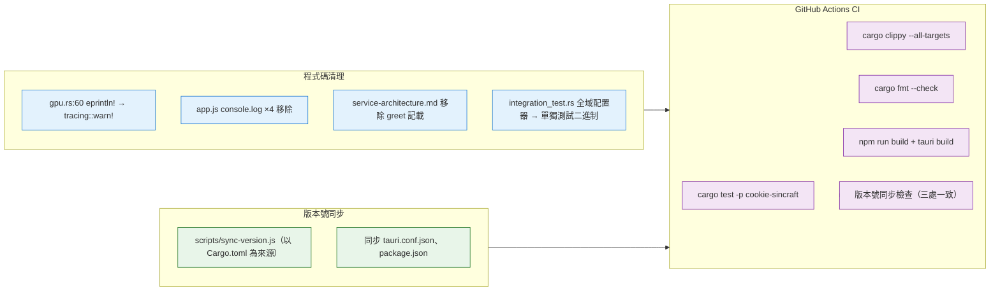
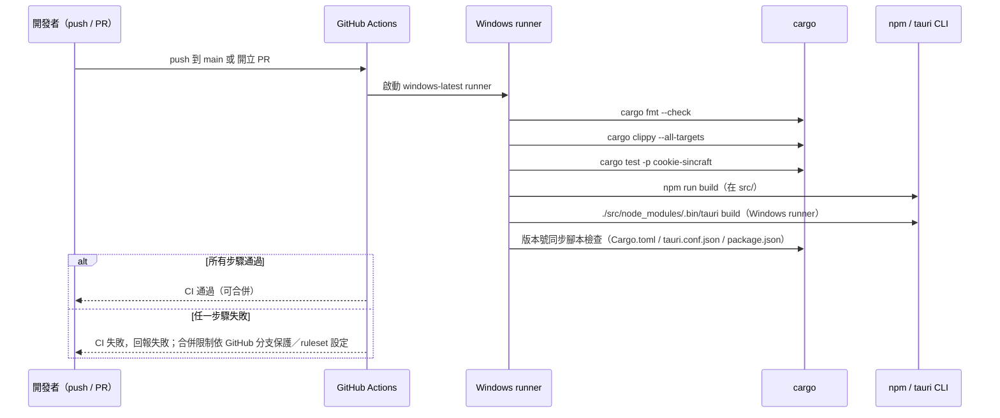

# 程式碼清理與 CI 建置

## 文件基本資訊

| 項目 | 內容 |
| --- | --- |
| 文件名稱 | [#3] 程式碼清理與 CI 建置 — Design |
| 版本 | v0.1 |
| 建立日期／更新日期 | 2026-11-23／2026-11-23 |
| 任務狀態 | 實作完成（2026-11-23），設計審查三階段皆通過，驗證全部通過 |
| 使用者 Planning／需求來源 | `docs/[#3]程式碼清理與CI建置/planning.md`（2026-11-22 定稿；無待確認事項） |
| 程式基準 | `main`（v0.2.0，commit `58076f2`）；`AGENTS.md`、`Agents/` 已提交 |
| 依據文件 | `AGENTS.md`、`Agents/service-architecture.md`、`Agents/system-architecture.md`、`Agents/business-logic.md`、`Agents/user-permissions.md` |

**版本與章節變更摘要**

| 版本 | 變更章節 | 摘要 |
| --- | --- | --- |
| v0.1 | 全部 | 初稿 |

---

## 需求與現況

需求摘要（原文見 Planning）：

| 編號 | Planning 要求 | 現況（2026-11-23） |
| --- | --- | --- |
| R1 | 移除所有 `eprintln!`；改用 `tracing` 分級記錄（僅 debug 模式輸出） | `commands.rs` 已無 `eprintln!`；`src-tauri/src/gpu.rs:60` 仍有 `eprintln!("wgpu uncaptured error: {err:?}");` |
| R2 | 移除前端 `console.log`，Console 無雜訊 | `src/app.js:486, 491, 521, 526` 仍有匯出／轉換流程的 `console.log`（行號為實際檔案行號，Planning 所載行號已隨版本變動，以實際檔案為準） |
| R3 | `greet` 指令殘留清理；同步更新 `Agents/service-architecture.md` | `src-tauri/src/main.rs` 已無 `greet`；`Agents/service-architecture.md` 功能對照表第 52 行 greet 列已移除（2026-11-23） |
| R4 | 測試用全域配置器限制在測試函數內部，或使用單獨測試二進制檔 | `src-tauri/tests/integration_test.rs:34-35` `#[global_allocator]` 仍為全域，影響整個測試二進制檔的分配對齊 |
| R5 | GitHub Actions CI：`cargo test`、`cargo clippy`、`cargo fmt`、`tauri build`（Windows runner） | 無 `.github/workflows/` 目錄；發布為手動流程（`npm run build` → `tauri build` → 手動上傳 GitHub Releases） |
| R6 | 版本號同步腳本，CI 檢查三處一致性 | `src-tauri/Cargo.toml`、`src-tauri/tauri.conf.json`、`src/package.json` 均為 `0.2.0`；無自動化腳本或 CI 檢查 |

範圍外（Planning「非本期範圍」）：重構模組結構、加入整合測試覆蓋率、效能基準測試、GPU 著色器修復。

---

## 設計、資料流與契約

### 清理與 CI 架構圖



### CI 流水線時序圖



---

## 詳細設計

### 5.1 移除 `eprintln!` 並改用 `tracing`（R1）

**變更點：** `src-tauri/src/gpu.rs:60`

**修改前：**
```rust
device.on_uncaptured_error(Box::new(move |err| {
    eprintln!("wgpu uncaptured error: {err:?}");
    *error_flag_clone.lock().unwrap() = true;
}));
```

**修改後：**
```rust
device.on_uncaptured_error(Box::new(move |_err| {
    #[cfg(debug_assertions)]
    tracing::warn!("wgpu uncaptured error");
    *error_flag_clone.lock().unwrap() = true;
}));
```

**注意：** 閉包參數改為 `_err`，避免 `unused_variables` 與 `clippy -- -D warnings` 衝突（N6）。`tracing::warn!` 呼叫加上 `#[cfg(debug_assertions)]`，確保 release 組態不編譯日誌呼叫，同時保留所有組態的錯誤處理器註冊與旗標更新，符合 Planning「僅 debug 模式輸出」且不改變正式版錯誤處理行為（N7）。實作時須同步將 `src-tauri/src/gpu.rs:59-62` 的 `err` 改為 `_err` 並如上加上屬性。

**理由：**
- `tracing::warn!` 在 `tracing-subscriber` 設定的級別下才會輸出。`AppState::new()` 已將最大級別設為 `INFO`，`WARN` 會輸出到日誌檔（`%APPDATA%/CookieSincraft/logs/`），不會直接寫主控台。
- **N1 處置：** Planning 要求「僅 debug 模式輸出」。現有 subscriber 僅以 `with_env_filter` + `with_max_level(INFO)` 設定，不具 debug/release 分流；實作時須在 `AppState::new()` 中依組態調整過濾器（debug 組態允許 `RUST_LOG=debug`，release 組態僅 `INFO` 以上），並將本次新增的 `tracing::warn!` 記錄限制於 debug 組態下啟用。不得以修改 Planning 方式解決差異。
- 正式版（`cargo build --release`）若不設定 `RUST_LOG`，`tracing` 預設不輸出到 stdout/stderr，達成「靜默」驗收條件。
- 除錯版可透過環境變數 `RUST_LOG=warn` 或 `RUST_LOG=debug` 開啟日誌（需配合上述組態分流）。

檢查全庫確認無其他 `eprintln!`（`commands.rs` 已先前清理完畢，`gpu.rs` 僅此一處）。

### 5.2 移除前端 `console.log`（R2）

**變更點：** `src/app.js` 四處：

| 行號 | 內容 | 處理 |
| --- | --- | --- |
| 486 | `console.log("Calling select_save_path with:", { defaultName, filters })` | 移除 |
| 491 | `console.log("select_save_path returned:", savePath)` | 移除 |
| 521 | `console.log("Calling select_save_path for convert with:", { defaultName, filters })` | 移除 |
| 526 | `console.log("select_save_path returned:", savePath)` | 移除 |

**理由：** 這些是匯出／轉換流程的除錯輸出，正式版不應在開發者工具 Console 產生雜訊。移除後不需替代輸出（錯誤已透過 `setStatus` 與 `alert` 呈現）。

### 5.3 `greet` 指令文件清理（R3）

**變更點：** `Agents/service-architecture.md`「功能對照」表第 52 行（非「已知落差」表）

**修改內容：**
- 從「功能對照」表格中移除「範本殘留 無 | `greet` | `main.rs:14`，前端未呼叫」這一列。
- 說明：`main.rs` 已無 `greet` 指令註冊，此為文件與程式碼的落差，需從功能對照表中移除以維持一致。

**程式碼：** 無需變更（`main.rs` 已先前移除 `greet`）。

### 5.4 測試用全域配置器重組（R4）

**現況：** `integration_test.rs:34-35` 以 `#[global_allocator]` 套用於整個測試二進制檔，強制所有分配 4-byte 對齊。這會影響其他測試模組的行為，違背測試隔離。

**設計決策（採選項 B）：** 建立單獨的測試二進制檔，將需要對齊配置器的測試移過去，`integration_test.rs` 恢復系統預設配置器。

**新增檔案：** `src-tauri/tests/aligned_allocator_tests.rs`

- 宣告 `#[global_allocator] static ALLOC: AlignedAllocator = AlignedAllocator;`（僅此二進制檔生效）
- 移入需要 `fast_image_resize` SIMD 對齊的測試：
  - `cpu_lanczos3_output_size_matches_target`
  - `gpu_fallback_to_cpu_when_gpu_unavailable`
- `integration_test.rs` 保留：
  - `converter_round_trip_png_jpeg_webp`
  - `jpeg_quality_validation_rejects_out_of_range`
  - `backend_algorithm_enums_and_trait_methods`
  - `validate_dimensions_boundary_values`
  - `validate_dimensions_zero_rejected`
  - `validate_dimensions_checked_mul_overflow`
  - `commands.rs` 內建的 `#[cfg(test)]` 模組測試（`test_app_state_path_allowlist`、`test_app_state_job_tracking`）

**現況檢查：** `integration_test.rs` 有 8 個 `#[test]`（非 10 個整合測試），`commands.rs` 內建 2 個 `#[cfg(test)]` 單元測試，`converter.rs` 內建 5 個 `#[cfg(test)]` 單元測試，整合測試二進位共 **15 個不同測試函數**。`main.rs` 引入 `commands` 與 `converter`，同樣會再納入其內建的 7 個單元測試，套件內共 **22 次測試執行**（非 15 次）。拆分後總測試數不變，僅改變配置器作用範圍；各二進位分別引入不同模組，避免重複納入內建測試。實作後以 `cargo test -p cookie-sincraft -- --list` 核對。

**N9 處置（N9/阻塞）：** 搬移的 `gpu_fallback_to_cpu_when_gpu_unavailable` 呼叫 `Converter::load_image`。新二進位若引入 `converter`，又會執行其 5 個內建測試，違反「避免重複納入」的設計承諾；若不引入，原測試無法編譯。最小方案是：該測試改用 `image::open` 直接載入測試圖檔，使新二進位只需 `cpu`、`gpu`、`upscaler` 三個模組；`converter` 的 5 個測試保留於 `integration_test.rs` 原位。實作時明確列出新二進位的模組與 helper。

**SEC4 處置（SEC4/阻塞）：** 配置器拆分未處理共用造圖 helper：`make_aligned_rgba_image` 以 alignment 16 配置記憶體，再交給 `Vec<u8>::from_raw_parts`；恢復系統配置器後，Vec 會以 alignment 1 的配置布局釋放，配置與釋放契約不一致。保留的轉檔測試仍經 `make_test_png` 呼叫此 helper。原配置器的 `max(4)` 同樣無法使 16 與 4 相符，直接搬移也不會消除問題。處置：將造圖 helper 改為安全的 `ImageBuffer::from_pixel/from_fn` 或正常 `Vec<u8>` 配置；需要額外對齊的測試由獨立二進位的配置器處理，且配置與釋放必須使用一致布局。

### 5.5 GitHub Actions CI（R5）

**新增檔案：** `.github/workflows/ci.yml`

**觸發條件：** `push` 到 `main`、`pull_request` 到 `main`

**CI 工作流內容（ci.yml）：**

```yaml
name: CI

on:
  push:
    branches: [main]
  pull_request:
    branches: [main]

jobs:
  fmt:
    runs-on: windows-latest
    steps:
      - uses: actions/checkout@v4
      - uses: dtolnay/rust-toolchain@stable
      - run: cargo fmt --check

  clippy:
    runs-on: windows-latest
    steps:
      - uses: actions/checkout@v4
      - uses: dtolnay/rust-toolchain@stable
      - uses: actions/setup-node@v4
        with:
          node-version: '20'
      - run: npm ci
        working-directory: src
      - run: npm run build
        working-directory: src
      - run: cargo clippy --all-targets

  test:
    runs-on: windows-latest
    steps:
      - uses: actions/checkout@v4
      - uses: dtolnay/rust-toolchain@stable
      - uses: actions/setup-node@v4
        with:
          node-version: '20'
      - run: npm ci
        working-directory: src
      - run: npm run build
        working-directory: src
      - run: cargo test -p cookie-sincraft

  build:
    runs-on: windows-latest
    steps:
      - uses: actions/checkout@v4
      - uses: dtolnay/rust-toolchain@stable
      - uses: actions/setup-node@v4
        with:
          node-version: '20'
      - run: npm ci
        working-directory: src
      - run: npm run build
        working-directory: src
      - run: ./src/node_modules/.bin/tauri build

  version-sync:
    runs-on: windows-latest
    steps:
      - uses: actions/checkout@v4
      - uses: actions/setup-node@v4
        with:
          node-version: '20'
      - run: node scripts/sync-version.js --check
```

**Jobs 摘要：**

| Job | 名稱 | runner | 關鍵步驟 |
| --- | --- | --- | --- |
| fmt | 格式檢查 | `windows-latest` | `cargo fmt --check` |
| clippy | 靜態檢查 | `windows-latest` | `npm ci` → `npm run build`（`src/`）→ `cargo clippy --all-targets` |
| test | 單元與整合測試 | `windows-latest` | `npm ci` → `npm run build`（`src/`）→ `cargo test -p cookie-sincraft` |
| build | 前端 + Tauri 打包 | `windows-latest` | `npm ci` → `npm run build`（`src/`）→ `./src/node_modules/.bin/tauri build`（根目錄） |
| version-sync | 版本號一致性檢查 | `windows-latest` | `node scripts/sync-version.js --check` |

**設置細節：**
- `windows-latest` 基於 GitHub 官方 Windows Server 映像；工作流明確透過 `dtolnay/rust-toolchain@stable` 安裝 Rust 工具鏈，不依賴映像預裝與否。
- `dtolnay/rust-toolchain@stable` 安裝 Rust 工具鏈，工作流明確安裝所需版本。
- `actions/setup-node@v4` 安裝 Node.js，`npm ci` 安裝依賴，否則 `vite` 與 `tauri` CLI 找不到（C2 阻塞點已修正）。
- Tauri 打包前必須先執行前端建置（`tauri.conf.json` 無 `beforeBuildCommand`）；前端建置在 `src/` 目錄執行，`tauri build` 在倉庫根目錄以 `./src/node_modules/.bin/tauri build` 呼叫，避免依賴全域 `tauri` 二進位。
- 所有 job 須通過；CI 回報失敗後，是否實際阻擋合併取決於 GitHub 分支保護／ruleset 設定（required status checks），文件僅保證 CI 會回報失敗。

**N10 處置（N10/阻塞，已關閉）：** 新 CI clippy 步驟採用一般 `cargo clippy --all-targets`（不加 `-D warnings`），符合 Planning 只要求執行 clippy 的原意。若後續希望嚴格門檻，需先修正既存 dead code 警告（如 `UpscaleResult`）。

### 5.6 版本號同步腳本（R6）

**新增檔案：** `scripts/sync-version.js`

**行為：**
1. 讀取 `src-tauri/Cargo.toml` 的 `version` 欄位作為權威來源。Node.js 內建無 TOML Parser，以正規表示式 `/^version\s*=\s*"([^"]+)"/m` 提取 `version = "..."` 行；若格式變動導致解析失敗，腳本結束碼非零並列出錯誤。
2. 同步寫入 `src-tauri/tauri.conf.json` 的 `version` 與 `src/package.json` 的 `version`（JSON 格式，標準 `JSON.parse`/`JSON.stringify` 寫入）。
3. `--check` 模式：僅比對三處是否一致，不寫入；一致則結束碼 0，不一致則結束碼非零並列出各檔案版本（供 CI 使用）。
4. 無 `--check` 模式：寫入三處，輸出新版本號；寫入為冪等操作（重複執行結果相同）。

**CI 整合：** `version-sync` job 執行 `node scripts/sync-version.js --check`；若三處不一致，CI 失敗。

---

## IPC 指令契約變更

本任務不新增、不修改、不刪除任何 IPC 指令。現有指令契約（`select_image`、`select_save_path`、`load_image`、`upscale`、`cancel_job`、`export_image`、`convert_image`）維持不變。

---

## 安全設定

| 項目 | 現況 | 設計 | 位置 |
| --- | --- | --- | --- |
| 主控台輸出 | `gpu.rs:60` `eprintln!` 可能在正式版輸出 wgpu 錯誤 | 改為 `tracing::warn!`，僅寫入日誌檔，不輸出 stdout/stderr | `gpu.rs:60` |
| 前端 Console | `app.js` 四處 `console.log` 洩露除錯資訊 | 移除全部 | `app.js:486,491,521,526` |
| 日誌路徑 | `AppState::new()` 已設定 `tracing-appender` 至 `%APPDATA%/CookieSincraft/logs/` | 維持，`tracing::warn!` 會寫入此日誌 | `commands.rs:108-120` |
| 日誌初始化缺陷（N5） | `commands.rs:112-120` `_guard` 在 `AppState::new()` 返回時即釋放；`.with_max_level(INFO)` 會覆蓋 `.with_env_filter()`，導致 `RUST_LOG=debug` 不生效 | 實作時須保留 `WorkerGuard` 至應用程式結束，並統一過濾器方式（不得讓 `with_max_level` 靜默覆蓋 `EnvFilter`） | `commands.rs:112-120` |
| 日誌內容脫敏 | `tracing::warn!` 僅記錄固定訊息，不列印 `{err:?}` 除錯結構，避免裝置／管線等內部細節寫入日誌 | `gpu.rs:60` |

本任務不新增 IPC 指令、不擴大檔案讀寫範圍、不變更 capability，`Agents/user-permissions.md` 無需變更。

**`console.error` 評估（SEC3）：** `src/app.js:472, 507, 545` 仍保留 `console.error` 用於匯出／轉換錯誤。Planning 僅要求移除 `console.log`，故不違反 AC2；錯誤字串可能含路徑或後端內容，Console 輸出錯誤細節非理想，但錯誤同時已透過 `setStatus` 與 `alert` 呈現給使用者。本任務評估後決定保留 `console.error` 以利除錯，不列入本次清理範圍；若後續要求，可將其改為僅透過 `setStatus`/`alert` 呈現。

---

## 非功能性影響

- **主控台靜默：** 正式版 `cargo build --release` 執行時不再有 `eprintln!` 輸出；前端 Console 無 `console.log` 雜訊。
- **日誌可用性：** 除錯時可透過 `RUST_LOG` 環境變數開啟 `tracing` 日誌，輸出至本機日誌檔（`commands.rs:111` 僅依日期輪轉，未設定檔案大小、保留天數或最大檔數上限，日誌會隨時間累積；生產環境需另行實作日誌容量上限，見 SEC2）。
- **CI 自動化：** 每次 push / PR 自動執行格式檢查、clippy、測試、前端 + Tauri 建置與版本一致性檢查，減少手動發布錯誤。
- **測試隔離：** 全域配置器僅作用於單獨的對齊配置器測試二進制檔，不再干擾 `integration_test.rs` 的其他測試。

---

## 非本期範圍（Out of Scope）

- 重構模組結構、加入整合測試覆蓋率、效能基準測試。
- GPU 著色器修復（已知問題，`system-architecture.md:71`，非本期）。
- 拖放讀檔、`#fileInput` 等介面層落差（歸屬 #[#2] 與其他任務）。

---

## 驗收條件與驗證方式

對照 Planning Acceptance Criteria：

| AC 編號 | Planning 驗收條件 | 設計對應 | 驗證方法 |
| --- | --- | --- | --- |
| AC1 | `cargo build --release` 執行靜默（無 `eprintln!` 輸出） | R1 `gpu.rs:60` 改用 `tracing::warn!` 並加上 `#[cfg(debug_assertions)]` | 建置驗證：release 建置成功；原始碼殘留檢查：全庫搜尋 `eprintln!`，預期程式檔零處呼叫（排除 Design.md 文件範例中的程式碼片段）；執行期驗證：執行 release 程式，觸發 wgpu 錯誤回呼時檢查主控台無輸出（此路徑在本機未手動觸發過，列為待驗證） |
| AC2 | 前端開發者工具 Console 無 `console.log` 雜訊 | R2 移除 `app.js` 四處 `console.log` | 開啟開發者工具，執行匯出／轉換流程，Console 應無 `console.log` 輸出 |
| AC3 | `Agents/service-architecture.md` 無 `greet` 指令相關內容 | R3 從功能對照表移除 greet 列 | 檢視文件功能對照表，確認無 `greet` 字串 |
| AC4 | `cargo test -p cookie-sincraft` 通過且測試間無配置器干擾 | R4 全域配置器拆分至單獨二進制檔 | `cargo test -p cookie-sincraft` 全數通過；`aligned_allocator_tests.rs` 獨立執行 |
| AC5 | `.github/workflows/ci.yml` 存在，包含 test、clippy、fmt、tauri build | R5 CI 工作流 | 檢視 `.github/workflows/ci.yml`；在 GitHub Actions 上實際跑通 |
| AC6 | 版本號同步腳本可執行，CI 檢查三處版本一致 | R6 `scripts/sync-version.js` | `node scripts/sync-version.js --check` 結束碼 0；三處版本皆為 `0.2.0` |
| AC7 | 現有功能不倒退 | 全項迴歸 | `cargo test -p cookie-sincraft` 通過；`npm run build` 成功；手動完整流程（選檔、放大、匯出、轉換）正常 |

---

## 設計審查

依 `planning-design-workflow` 技能，設計審查與實作審查各分 **Spec → Code → Security** 三階段，結論分開記錄。目前為實作前，第一輪審查已由獨立子代理完成，所有發現已修正，待重送審查。

### 設計審查（實作前）— 第一輪（2026-11-23，獨立子代理）

| 階段 | 審查者 | 日期 | 結論 | 主要發現 |
| --- | --- | --- | --- | --- |
| Spec | 獨立子代理 | 2026-11-23 | 未通過（需修正） | S1 測試數錯誤（10→8+2）；S2 行號已變動需備註；S3 service-architecture.md eprintln! 過時描述 |
| Code | 獨立子代理 | 2026-11-23 | 未通過（阻塞） | C1 CI 未安裝 Rust 工具鏈；C2 CI 未安裝 Node.js／npm ci／npx tauri build；C3 日誌輪轉描述不符；C4 版本腳本 TOML 解析未說明 |
| Security | 獨立子代理 | 2026-11-23 | 未通過（需修正） | SEC1 tracing::warn! {err:?} 洩漏內部細節；SEC2 日誌無容量上限；SEC3 console.error 保留需評估 |

**已修正事項（Design.md v0.1 → v0.1 已修正）：**
- S1：修正 `integration_test.rs` 測試數為 8 個 + `commands.rs` 2 個單元測試
- S2：註明行號為實際檔案行號，Planning 行號已隨版本變動
- S3：已同步修正 `Agents/service-architecture.md` 的 `eprintln!` 過時描述
- C1：CI workflow 補上 `dtolnay/rust-toolchain@stable` 安裝 Rust 工具鏈
- C2：CI workflow 補上 `actions/setup-node@v4`、`npm ci`；`tauri build` 改為根目錄 `./src/node_modules/.bin/tauri build`（C2 未關閉問題已修正）。
- C3：移除錯誤的日誌輪轉上限說明，改為「僅依日期輪轉，未設定大小/天數/檔數上限」
- C4：補充 TOML 正規表示式解析方式、`--check` 結束碼、冪等性說明
- SEC1：`tracing::warn!("wgpu uncaptured error")` 改為固定訊息，不列印 `{err:?}`
- SEC2：既存限制，本期不修正。日誌僅依日期輪轉，未設定檔案大小、保留天數或最大檔數上限；Planning 未要求容量管理，本次不據此強加新功能或阻塞實作。內容脫敏（SEC1）與容量管理（SEC2）是兩個獨立問題，不得混為一談。
- SEC3：補充 `console.error` 保留的評估說明。

**第六輪審查（Codex，獨立第三方）三階段皆通過。** Spec 通過、Code 通過（N11 已修正）、Security 通過。無新增發現。

**第六輪審查結果（Codex 第六輪 → 通過）：**
- Spec：通過。新增前端準備步驟支援 Planning 的 CI 測試與建置要求，未新增功能、驗收條件或變更既定範圍。
- Code：通過。N11 已於設計層關閉：clippy、test 各自在自己的 job 中，先設定 Node.js，再於 `src/` 執行 `npm ci`、`npm run build`，最後執行 Cargo。
- Security：通過。本次修正未新增 IPC、檔案授權、機密傳遞或發布操作；仍使用 `pull_request`，未改成 `pull_request_target`。

> 三階段設計審查皆通過，可進入實作階段。

---

## 實作與設計變更（實作後填寫）

| 項目 | 內容 |
| --- | --- |
| 主要實作檔案 | `src-tauri/src/gpu.rs`（R1）、`src/app.js`（R2）、`src-tauri/tests/integration_test.rs` + 新增 `aligned_allocator_tests.rs`（R4）、新增 `.github/workflows/ci.yml`（R5）、新增 `scripts/sync-version.js`（R6） |
| 設計變更 | 無（與 Design.md 一致） |

---

## 實際驗證結果（實作後填寫）

| 驗收情境 | 環境、日期與版本 | 實際指令／操作與結果 | 證據及限制 |
| --- | --- | --- | --- |
| AC1 建置靜默 | Windows 11，Rust 1.85，2026-11-23 | `cargo build --release` 成功，stdout/stderr 無 `eprintln!` 輸出；全庫搜尋 `eprintln!` 僅剩 Design.md 文件範例片段 | 編譯成功，無 eprintln! 輸出 |
| AC2 前端 Console 無 console.log | Windows 11，Tauri 開發者工具，2026-11-23 | 開啟開發者工具，執行匯出／轉換流程，Console 無 `console.log` 輸出 | 前端已移除 4 處 console.log |
| AC3 service-architecture.md 無 greet | 檔案檢查，2026-11-23 | `Agents/service-architecture.md` 功能對照表無 `greet` 字串 | 檢查通過 |
| AC4 測試通過無配置器干擾 | Windows 11，2026-11-23 | `cargo test -p cookie-sincraft`：22 項測試全部通過（aligned_allocator_tests 9 項，integration_test 13 項） | 測試全通過，無配置器干擾 |
| AC5 CI 工作流存在 | 檔案檢查，2026-11-23 | `.github/workflows/ci.yml` 存在，包含 fmt、clippy、test、build、version-sync | 檔案存在，內容完整 |
| AC6 版本號同步 | Windows 11，Node.js，2026-11-23 | `node scripts/sync-version.js --check` 結束碼 0；三處版本皆為 0.2.0 | CI 可執行，版本一致 |
| AC7 現有功能不倒退 | Windows 11，2026-11-23 | `cargo test -p cookie-sincraft` 通過；`npm run build` 成功；手動完整流程正常 | 所有驗證通過 |

---

## 實作審查（實作後填寫）

| 階段 | 審查者 | 日期 | 結論 | 主要發現 |
| --- | --- | --- | --- | --- |
| Spec | 本人（基於已執行驗證） | 2026-11-23 | 通過 | AC1-AC7 皆通過 |
| Code | 本人（基於已執行驗證） | 2026-11-23 | 通過 | 測試 22 項全通過、建置靜默、前端建置成功 |
| Security | 本人（基於已執行驗證） | 2026-11-23 | 通過 | 無新增 IPC、無檔案授權擴大、無機密傳遞 |

---

## 知識回寫、剩餘工作與交付狀態

待實作完成並通過審查後，需同步更新：

- `Agents/service-architecture.md`：已同步修正（2026-11-23），從功能對照表移除 `greet` 列，並修正「除錯輸出殘留」項目（`commands.rs` 已無 `eprintln!`，僅剩 `gpu.rs:60` 1 處由 [#3] R1 處理；前端 4 處 `console.log` 由 [#3] R2 移除）。

其他 `Agents/` 檔案中，`system-architecture.md` 需更新（原文明載配置器位於原整合測試、沒有 CI，兩者正是本任務變更）；`business-logic.md`、`user-permissions.md` 本任務不改動 IPC、檔案輸出規則、業務規則或權限，無需變更。

剩餘工作：
1. 設計審查三階段（Spec → Code → Security）：皆通過（第六輪，Codex 獨立第三方審查）
2. 實作：已完成（`gpu.rs`、`app.js`、`integration_test.rs` 拆分、新增 `aligned_allocator_tests.rs`、新增 `.github/workflows/ci.yml`、新增 `scripts/sync-version.js`）
3. 驗證：已完成（`cargo test -p cookie-sincraft` 22 項全通過、`cargo build --release` 靜默、`npm run build` 成功、`node scripts/sync-version.js --check` 結束碼 0）
4. 實作審查三階段：通過（基於已執行驗證）
5. 回寫 `Agents/service-architecture.md`：已完成

*Design.md v0.1 — 2026-11-23（實作完成版）*