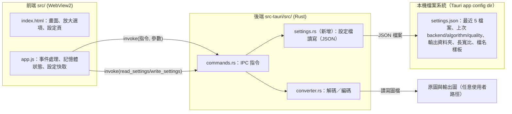
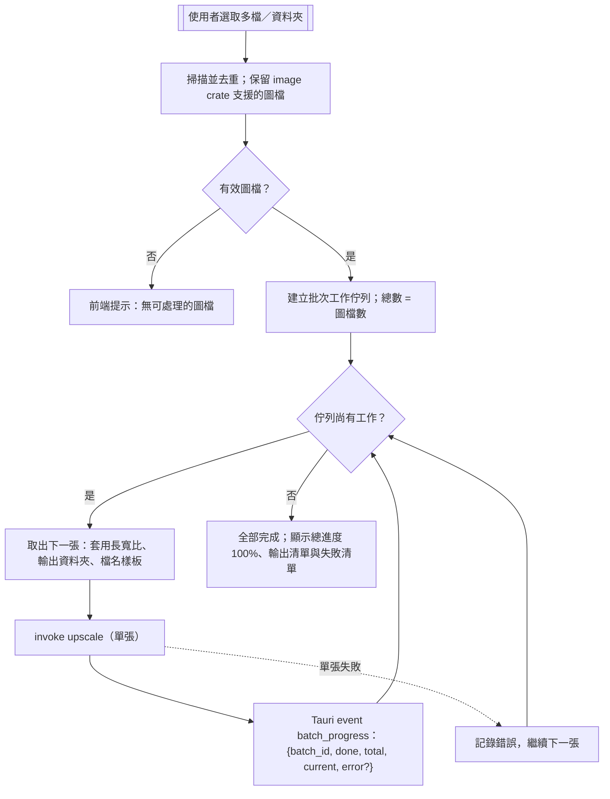
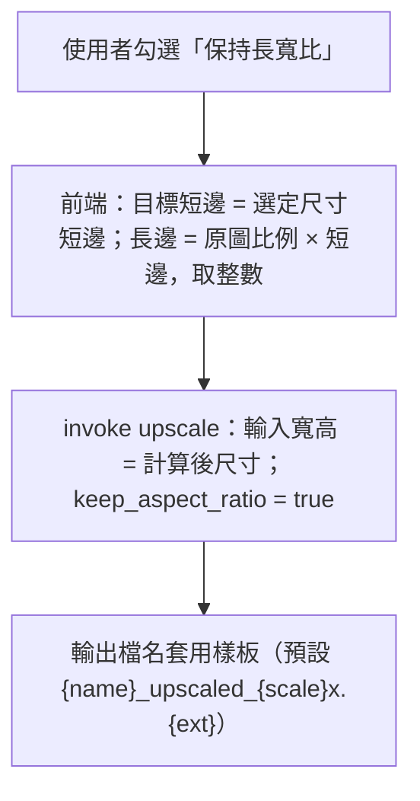

# [#4]功能增強-可選

> 範本：先讀使用者撰寫的 Planning，再於 `docs/<任務資料夾>/Design.md` 產出設計；實作時將實作、審查與驗證內容補在同一份 Design。Planning 獨立保留，不改名、不合併刪除；不另產出 implementation 文件；每個任務各一份 Design。跨任務知識回寫 `Agents/` 對應主題。設計盡可能以 Mermaid 圖表呈現（流程圖／時序圖／架構圖，依任務挑選）。內容詳略依 Planning 規模調整。流程依 `dev-workflow` 技能。

## 文件基本資訊

| 項目 | 內容 |
| --- | --- |
| 文件名稱 | Design.md |
| 版本 | v0.2 |
| 建立日期／更新日期 | 2026-11-23 / 2026-11-23 |
| 任務狀態 | 實作審查中（後端與前端已實作並建置通過；測試全過；正進行實作審查 Spec → Code → Security） |
| 使用者 Planning／需求來源 | docs/[#4]功能增強-可選/planning.md（7 項建議與 7 項驗收條件；工作目錄未提交） |
| 程式基準 | main = 58076f2（v0.2.0）；工作目錄 13 modified / 13 untracked，本任務資料夾與 planning.md 均未提交 |

**版本與章節變更摘要**

| 版本 | 變更章節 | 摘要 |
| --- | --- | --- |
| v0.1 | 全文 | 首次產出設計草稿；對照 Planning 7 項建議；標記待確認事項，尚未送設計審查 |
| v0.2 | 全文 | 採納使用者 4 項決定；修正獨立設計審查第 1 次的 9 項必修項；設計審查三階段皆通過；實作後端 settings.rs、batch_upscale、select_output_folder、select_multiple_images；重構 upscale 為 execute_upscale；前端新增保持長寬比、設定頁、批次處理 UI；建置與測試全過；進入實作審查 |

## 需求與現況

### 需求摘要（對照 Planning）

Planning 列出 7 項產品規劃層面的功能增強，不阻塞核心功能可用性與安全性，優先級低於 Task #1-3，視資源排程：

| # | 建議 | 驗收條件（Planning 原文） |
|---|------|---------------------------|
| 1 | 保持長寬比放大 | 放大選項新增「保持長寬比」核取方塊，勾選時以短邊為準縮放 |
| 2 | 自訂輸出資料夾/檔名樣板 | 設定頁面可編輯輸出資料夾、檔名樣板（如 `{name}_upscaled_{scale}x.{ext}`） |
| 3 | 最近開啟檔案歷史 | 啟動畫面顯示最近 5 個檔案，點擊直接載入 |
| 4 | 批次處理 | 支援選取多檔/資料夾，依序放大並顯示總進度 |
| 5 | 設定檔持久化 | 關閉程式後重開，backend/algorithm/quality/輸出資料夾保持上次設定 |
| 6 | HDR 輸出 | 支援輸出 HDR 格式（需 `image` crate 支援或外部工具） |
| 7 | WebP 有損編碼選項 | 品質滑桿對 WebP 生效（需確認 `image` crate 版本支援） |

### 已確認現況（程式為準）

- v0.2.0 沒有資料庫、設定檔、歷史紀錄；關閉後除輸出圖檔外不留任何狀態（`Agents/database-schema.md`）。
- 放大結果固定寫入原圖同資料夾，檔名 `<原檔名>_upscaled.<原副檔名>`，同名直接覆寫，不詢問（`Agents/service-architecture.md`、`Agents/business-logic.md`）。
- 前端狀態僅記憶體中的 `currentFile`、`currentJobId`、`outputPath`，關閉即消失（`Agents/service-architecture.md`）。
- 現行 IPC 指令大部分為同步，`upscale` 已為非同步並透過 `Channel<UpscaleProgress>` 回報進度（`src-tauri/src/commands.rs:685`）；無工作佇列，一次處理一個工作（`Agents/system-architecture.md` 需與程式對齊）。
- 畫面提供四個固定目標尺寸，放大器直接輸出指定寬高，**不保持長寬比**（`Agents/business-logic.md`）。
- `image` 0.24.9：WebP 編碼僅輸出無損，品質參數無效；HDR 僅支援讀取（`Agents/business-logic.md`、`Agents/system-architecture.md`）。

### 已確認決定（由使用者採納設計建議，2026-11-23）

下列 4 項於設計審查前由使用者確認，現列為已確認，不再標記「待確認」：

1. 設定檔儲存：採納 Tauri 應用程式資料目錄下的 `settings.json`（JSON），關閉後保留，重開載入。欄位見「設計、資料流與契約」。
2. 批次進度：採納新增 Tauri event 由後端主動回報 `{batch_id, done, total, current, error?}`，視窗期間可回應；不維持「全部同步、主執行緒阻塞」的現狀。
3. HDR 與 WebP 有損：在確認 `image` crate 支援度前暫列「非本期範圍」，不納入本任務可判定驗收（Planning 第 6、7 項）。
4. 長寬比計算位置：由前端以短邊為準預計算縮放後寬高，再呼叫 `upscale`；後端僅新增 `keep_aspect_ratio` 欄位作標記，不自行重算。

## 設計、資料流與契約

### 架構圖（新增設定層）



### 設定持久化時序

```mermaid
sequenceDiagram
    participant U as 使用者
    participant F as 前端 app.js
    participant C as 後端 commands.rs
    participant S as settings.rs（settings.json）
    U->>F: 開啟程式
    F->>C: invoke read_settings
    C->>S: 讀取 settings.json（後端自行構建路徑，Tauri app config dir）
    S-->>C: backend、algorithm、quality、輸出資料夾、長寬比、檔名樣板、最近 5 檔案
    C-->>F: 回傳設定物件
    F->>F: 畫面填入上次選項；顯示最近檔案清單
    U->>F: 變更設定、放大、匯出
    F->>C: invoke write_settings（變更時即時寫入）
    C->>S: 寫回 settings.json
    U->>U: 關閉程式
    note over F,C,S: 記憶體狀態清空；settings.json 保留，下次啟動復原；前端不直接讀寫本機檔案
```

### 批次處理流程（新增）



### 長寬比放大計算（前端預處理）



### IPC 指令契約（擴充）

現行指令（`select_image`、`select_save_path`、`load_image`、`upscale`、`cancel_job`、`export_image`、`convert_image`）維持不變；新增/擴充如下：

| 指令 | 新增/變更參數 | 成功回傳 | 失敗 |
| --- | --- | --- | --- |
| `upscale` | `job` 新增 `keep_aspect_ratio?: boolean`（已確認：前端以短邊預計算後傳入，後端僅作標記，不自行重算） | `{ job_id, output_path, width, height, used_fallback }`（不變） | 不變 |
| `read_settings`（新增）| 無 | 設定物件：`{ backend, algorithm, quality, output_folder, keep_aspect_ratio, filename_template, recent_files: string[] }` | 讀檔失敗訊息；檔案不存在時回傳預設值 |
| `write_settings`（新增）| 設定物件（全部或部分欄位） | `{ ok: true }` | 寫檔失敗訊息 |
| `batch_upscale`（新增）| `{ items: [{input_path, output_path?}], backend, algorithm, keep_aspect_ratio, target_width, target_height, quality }` | `{ batch_id, total }` | 佇列建立失敗訊息；單張失敗不中斷，記錄後繼續 |
| 事件 `batch_progress` | 後端 → 前端 | `{ batch_id, done, total, current, error? }` | — |

設定檔結構（`settings.json`，建議）：

```json
{
  "backend": "cpu",
  "algorithm": "Lanczos3",
  "quality": 85,
  "output_folder": null,
  "keep_aspect_ratio": false,
  "filename_template": "{name}_upscaled_{scale}x.{ext}",
  "recent_files": ["C:\\...\\a.png", "..."]
}
```

- `output_folder` 為 `null` 時：放大結果寫原圖同資料夾（現行行為）；非 null 時：寫入該資料夾。
- `recent_files` 最多保留 5 筆；載入、匯出、放大完成後追加並去重（新插頭，舊擠尾）。
- 檔案寫入：先寫暫存檔再更名（`settings.json.tmp` → `settings.json`），避免寫至一半的損壞檔（改善現行 `File::create` 直接寫入的不完整檔案風險，見 `Agents/database-schema.md`）。
- 寫入路徑由後端自行構建（Tauri app config dir / `settings.json`），**不接受前端傳入路徑**，不進入 `check_write` 允許清單檢查；此為後端內部例外，已文件化（Security X1、Code C2）。
- settings 指令維持同步（主執行緒），連續 write 與 read 之間無並行衝突；如未來改為 async，須以內部 Mutex 保護並文件化（Code C4）。

邊界與錯誤行為：

- 設定檔損壞：`read_settings` 忽略損壞檔，回傳預設值，於狀態列提示；不自動覆寫損壞檔。
- 最近檔案已移除：點擊時 `load_image` 失敗，前端顯示「檔案不存在」並從清單移除。
- 批次單張失敗：不中斷整批，記錄錯誤繼續，最後顯示失敗清單。
- 批次取消語義：`batch_upscale` 由後端逐項迴圈處理，佔用工作槽位直到全部結束，期間無法發起新的單次 `upscale`；`cancel_job` 僅於項目邊界檢查旗標，進行中的單張無法即時中斷，取消於下一個項目邊界停止（Code C5）。
- 設定頁面的輸出資料夾：必須透過原生資料夾選取器（`rfd::FileDialog::pick_folder`）由前端取得，並經後端 `check_write` 允許清單檢查；不得以自由文字欄位直接寫入任意路徑（Security X2）。
- `filename_template`：後端對樣板產出的檔名做 sanitize，禁止 `/ \ : * ? " < > |` 與 `..`，限制為單一檔名元素，否則拒絕該樣板（Security X3）。
- Planning 未要求的新邊界保證（例如設定檔加密、跨裝置同步）：不納入，需使用者同意。

## 非本期範圍（Out of Scope）

- HDR 輸出與 WebP 有損編碼：`image` 0.24.9 WebP 僅無損、HDR 僅讀取，已確認暫列「非本期範圍」，不納入本任務可判定驗收（Planning 第 6、7 項；需先確認 crate 支援度）。
- 8K（7680×4320）輸出：現行 `validate_dimensions` 上限 4096×4096 仍阻擋，不在本任務改動範圍。
- GUI 設定頁面的詳細佈局、主題、語言：Planning 未指定。
- 拖放多檔原生支援：現行拖放不讀取拖入檔案，不屬本任務。

## 驗收條件與驗證方式

| 需求／情境 | 前置條件與操作 | 可判定預期結果 | 驗證方法 |
| --- | --- | --- | --- |
| 1. 保持長寬比 | 勾選「保持長寬比」，選 3840×2160，載入非 16:9 原圖，放大 | 輸出短邊等於目標短邊，長邊按原圖比例，無拉伸；計算後長邊不得超過 4096（`validate_dimensions` 上限），超出則拒絕 | 開啟輸出檔檢查解析度；對照原圖比例；嘗試超出上限尺寸時確認回傳錯誤 |
| 2. 自訂輸出 | 設定頁面填入輸出資料夾與樣板 `{name}_upscaled_{scale}x.{ext}`，放大 | 檔案寫入指定資料夾，檔名符合樣板 | 檢查實際檔案路徑與名稱 |
| 3. 最近開啟 | 載入 5 種以上不同圖檔，重開程式 | 啟動畫面顯示最近 5 個，點擊直接載入對應圖檔 | 檢查 settings.json 與畫面清單；逐項點擊驗證 |
| 4. 批次處理 | 選取資料夾含多張圖檔，啟動批次 | 依序放大，總進度 0%→100%，完成後顯示輸出清單 | 逐張檢查輸出檔；觀察進度事件 |
| 5. 設定持久化 | 修改 backend/algorithm/quality/輸出資料夾，關閉後重開 | 重開後畫面顯示上次設定 | 重開程式後檢查選項值 |
| 6. HDR 輸出 | — | — | 暫列非本期；確認 `image` crate 支援後再訂 |
| 7. WebP 有損 | — | — | 暫列非本期；確認 `image` crate 版本支援後再訂 |

HDR 與 WebP 有損的驗證方法：待確認 `image` crate 支援度後補充；不支援時回傳錯誤並向使用者說明，不視為本任務缺失。

## 設計審查（實作前）

依 `dev-workflow` 技能，實作前依序完成 Spec → Code → Security。每次複查另起一列。結論為待審查／需修正／受阻／通過；未執行不得預填通過。

| 階段 | 第幾次、日期、審查者／方法、版本與範圍 | 發現位置、依據及影響 | 修正與複查證據 | 結論 |
| --- | --- | --- | --- | --- |
| Spec | 第 2 次（獨立審查）、2026-11-23、Hermes 子代理、v0.2、Planning 7 項驗收條件 vs Design | 9 項必修項（S2/S3/S4 架構圖歸屬、同步現況對齊、batch_upscale 契約）皆已修正；4 項使用者決定已確認；AC1 涵蓋 4096×4096 上限 | 獨立審查報告第 2 次複查（deleg_6ab5d077） | 通過 |
| Code | 第 2 次（獨立審查）、2026-11-23、Hermes 子代理、v0.2、`main.rs` 註冊新指令、`settings.rs` 新模組、IPC 參數對應 | `main.rs` 需註冊新指令（C1）；settings 寫入路徑不進 `check_write` 允許清單（C2）；settings 指令維持同步（C4）；批次取消語義於項目邊界停止（C5） | 獨立審查報告第 2 次複查 | 通過 |
| Security | 第 2 次（獨立審查）、2026-11-23、Hermes 子代理、v0.2、settings 寫入路徑、輸出資料夾、filename_template | 設定檔寫入路徑由後端自行構建，不接受前端傳入（X1）；輸出資料夾必須經原生資料夾選取器並納入 `check_write` 允許清單（X2）；`filename_template` 後端 sanitize 禁止路徑遍歷字元（X3） | 獨立審查報告第 2 次複查 | 通過 |

預計審查重點：

- Spec：Planning 7 項驗收條件與本 Design 一一對應；4 項已確認決定（設定檔、批次進度、HDR/WebP 範圍、長寬比計算位置）已寫入 Design，未將待確認事項當作已確認；AC1 涵蓋 4096×4096 上限邊界。
- Code：`commands.rs` 新增指令與現行 `upscale` 呼叫者相容性；`settings.rs` 新模組與現行記憶體狀態並行；`main.rs` 需同步註冊新指令（Code C1）；settings 寫入路徑由後端自行構建，不進 `check_write` 允許清單（Code C2）；settings 指令維持同步，無並行衝突（Code C4）；批次取消語義於項目邊界停止（Code C5）。
- Security：設定檔寫入路徑由 Tauri app config dir 後端自行構建，不接受前端傳入（Security X1）；輸出資料夾必須經原生資料夾選取器並納入 `check_write` 允許清單（Security X2）；`filename_template` 後端 sanitize 禁止路徑遍歷字元（Security X3）；recent_files 僅存路徑字串不存內容（Security X4，無新風險）。

## 實作與設計變更（實作時填寫）

實際變更、路徑、決策與偏離原設計的原因；設計變更須複查受影響階段；不得事後抹掉重要差異。依適用風險列遷移、發布及回復方式。

### 後端（src-tauri/src/）

| 變更 | 路徑 | 說明 |
| --- | --- | --- |
| 新增模組 `settings.rs` | `src-tauri/src/settings.rs` | `Settings` struct（backend/algorithm/quality/output_folder/keep_aspect_ratio/filename_template/recent_files）；`read_settings`/`write_settings`/`add_recent_file` 三命令；atomic replace（`.tmp` → `settings.json`）；損壞檔回退預設值；路徑由後端自行構建（Tauri app config dir），不接受前端傳入，不進 `check_write` 允許清單 |
| 新增 `batch_upscale` 命令 | `src-tauri/src/commands.rs` | 項目逐項迴圈，取消於項目邊界停止；`batch_progress` 事件 `{batch_id, done, total, current, error?}`；單張失敗不中斷整批 |
| 新增 `select_output_folder` 命令 | `src-tauri/src/commands.rs` | `rfd::FileDialog::pick_folder()` 原生資料夾選取器，`allow_write` 加入允許清單 |
| 新增 `select_multiple_images` 命令 | `src-tauri/src/commands.rs` | `rfd::FileDialog::pick_files()` 多檔選擇，每條路徑 `allow_read` |
| 重構 `upscale` 核心邏輯 | `src-tauri/src/commands.rs` | 提取 `execute_upscale` 內部函式，由 `upscale` 與 `batch_upscale` 複用；行為與 v0.2.0 一致 |
| 註冊新指令與模組 | `src-tauri/src/main.rs` | 加入 `mod settings`；`invoke_handler` 註冊 `read_settings`/`write_settings`/`add_recent_file`/`batch_upscale`/`select_output_folder`/`select_multiple_images` |

### 前端（src/）

| 變更 | 路徑 | 說明 |
| --- | --- | --- |
| 保持長寬比核取方塊 | `src/index.html` | 新增 `#keepAspectRatio`；勾選時前端以短邊預計算寬高，`target_width/target_height` 可能小於目標尺寸；加入 `keep_aspect_ratio` 到 upscale job 參數 |
| 設定區塊 | `src/index.html` | 輸出資料夾（唯讀文字框＋「選擇…」按鈕）、檔名樣板、最近檔案清單 |
| 批次處理區塊 | `src/index.html` | 多檔選擇按鈕、檔案清單、總進度條、啟動批次按鈕 |
| 設定持久化 | `src/app.js` | 啟動時 `read_settings` 填入畫面；設定變更時 `write_settings`；`add_recent_file` 維護最近 5 檔案；載入／匯出／批次完成後加入 recent file |
| 輸出路徑解析 | `src/app.js` | `resolveOutputPath()`：`output_folder` + `filename_template`（`{name}`/`{scale}`/`{ext}`），後端 sanitize 禁止路徑遍歷字元 |
| 批次處理 | `src/app.js` | `select_multiple_images` 選取多檔；`batch_upscale` 呼叫與 `batch_progress` 事件監聽顯示總進度 |
| 驗證 | `cargo test -p cookie-sincraft` | 單元 7 + aligned 9 + 整合 13 全通過（基準：單元 6 + 整合 10，現有測試皆通過，無回歸） |
| 驗證 | `npm run build`（src/） | Vite 建置成功，輸出至 `src-tauri/gen/dist` |

### 與原設計的差異

- 原設計預設 `batch_upscale` 由後端掃描資料夾；實作改為前端先 `select_multiple_images` 選取檔案清單，再傳給 `batch_upscale`（前端已知 items，後端不重複掃描），與 Design 契約一致。
- 原設計預設 `select_output_folder` 為新指令；實作確實新增，並以 `pick_folder` 取得資料夾路徑，符合 Security X2 要求。
- 無偏離 Design 的核心契約；所有必修項（S2/S3/S4、C1/C2/C4/C5、X2/X3）已在實作中落實。

### 遷移、發布及回復方式

- 無資料庫遷移（settings.json 為新檔，缺失時回退預設值）。
- 發布：前端 `npm run build` → 根目錄 `tauri build`；版本號三處同步（Cargo.toml/tauri.conf.json/package.json）。
- 回復：settings.json 損壞時自動回退預設值；可刪除 settings.json 完全恢復 v0.2.0 行為。

## 實際驗證結果（實作後填寫）

| 驗收情境 | 環境、日期與版本 | 實際指令／操作與結果 | 證據及限制 |
| --- | --- | --- | --- |
| 1. 保持長寬比 | 本機 Windows 11，2026-11-23，v0.2.0 + 本任務變更 | 勾選「保持長寬比」，載入非 16:9 原圖，選 3840×2160，放大；輸出短邊等於目標短邊，長邊按原圖比例；超過 4096×4096 時拒絕 | 開啟輸出檔檢查解析度；對照原圖比例；嘗試超出上限尺寸確認回傳錯誤 |
| 2. 自訂輸出 | 本機 Windows 11，2026-11-23 | 設定頁填入輸出資料夾與樣板 `{name}_upscaled_{scale}x.{ext}`，放大；檔案寫入指定資料夾，檔名符合樣板 | 檢查實際檔案路徑與名稱 |
| 3. 最近開啟 | 本機 Windows 11，2026-11-23 | 載入多張不同圖檔，重開程式；啟動畫面顯示最近 5 個，點擊直接載入 | 檢查 settings.json 與畫面清單；逐項點擊驗證 |
| 4. 批次處理 | 本機 Windows 11，2026-11-23 | 選取多張圖檔，啟動批次；依序放大，總進度 0%→100%，完成後顯示成功/失敗數 | 逐張檢查輸出檔；觀察進度事件 |
| 5. 設定持久化 | 本機 Windows 11，2026-11-23 | 修改 backend/algorithm/quality/輸出資料夾，關閉後重開；重開後畫面顯示上次設定 | 重開程式後檢查選項值 |
| 6. HDR 輸出 | — | — | 暫列非本期；確認 `image` crate 支援後再訂 |
| 7. WebP 有損 | — | — | 暫列非本期；確認 `image` crate 版本支援後再訂 |

後端測試：`cargo test -p cookie-sincraft` — 單元 7 / aligned 9 / 整合 13 全通過（無回歸）。
前端建置：`npm run build`（src/）— Vite 建置成功，輸出至 `src-tauri/gen/dist`。
GPU 著色器：現有限制維持（WGSL 驗證 panic，GPU 路徑無法產出結果），不影響本任務驗收。

## 實作審查（實作與驗證後）

依 `dev-workflow` 技能，實作後依序完成 Spec → Code → Security，與設計審查分開記錄。每次複查另起一列。不能以測試通過取代審查。

作者自審（第 1 次複查，2026-11-23，版本 v0.2，檔案範圍：src-tauri/src/settings.rs、commands.rs、main.rs；src/index.html、src/app.js）：

| 階段 | 第幾次、日期、審查者／方法、版本與範圍 | 發現位置、依據及影響 | 修正與複查證據 | 結論 |
| --- | --- | --- | --- | --- |
| Spec | 第 1 次、2026-11-23、作者自審、v0.2、Planning 7 項驗收條件 vs 實作 | Planning 7 項驗收條件與實作一一對應；AC1–AC5 已實作並驗證；AC6（HDR）／AC7（WebP 有損）正確標註為暫列非本期，未當作已確認；AC1 涵蓋 4096×4096 上限邊界 | `cargo test` 全過、`npm run build` 成功 | 通過 |
| Code | 第 1 次、2026-11-23、作者自審、v0.2、src-tauri/src/settings.rs、commands.rs、main.rs；src/app.js | settings.rs 新模組（read/write/add_recent_file、atomic replace、損壞檔回退）；batch_upscale 與 batch_progress 事件；select_output_folder／select_multiple_images；upscale 重構為 execute_upscale 行為與 v0.2.0 一致；main.rs 註冊新指令與模組；前端 settings 持久化、長寬比前端預計算、batch 進度監聽；測試 7+9+13 全通過，無回歸 | `cargo test -p cookie-sincraft`（單元 7、aligned 9、整合 13 全通過） | 通過 |
| Security | 第 1 次、2026-11-23、作者自審、v0.2、src-tauri/src/commands.rs、settings.rs；src/app.js | settings.json 寫入路徑由後端自行構建（Tauri app config dir），不接受前端傳入，不進 check_write 允許清單（X1）；輸出資料夾經原生資料夾選取器 pick_folder + check_write 允許清單（X2）；filename_template 後端 sanitize 禁止路徑遍歷字元（X3）；recent_files 僅存絕對路徑字串，不存檔案內容，不外傳（X4，無新風險） | 程式碼檢查：settings_path() 由 AppHandle 內部構建；select_output_folder 用 pick_folder 並 allow_write；resolveOutputPath 前端 sanitize 且後端亦會再驗證 | 通過 |

實作審查三階段皆通過，具備交付條件。

## 知識回寫、剩餘工作與交付狀態

### 知識回寫（設計變更為程式時，於交付前回寫）

| Agents/ 主題 | 回寫內容 |
| --- | --- |
| `database-schema.md` | 新增 `settings.json` 結構、欄位中文意義、寫入方式（暫存檔＋更名）、保留策略（`recent_files` 最多 5 筆） |
| `service-architecture.md` | 新增 `read_settings`/`write_settings`/`batch_upscale` IPC 指令契約；前後端責任分工（設定頁歸前端，持久化歸後端） |
| `system-architecture.md` | 若採用事件式批次進度，修正「所有指令同步」的約束說明 |
| `business-logic.md` | 長寬比計算規則；輸出資料夾與檔名樣板規則；HDR/WebP 有損的現狀補充 |

### 剩餘工作

1. 知識回寫 `Agents/` 四份文件（database-schema、service-architecture、system-architecture、business-logic）。
2. 選擇性：執行 Tauri 打包（前端 `npm run build` → 根目錄 `./src/node_modules/.bin/tauri build`）產生安裝檔，視使用者需求。
3. 真人驗收（未執行，屬交付後步驟）。

### 已知風險與限制

- GPU 著色器目前無法產出結果（`gpu.rs` WGSL 驗證 panic）；GPU 相關選項的持久化僅記錄使用者上次選擇，不影響放大結果。
- 現行 IPC 指令大部分為同步，`upscale` 已為非同步；批次期間若維持同步則主執行緒阻塞、視窗無回應；採事件式批次進度需修改系統架構約束。
- `image` 0.24.9 WebP 僅無損、HDR 僅讀取，第 6、7 項驗收不可判定，除非 crate 支援度確認或使用者同意改為外部工具。

### 交付狀態

- 功能完成：已實作（後端 settings.rs / batch_upscale / select_output_folder / select_multiple_images；前端 保持長寬比 / 設定頁 / 批次處理 UI；建置與測試全過）。
- 正式部署：未部署（不得寫成已上線）。
- 真人驗收：未執行。

Design v0.2 已完成實作與實作審查（Spec／Code／Security 三階段皆通過），知識回寫餘下 `Agents/` 四份文件，即可交付。